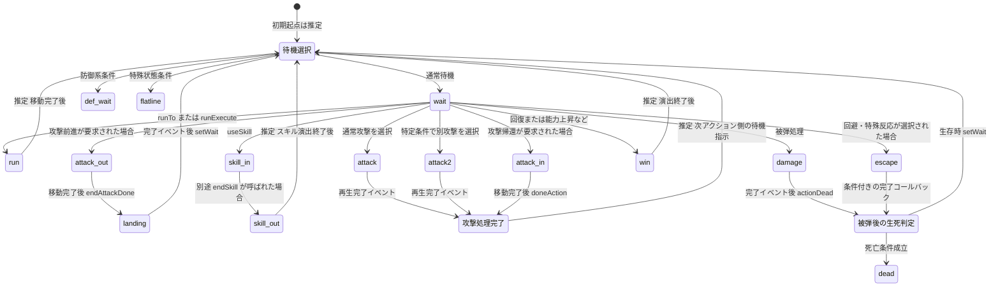

# キャラクター表示モーションの状態遷移

この文書はキャラクターの**見た目の演出状態**を規定する。戦闘のHP・ダメージ・状態異常・攻撃結果を計算する状態機械とは独立し、Clientの表示イベント・演出要求によって切り替える。演出完了が戦闘計算やPRNG消費順を変更することはない。対象は本書のモーション切替処理を持つキャラクター表示系統とし、別系統のアニメーション実装へ無条件に適用しない。

再生フレーム、ボーン変換、アトラス、最終フレーム保持とループは[スプライトアニメーション実行規則](sprite_animation_runtime.md)に従う。下表の英字は`MovementData.name`として参照する**モーション名**であり、`attackMove`、`runTo`、`runExecute`、`useSkill`、`endSkill`、`setWait`、`actionDead`、`doneAction`等は切替要求・処理識別子であってモーション名ではない。

## モーション一覧

| `MovementData.name` | 表示上の役割 | 確定範囲 |
| --- | --- | --- |
| `attack` | 通常攻撃 | モーション名と用途が確定 |
| `attack2` | 条件に応じた第2攻撃 | モーション名と用途が確定。選択条件の詳細は未確定 |
| `attack_in` | 攻撃帰還・移動演出 | 帰還側切替時の再生順序が確定 |
| `attack_out` | 攻撃前進・移動演出 | 前進側切替時の再生順序が確定 |
| `damage` | 被弾 | 完了時の生死判定経路を持つ |
| `dead` | 死亡 | 死亡条件成立時に再生 |
| `def_damage` | 防御被弾と考えられる | 用途は推定。切替起点・完了後遷移は未確定 |
| `def_wait` | 防御系待機 | 待機選択の分岐先。具体的な防御条件は未確定 |
| `entry` | 登場と考えられる | 用途は推定。遷移は未確定 |
| `escape` | 回避・特殊被弾反応 | 条件付き完了コールバックを持つ |
| `flatline` | 特殊な待機・異常状態 | 待機選択の分岐先。条件詳細は未確定 |
| `landing` | 着地 | 攻撃前進後の再生順序が確定 |
| `run` | 走行・位置移動 | `runTo`または`runExecute`で再生を要求 |
| `skill_all` | 全体スキル演出と考えられる | 用途は推定。遷移は未確定 |
| `skill_in` | スキル開始演出 | `useSkill`で再生を要求 |
| `skill_out` | スキル終了演出 | 別途`endSkill`が呼ばれた場合に切替 |
| `wait` | 通常待機 | 待機選択の通常経路 |
| `win` | 勝利・回復・能力上昇・復活などの演出 | 勝利時専用に限定しない。終了後の自動復帰は推定 |

`def_damage`・`entry`・`skill_all`は一覧に含めるが、**この資料に接続経路が示されていないため、他の状態からの自動遷移を追加しない**。モーションが素材側にない場合、別名へ勝手に置換せず既存の参照失敗・代替画像規則に従う。この一覧からファイルPathやCharacterIDとの対応を推測しない。全Character・Action対応表を機械的に生成できないため必須Schemaとしては要求せず、Clientに登録した構成セットの明示選択で参照する。

## 状態遷移

次図は表示モーションの切替要求と完了通知の経路を示す。**「推定」の付いた矢印は確定した自動遷移ではない**。該当する呼出元から指示があった場合の候補経路を表し、実装では根拠のないタイマーやモーション終了で自動的に遷移させない。図中の各矢印も、呼出元から要求が届き表示制御側のガードを通過した場合を対象とする。

## 待機選択・移動・通常攻撃

* 待機選択が要求されたとき、キャラクターの確定済み表示条件に基づき`wait`・`def_wait`・`flatline`のいずれかを選択する。判定できないときは`wait`を表示上のフォールバックとする。個別フラグの値・優先順を推測しない。
* `runTo`または`runExecute`の表示要求が成立した場合、`run`を再生する。移動完了後の待機選択は**推定経路**であり、呼出元の復帰指示なしに確定した自動遷移として実行しない。移動速度や軌道の数値も本書では定めない。
* 通常攻撃では`attack`、上位の表示イベントから別攻撃種別が明示された場合は`attack2`を再生する。いずれも再生完了イベントで**攻撃処理完了**へ進む。`attack2`を選ぶ判定式や確率を新設しない。攻撃処理完了後に待機を選択する経路は次アクションの指示に依存する**推定経路**とする。
* モーション名を限定するため、`attack`と`attack2`を無条件に「任意の名前の攻撃モーション」に読み替えない。追加の攻撃モーションが必要になった場合は対応表・切替条件を別途定める。

## 攻撃前進・帰還

攻撃移動要求の前進側と帰還側は**別経路**とする。図の`AttackOut → Landing`および`AttackIn → AttackFinished`の間には、モーション完了通知により開始される位置移動処理がある。

* **前進：** `attack_out`再生 → 完了通知 → 位置移動 → `landing`再生 → 完了通知 → `setWait`による待機選択。待機結果は`wait`・`def_wait`・`flatline`のいずれかとする。
* **帰還：** `attack_in`再生 → 完了通知 → 位置移動 → 攻撃処理完了。**この経路単独では`landing`や待機選択を自動実行しない。** 待機への復帰は次アクション側の指示があった場合に限る。
* `attack_out → attack/attack2 → attack_in`を一連の必須順序とはしない。移動の目標座標、跳躍軌道、継続時間は本資料に値がないため固定しない。

## 被弾・回避・生死判定

* 被弾表示では`damage`を再生する。回避・特殊反応が選択された場合に`escape`を再生する経路を持つ。アニメーションロック中は要求を受理せず終了する場合があり、ロック条件を新設しない。
* `damage`の再生完了イベント後には`actionDead`に相当する生死判定処理へ進む。`escape`は**条件付きの完了コールバックが届く場合だけ**同じ生死判定へ進む。`escape`の全再生が必ず判定へ進むとはしない。
* 生死判定で生存している場合は`setWait`による待機選択へ進む。死亡条件が成立した場合は`dead`を再生し、関連アクション・エフェクトの停止処理を行う。生死の根拠は確定済みのBattle結果を参照し、Clientのモーション再生を理由にHPや死亡条件を再計算しない。
* `def_damage`は防御被弾の候補名として保持するが、`damage`と同じ生死判定やコールバック順序を**推測して複製しない**。`dead`からの復活時にどのモーションへ切り替えるかも未確定である。

## スキル・その他の演出

* `useSkill`が要求された場合は`skill_in`を再生する。`skill_in`が終了しただけで`skill_out`へ切り替えず、**別途`endSkill`が呼ばれた場合**に`skill_out`を再生する。`skill_out`終了後の待機選択は推定経路とする。
* `win`は勝利時専用ではなく、回復・能力上昇・復活などの演出でも使用する。演出終了後の待機選択は推定経路とする。
* `entry`（登場と考えられる）と`skill_all`（全体スキル演出と考えられる）については、切替起点・完了コールバック・復帰先が示されていないため、一覧登録以外の自動遷移を定義しない。

## 演出要求の競合

- 死亡が確定した場合は死亡演出を優先し、古いモーションの完了通知で待機へ戻さない。
- 移動・攻撃・被弾・スキルなど同時に成立しない表示要求は、表示イベントの順序と既存のロック条件に従って受理・保留・取消を扱う。ゲームのHP・PRNG・戦闘結果は変更しない。
- 具体的な制御引数、イベント種別番号、移動座標、時間、コールバック管理の実装詳細は`design/programming/client/client.md`に置き、本書には列挙しない。確定していない引数値や確率を新設しない。

## Client側のイベント境界

* 再生制御の完了通知と、フレームに付属する文字列イベントは別種として扱う。個々の通知種別番号・発火契機は本書で固定せず、再生Runtimeの実装設計で検証する。
* 状態制御部は「現在のモーション、段階、演出要求ID」を関連付けてコールバックを照合する。次段階へ進んだ要求の重複通知や、切替前の古い通知で位置移動・生死判定・完了通知を二重実行しない。
* アクション完了通知はClientの演出シーケンサへ渡し、Serverおよび`game-core`の計算完了を表示イベントの到着まで待たせない。推定遷移は、この通知だけを根拠に自動発火させない。
* 再生位置・姿勢・ループ・停止処理は[スプライトアニメーション実行規則](sprite_animation_runtime.md)に従う。推定条件をゲームルールに置き換えたり、未確認のモーションを無理に再生したりしない。
