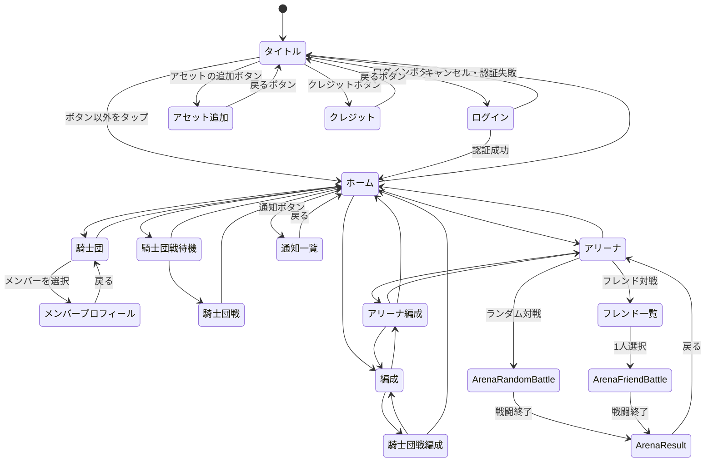

# シーン

## 遷移

## 認証画面

タイトル画面に「ログイン」ボタンを設け, 認証用ログイン画面へ遷移する. ログイン画面ではClientがLoginID・Password入力, 必要な追加認可情報の案内, ログイン操作, 成功/失敗表示, キャンセル操作を担当する. 資格情報の送信はPublic API Originの第一者トップレベルページ（`/auth/authorize`）で行い, Clientの認可コード・PKCE方式を維持する. ログイン・Session確認後は固定Callback URI `https://rehydrangeaodyssey.github.io/auth/callback/`へ戻り, 認可コードを一度だけ交換する. 認証失敗・キャンセル・未ログインの場合はタイトルからホームへ進むこともでき, Server通信が必要な機能だけを制限する.

## UI

### タイトル

* ボタン以外の領域をタップすると, ログインせずホーム画面へ遷移できる.
* 「ログイン」ボタンからログイン画面へ遷移する.
* キャッシュクリアボタンを配置する.
* 「アセットの追加」ボタン, 「アセット削除」ボタン, 「クレジット」ボタンを配置する. 追加では専用の「アセット追加」シーンへ遷移する. 削除ではOPFSの`./assets/`から任意素材を個別または一括で明示的に削除できる.
* キャッシュクリアはOPFSの`cache`フォルダ内のファイルのみを削除対象とする.
* ログイン不可またはServer未接続時もタイトル・ホーム間の遷移、保存済みアセットの利用・削除、キャッシュクリア、クレジットを利用可能とする。**新規のアセット取り込みは当該起動でログイン成功後にのみ許可する。** Server通信必須操作は制限する。容量不足時もアセット削除は利用可能とする。

### ログイン

* LoginID・Passwordを入力してログインを実行する. 追加認可が必要な構成では既存のDiscord追加認可を使用する.
* 通信・認証に必要なページ遷移と認可コード交換は既存の認証通信契約に従う.
* 認証成功時はホームへ進み, キャンセル・認証拒否の場合はタイトルへ戻る. 未ログインのままでもタイトルからホームへ進める.

### アセット追加

* 「戻る」ボタンを配置し, 押下時はタイトルへ戻る.

* ログイン成功後に限りユーザーがPNG画像およびHCA音声をファイル単位またはディレクトリ単位で一括選択し, Clientへ取り込めるシーンとする. コピーと移動を選択できるようにする. 移動時は「ゲーム内へファイルの移動はゲーム終了時に消える可能性がある」と表示する. 元ファイル削除は対応ブラウザで削除権限を得られる場合のみ実行し, 実行できない端末では移動不可としてコピーを案内する.
* PNG/HCAはOPFSの`./assets/`配下に保存し, `https://github.com/ReHydrangeaOdyssey/AssetDictionary`からLogin完了時に取得する二段SHA-256辞書の配置先Pathを使用する. 辞書の候補に一致しない場合はユーザー用素材として「BGM」「SE」「Voice」「Character」「SD Character」「Character Icon」から区分を選択させ, 対応する配置先を選択する. 既存Pathへの書込みは個別確認または一括上書き・一括キャンセルの選択を行う. アセット削除はタイトル画面から個別・一括で明示的に操作できる.
* PNGの表示には`createImageBitmap()`を使用する. 詳細は「[クライアント仕様](client.md)」を参照する.

### クレジット

* タイトルの「クレジット」ボタンから遷移する. ライセンス・著作権・帰属表記を専用画面に集約して表示する.
* Rust依存ライブラリについては`cargo-about`で生成して静的配布物へ組み込んだライセンス情報を表示し, 自動生成に含まれない配布物の必要な表記も同じ画面に掲載する. 本文はスクロールして閲覧できる.
* 「戻る」ボタンでタイトル画面に戻る. Server未接続・ログイン不可時にも閲覧できる.

### ホーム

### 騎士団戦

### 騎士団戦編成

### アリーナ対戦の遷移

アリーナ画面の「ランダム対戦」ボタンからRandom Arena戦闘画面へ遷移する。「フレンド対戦」ボタンからフレンド一覧（Player表示名）を開き、任意の1人を選択してFriend Arena戦闘画面へ遷移する。いずれも戦闘終了後はリザルト画面へ移り、「戻る」ボタンでアリーナ主要画面へ戻る。サーバー未接続時は両対戦ボタンを使用不可とする。

## 参照資料

* `design/client/client.md`.
* 添付`rust_wasm_png_hca_library_selection(1).md`（2026-10-09）, 第1～4節.

### 騎士団メンバー・プロフィール・通知

* 騎士団の所属メンバー一覧でPlayerを選択すると、そのPlayerのプロフィールを表示する。プロフィールは「プレイヤー名」「騎士団戦参加回数」「騎士団戦勝利数」「累計騎士団スコア」「フレンド申請ボタン」を含む。
* フレンド申請ボタンは`SendFriendRequest`を呼ぶ。ホームの「通知」ボタンで`ListNotifications`のフレンド申請一覧を表示し、「承認」「拒否」操作は`RespondFriendRequest`へ送る。拒否を申請者へ通知しない。
* アリーナのフレンド一覧は`ListFriends`の承認済みフレンド名を表示し、選択したPlayerIDで既存のFriend Arena戦闘を開始する。
