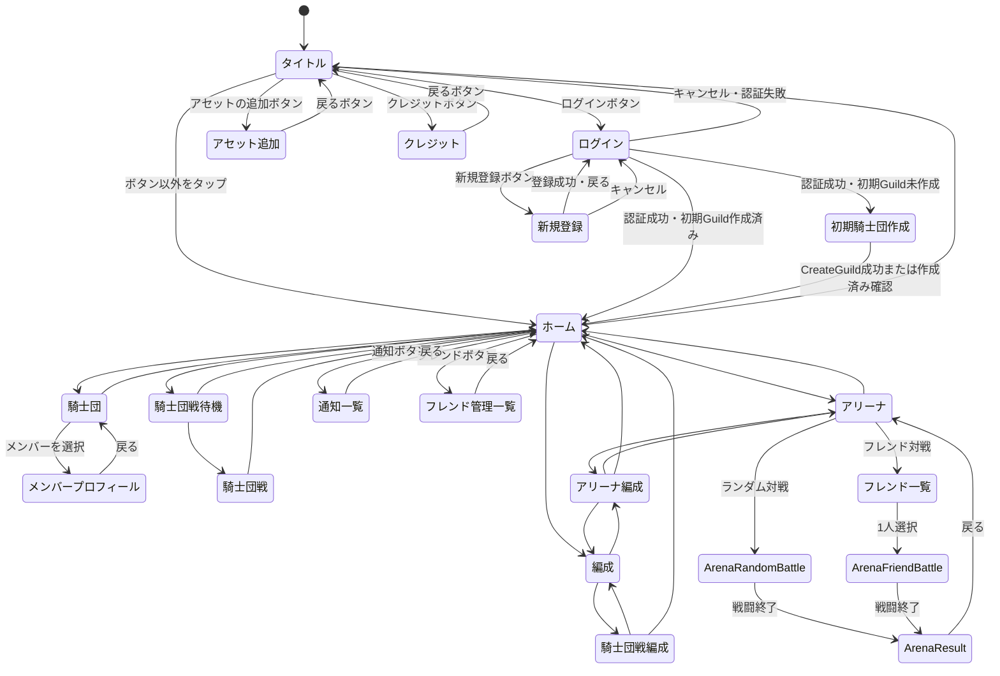

# シーン

## 遷移

## 認証画面

タイトル画面に「ログイン」ボタンを設け, 認証用ログイン画面へ遷移する. ログイン画面ではClientがLoginID・Password入力, 必要な追加認可情報の案内, ログイン操作, 成功/失敗表示, キャンセル操作と「新規登録」ボタンを担当する。新規登録画面ではCreateAccountの必須入力を行い、登録成功後はログイン画面へ戻る（登録だけではLogin成功とみなさない）。 資格情報の送信はPublic API Originの第一者トップレベルページ（`/auth/authorize`）で行い, Clientの認可コード・PKCE方式を維持する. ログイン・Session確認後は固定Callback URI `https://rehydrangeaodyssey.github.io/auth/callback/`へ戻り, 認可コードを一度だけ交換する. 認証失敗・キャンセル・未ログインの場合はタイトルからホームへ進むこともでき, Server通信が必要な機能だけを制限する。認証成功後は`GetInitialGuildStatus`により作成済みを判定し、未作成なら初期騎士団作成画面へ、作成済みならホームへ遷移する。

## UI

### タイトル

* ボタン以外の領域をタップすると, ログインせずホーム画面へ遷移できる.
* 「ログイン」ボタンからログイン画面へ遷移する.
* キャッシュクリアボタンを配置する.
* 「アセットの追加」ボタン, 「アセット削除」ボタン, 「クレジット」ボタンを配置する. 追加では専用の「アセット追加」シーンへ遷移する. 削除ではOPFSの`./assets/`から任意素材を個別または一括で明示的に削除できる.
* キャッシュクリアはOPFSの`cache`フォルダ内のファイルのみを削除対象とする.
* ログイン不可またはServer未接続時もタイトル・ホーム間の遷移、アセットの新規取り込み・利用・削除、キャッシュクリア、クレジットを利用可能とする。未ログイン時の新規取り込みは辞書を取得せず手動区分指定で配置し、ログイン後に辞書照合する。 Server通信必須操作は制限する。容量不足時もアセット削除は利用可能とする。

### ログイン

* LoginID・Passwordを入力してログインを実行する. 追加認可が必要な構成では既存のDiscord追加認可を使用する.
* 通信・認証に必要なページ遷移と認可コード交換は既存の認証通信契約に従う.
* 「新規登録」からアカウント新規作成画面へ進める.
* 認証成功後は`GetInitialGuildStatus`を取得し、初期Guild作成済みならホーム、未作成なら初期騎士団作成画面へ進む. キャンセル・認証拒否の場合はタイトルへ戻る. 未ログインのままでもタイトルからホームへ進める.

### 新規登録

* ログイン画面の「新規登録」から遷移する。`CreateAccount`に必要なLoginID、Password、UserNameおよび追加認可必須時の認可情報を入力する。
* 登録成功時はログイン画面へ戻る。登録失敗時は当該画面で既存の`CreateAccount`エラーを表示し、再入力できる。「戻る」でログイン画面へ戻る。
* 資格情報を扱う画面は認証Originの第一者トップレベルページで実行し、静的Clientへ資格情報を渡さない。

### 初期騎士団作成

* 認証完了後に`GetInitialGuildStatus`で`initial_guild_created=false`となったPlayerを対象とし、Guild名と昼夜の開始時刻を入力して`CreateGuild`を1回だけ実行する。
* `GetInitialGuildStatus`の結果が作成済みなら重複作成を行わずホームへ進む。作成成功応答が得られない場合も作成要求は再送せず、照会APIで確定状態を確認する。未作成なら画面に留め、CreateGuildの拒否・失敗理由を表示する。
* 初期Guild作成が完了するまで他の認証必須ゲームAPIへ遷移・操作しない。未ログイン状態へ戻る場合はAccessTokenを破棄し、タイトルへ戻る。

### アセット追加

* 「戻る」ボタンを配置し, 押下時はタイトルへ戻る.

* ログインの有無を問わずユーザーがPNG画像およびHCA音声をファイル単位またはディレクトリ単位で一括選択し, Clientへ取り込めるシーンとする. コピーと移動を選択できるようにする. 移動時は「ゲーム内へファイルの移動はゲーム終了時に消える可能性がある」と表示する. 元ファイル削除は対応ブラウザで削除権限を得られる場合のみ実行し, 実行できない端末では移動不可としてコピーを案内する.
* PNG/HCAはOPFSの`./assets/`配下に保存し、辞書を取得済みならその二段SHA-256辞書の配置先Pathを使用する。辞書が未取得の場合は手動の区分・対象指定で保存し、ログイン後に`https://github.com/ReHydrangeaOdyssey/AssetDictionary`から辞書を取得して既存素材も照合する。 辞書の候補に一致しない場合はユーザー用素材として「BGM」「SE」「Voice」「Character」「SD Character」「Character Icon」から区分を選択させ, 対応する配置先を選択する. 既存Pathへの書込みは個別確認または一括上書き・一括キャンセルの選択を行う. アセット削除はタイトル画面から個別・一括で明示的に操作できる.
* PNGの表示には`createImageBitmap()`を使用する. 詳細は「[クライアント仕様](client.md)」を参照する.

### クレジット

* タイトルの「クレジット」ボタンから遷移する. ライセンス・著作権・帰属表記を専用画面に集約して表示する.
* Rust依存ライブラリについては`cargo-about`で生成して静的配布物へ組み込んだライセンス情報を表示し, 自動生成に含まれない配布物の必要な表記も同じ画面に掲載する. 本文はスクロールして閲覧できる.
* 「戻る」ボタンでタイトル画面に戻る. Server未接続・ログイン不可時にも閲覧できる.

### ホーム

### 騎士団戦

### 騎士団戦編成

### 騎士団・編成画面の操作

* 騎士団画面では所属Guildの名前・団長/副団長・メンバー一覧・施設レベルと次Lv必要Goldを既存の`GetGuildDetail`・`GetGuildFacilityUpgradeCost`で表示する。メンバーからプロフィールへ遷移し、施設強化は本人のGuild所属確認と残高確認後に`UpgradeGuildFacility`で1Lvずつ行う。権限不足、所持Gold不足、最大Lvのエラーは既存の専用応答で表示し、成功後に施設情報を再取得する。「戻る」はホームへ戻る。
* 編成画面では「アリーナ編成」「騎士団戦編成」を選択する。画面表示時に`GetArenaParty`/`GetGuildBattleParty`で登録済み編成を取得し、編成スロットと選択Character/Follower/Abilityを表示する。変更確定にはそれぞれ`UpdateArenaParty`/`UpdateGuildBattleParty`を呼び、成功した場合だけServer応答に一致する編成をローカル保存する。「戻る」は変更を保存せず直前の編成選択画面へ戻る。
* 編成更新がServerに拒否された場合は理由を表示し、ローカル編集状態をServer確定済み編成として扱わない。Server未接続では保存APIを使用できないがローカル閲覧は可能とする。
* 騎士団戦待機画面では`GetMyGuildBattle`により本人所属Guildの対戦IDと開始時刻を確認し、参加可能な対戦がある場合だけ`JoinGuildBattle`を行う。`GetGuildBattleResult`で終了を確認した対戦は結果を表示し、「戻る」でホームへ戻る。

### アリーナ対戦の遷移

アリーナ画面の「ランダム対戦」ボタンからRandom Arena戦闘画面へ遷移する。「フレンド対戦」ボタンからフレンド一覧（Player表示名）を開き、任意の1人を選択してFriend Arena戦闘画面へ遷移する。いずれも戦闘終了後はリザルト画面へ移り、「戻る」ボタンでアリーナ主要画面へ戻る。サーバー未接続時は両対戦ボタンを使用不可とする。

## 参照資料

* `design/client/client.md`.
* 添付`rust_wasm_png_hca_library_selection(1).md`（2026-10-09）, 第1～4節.

### 騎士団メンバー・プロフィール・通知

* 騎士団の所属メンバー一覧でPlayerを選択すると、そのPlayerのプロフィールを表示する。プロフィールは「プレイヤー名」「騎士団戦参加回数」「騎士団戦勝利数」「累計騎士団スコア」「フレンド申請ボタン」を含む。
* フレンド申請ボタンは`SendFriendRequest`を呼ぶ。ホームの「通知」ボタンで`ListNotifications`のフレンド申請一覧を表示し、「承認」「拒否」操作は`RespondFriendRequest`へ送る。拒否を申請者へ通知しない。
* ホームの「フレンド」ボタンから管理用のフレンド一覧を表示する。一覧から本人の「フレンド解除」操作で`RemoveFriend`を呼び、成功時は表示を更新する。「戻る」でホームへ戻る。
* アリーナのフレンド一覧は`ListFriends`の承認済みフレンド名を表示し、選択したPlayerIDで既存のFriend Arena戦闘を開始する。
* 同方向の再申請に対する「申請済み」応答を表示する。双方が同時申請した場合、いずれかの承認後に逆方向の申請へ応答した際は「既にフレンド」を表示してその申請操作を終了する。

### フレンド状態による操作表示

* `GetPlayerProfile`の`already_friends=true`ならプロフィールの「フレンド申請」を無効化する。申請送信で「申請済み」の応答を受けた場合は新たな申請を作成せず、その状態を表示する。
* ホーム通知一覧は表示時に`ListNotifications`で再取得する。「承認」「拒否」の成立後は同一覧を再取得する。「既にフレンド」の応答でも対象申請を一覧から更新する。
* フレンド一覧で解除が成立した場合は`ListFriends`を再取得する。解除された相手とのフレンド対戦開始はServer側の最新の関係Validationに従う。
