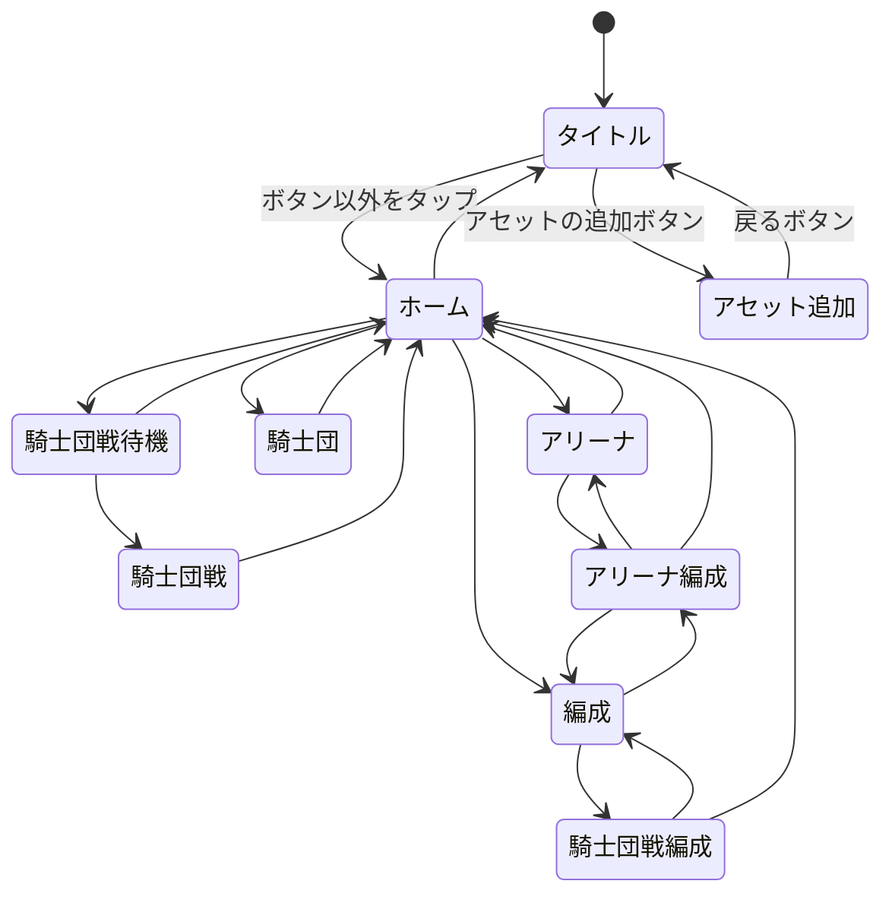

# シーン

## 遷移

## UI

### タイトル

* ボタン以外の領域をタップするとホーム画面へ遷移する.
* キャッシュクリアボタンを配置する.
* 「アセットの追加」ボタンと「アセット削除」ボタンを配置する. 追加では専用の「アセット追加」シーンへ遷移する. 削除ではOPFSの`./assets/`から任意素材を個別または一括で明示的に削除できる.
* キャッシュクリアはOPFSの`cache`フォルダ内のファイルのみを削除対象とする.
* ログイン不可またはServer未接続ではホーム画面への移動以外のオンラインゲーム操作を不可とする. 容量不足を解消するためのローカル「アセット削除」はServer未接続でも利用可能とする.

### アセット追加

* 「戻る」ボタンを配置し, 押下時はタイトルへ戻る.

* ユーザーがPNG画像およびHCA音声をファイル単位またはディレクトリ単位で一括選択し, Clientへ取り込めるシーンとする. コピーと移動を選択できるようにする. 移動時は「ゲーム内へファイルの移動はゲーム終了時に消える可能性がある」と表示する. 元ファイル削除は対応ブラウザで削除権限を得られる場合のみ実行し, 実行できない端末では移動不可としてコピーを案内する.
* PNG/HCAはOPFSの`./assets/`配下に保存し, `https://github.com/ReHydrangeaOdyssey/AssetDictionary`からLogin完了時に取得する二段SHA-256辞書の配置先Pathを使用する. 辞書の候補に一致しない場合はユーザー用素材として「BGM」「SE」「Voice」「Character」「SD Character」「Character Icon」から区分を選択させ, 対応する配置先を選択する. 既存Pathへの書込みは個別確認または一括上書き・一括キャンセルの選択を行う. アセット削除はタイトル画面から個別・一括で明示的に操作できる.
* PNGの表示には`createImageBitmap()`を使用する. 詳細は「[クライアント仕様](client.md)」を参照する.

### ホーム

### 騎士団戦

### 騎士団戦編成

## 参照資料

* `design/client/client.md`.
* 添付`rust_wasm_png_hca_library_selection(1).md`（2026-10-09）, 第1～4節.

