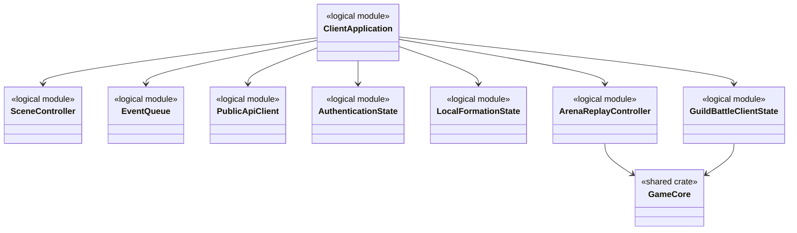
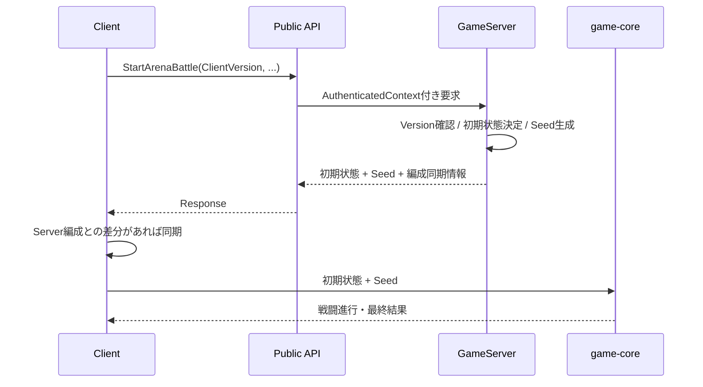
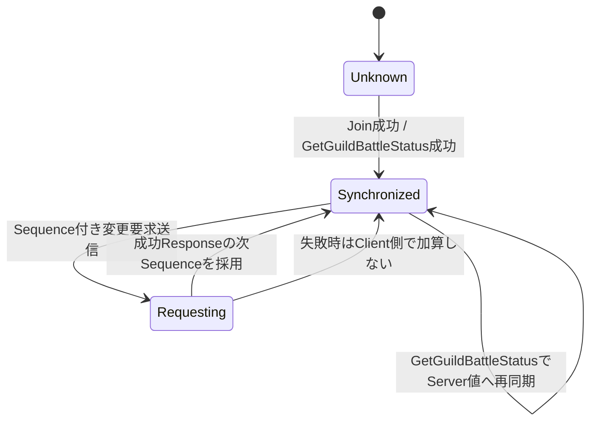

# Clientプログラミング設計

## 概要

Clientは、ログイン画面・ログイン操作、画面・入力・演出、Public API通信、認証状態、ログイン・サーバー未接続時のゲームプレイ制御、ローカル編成、キャラクター画像の割り当て、ArenaおよびGuildBattle殲滅戦闘再現、GuildBattle表示状態を担当します。

戦闘計算そのものはClient専用実装にせず、GameServerと同じ`game-core`とPRNG仕様を使用します。Serverが正本である状態をClient側で独自に確定しません。

## 論理構成



`logical module`は責務名であり、Rustの具体的な`struct`名を固定するものではありません。

## Web Client実行方式とブラウザ境界

- ClientはRust/WASM（`wasm32-unknown-unknown`）を対象とし, iPhone Safari/PWAおよびAndroid Chrome/PWA上で動作させます。静的Clientは`https://rehydrangeaodyssey.github.io/`で配布し, 配布リポジトリは`https://github.com/ReHydrangeaOdyssey/ReHydrangeaOdyssey.github.io`とします。独自ドメインは採用しません。ブラウザ下限をiOS Safari 16.3 / Android Chrome 120, 対応するOS下限をiOS 16.3 / Android 8.0とします。OS下限はブラウザの導入可能条件に基づくものであり, 該当OSでの全機能・性能の合格判定には実機試験を要します。対応するブラウザ機能の動作は対象環境ごとの試験で確認します。
- ブラウザとの接続には`wasm-bindgen`, `web-sys`, `js-sys`, `wasm-bindgen-futures`を使用します。Browser APIのPromiseは`wasm-bindgen-futures`を用いてRustの`Future`と連携させます。
- 描画基盤として汎用2Dエンジンを追加せず, WebGL 2を`web-sys`経由で使用する独自スプライトバッチレンダラーとします。UI Frameworkも使用しません。
- 戦闘計算は`game-core`、Protocol Buffers生成型は`protocol`、符号化・復号は`prost`を使用する。
- ClientとPublic API Server間の通信方式はHTTP/2 over TLS 1.3, API PayloadはProtocol Buffersとします。`SubscribeGuildBattleUpdates`はHTTP/2 Response streamを使用し, `GuildBattleScoreUpdate`をProtocol Buffers varint長prefix付きで受信します。WebSocketはPublic API通信方式として採用しません。ブラウザ標準の`fetch()`およびResponse Bodyの`ReadableStream`を使用し, `web-sys`等を経由してRust/WASMと接続します。HTTP/2/TLS 1.3はブラウザとServerのネゴシエーションに依存し, 実接続で検証します。

### 描画パイプライン

```text
OPFSのPNG → File / Blob → createImageBitmap() → WebGL 2 texImage2D()
            → 不要なImageBitmapをclose() → スプライトバッチ描画
```

- ブラウザでPNGをデコードし, 必要な画像をGPUへアップロードします。すべての展開済み画像をWASMヒープへ保持しません。
- 描画順とブレンド状態を保持しつつバッチ化し, draw callやJS/WASM境界の往復を削減します。テクスチャ共有・アトラス化・インスタンシング等の適用範囲は実測結果に基づき決定します。
- 使用終了時には`ImageBitmap.close()`と`deleteTexture()`によって不要な資源を解放します。
- GPUテクスチャ, WASMヒープ, ブラウザ内の一時メモリを別々に把握します。WebGL 2とCanvas 2Dの比較優位やFPS値は現時点で保証しません。

### キャラクタースプライトアニメーション

- アニメーションデータは`design/system/sprite_animation.proto`に定義する`SpriteAnimationData`を使用します。骨格・ボーン・表示データ、モーション・ボーンタイムライン・フレーム、テクスチャ参照をそれぞれ保持し、`repeated`フィールドの要素順を維持します。
- ボーンおよびフレームの座標・拡縮・傾き、表示Index、補間を評価して描画します。静止値とフレーム値を合成した後、親ボーンから位置・倍率・傾きの成分を継承してワールド行列を構築し、最後にスキン行列を乗じます。行列を単純に親子乗算する方式は採用しません。色・ブレンド・イベント等のフィールドは保持しますが、姿勢評価への適用範囲は実行規則に従います。PNGの画像本体・アトラスファイル本体は別アセットとし、既定のOPFS読込み・WebGL 2テクスチャ描画の経路を使用します。
- スプライトのアトラスデータは`design/system/plist.proto`の`PlistRoot`・`Frames`・`FramesFrame`・`Metadata`・`Texture`で表現します。フレームのキーと切り出し矩形・元画像サイズ・オフセットを保持し、アニメーションの`DisplayData`・`TextureData`が持つ画像参照情報と区別します。
- 骨格・スプライトアトラスの復元、モーション評価、補間、親子成分継承、表示Index・Z順の確定規則は`design/client/sprite_animation_runtime.md`に従います。アトラス回転は`FramesFrame.packing_rotation`の明示値だけを使用し、画像名称や行列の符号から推定しません。描画はWebGL 2の四角形・通常アルファ合成で行います。
- キャラクターの表示状態制御には`design/client/character_motion_state.md`で定義した18種のモーション名・受理条件・完了通知順序を使用します。待機選択は`wait`/`def_wait`/`flatline`、走行は`runTo`/`runExecute`で`run`、通常攻撃は`attack`、条件付き第2攻撃は`attack2`を使用します。前進側は`attack_out → 跳躍移動 → landing → 完了通知 → 待機選択`、帰還側は`attack_in → 跳躍移動 → 攻撃処理完了`とし、自動で待機へ戻しません。`damage`完了時および条件付き`escape`完了時は`actionDead`に相当する生死判定から、生存時`setWait`、死亡時`dead`へ進めます。`useSkill`は`skill_in`、別途`endSkill`が届いたときだけ`skill_out`へ切り替えます。`win`は勝利専用ではなく回復・能力上昇・復活でも使用します。`def_damage`/`entry`/`skill_all`の推定用途や、`run`/`skill_out`/`win`等からの推定復帰を無条件の自動遷移として実装しません。再生制御イベント種別`1`/`2`と`FrameData.event_name`を区別し、段階済み・旧要求の重複コールバックを無視します。
- アニメーションはClientのイベントキューに連動した表示処理とし、画像・UV・アニメーションデータをGameServerの`ProcessedMasterData`に含めません。骨格・アニメーション・アトラス・PNG本体は原則ユーザーが各自用意し、例外的な代替画像などClient配布素材は別リポジトリから取得します。

### キャラクター構成セットのClient専用取り込み

アセット追加画面からユーザー提供の骨格ProtoBuf、アトラスProtoBuf、参照PNGをセットで取り込み、セットの検証・原子的な登録・差替え・削除をOPFS内で完結させます。対応するゲームのPublic/Private RPCは作りません。`design/client/local_asset_storage.md`のセットManifestに従い、アニメーション構造検証が失敗したセットは登録せず、既存の検証済みセットを維持します。CharacterID・Actionへの機械生成不能な対応Schemaは追加せず、明示されたユーザーの表示選択をもとに必要な参照を解決します。

### 表示モーション制御の実装詳細

状態名と状態間の接続は`design/client/character_motion_state.md`を正本とします。演出要求の識別子、位置移動の開始/終了・所要時間、演出種別の伝達、再生完了コールバックの抑止はこの実装境界で扱い、状態遷移書には引数値・フラグbit・座標式を列挙しません。

- 戦闘表示イベントが攻撃演出種別を**明示しているときだけ**、指定された`attack`または`attack2`を選択します。根拠のない確率やキャラクター名から`attack2`を選択しません。演出種別未指定時の恣意的な第2攻撃への切替は行いません。
- 再生制御から届く既存のイベント種別`1`・`2`は完了関連通知の対象として受け取り、モーション再生要求ID・現在段階と照合します。自然終了・停止・ループ切替と各番号の厳密な意味は元資料では未確定のため、その番号だけで新しい自然終了条件を発明しません。`FrameData.event_name`は別のデータ通知であり完了を代用しません。
- 死亡が確定した表示要求を優先し、古い再生要求の完了通知は破棄します。被弾・スキル・移動間で優先を確定できない場合は新しい要求を一律に割り込ませず、表示イベントの順序・既存ロック状態に従い拒否または保留します。取消時に古い要求の完了通知を再発火させません。戦闘演算を再計算しません。
- 待機要求は現在Battleの確定した表示条件だけで`wait/def_wait/flatline`を選択し、未定義のフラグ値を推定しません。条件が解決できない場合は`wait`を表示上のフォールバックとし、被弾の可否や死亡の判定を待機モーション名から計算しません。
- 移動演出の開始/目標位置と時間は呼出元の戦闘表示イベントから受け取り、未提示の固定距離・跳躍高さ・durationを導入しません。位置情報が足りない場合は不正な移動を捏造せず当該移動演出を不成立表示として扱い、ゲーム状態はそのまま維持します。


### HCAデコード・音声パイプライン

- HCAデコード候補は`cridecoder`（`0.3.6`）とする。`default-features = false`を指定し, 不要なPythonバインディングを有効化しません。
- HCAからPCMへ変換した音声をWeb Audio APIへ渡します。短いSE/ボイスでは必要に応じて全体を`AudioBuffer`へデコードして再利用します。
- 長いBGM/ボイスはOPFSから必要な圧縮ブロックを読み, 小容量PCMバッファへ逐次デコードします。`AudioWorkletNode`へ`MessagePort`経由でPCMチャンクを供給し, `AudioWorkletProcessor`の小容量キューから再生します。
- `AudioWorkletProcessor.process()`内でHCAデコードや大容量のメモリ確保を行いません。制御側または専用Workerが先読みし, 音声出力側と役割を分離します。
- HCAは22,050Hzとし、暗号化されている場合は鍵キャッシュを先に試してから必要に応じて鍵探索します。ループはOPFSの`./assets/sound/bgm/`（ディレクトリ境界と大文字小文字を区別し、配下のサブディレクトリを含む）に配置されたHCAに限り音源全体を繰り返し、その他のHCAでは無効にします。`hca_config.json`は使用しません。SEの同時再生上限は5です。ステレオ2チャンネル（左・右）を再生対象とし, HCAの左右音声を保持したPCMをWeb Audio APIへ供給します。1チャンネル入力はPCMを左右に複製して出力します。ステレオの実機動作は別途検証します。長尺音声のPCM先読みは初期500ms, 残り250ms到達前に補充する暫定設定を採用し, 欠音・メモリ使用・I/O遅延から調整します。`SharedArrayBuffer`は初期実装では使用しません。
- HCAのiPhone Safari/WASMでのコンパイル・正しい再生・ピークメモリは未検証です。`cridecoder`は検証合格を最終採用条件とする候補であり, 動作確認済みとは記載しません。
- `cridecoder`リポジトリはMIT Licenseを掲示していますが, Client配布物に含める当該ライブラリと推移的依存ライブラリのライセンスを確認します。一方, PNG/HCAの音源・画像ファイルは各ユーザーが用意して自端末へ取り込むため, 個別素材のライセンスをClientが自動審査する機能は設けません。ユーザー持ち込み素材の権利と, Clientが配布するソフトウェア/同梱素材の権利は区別します（参照: https://github.com/seiunx-dev/cridecoder）。

### クレジット画面・依存ライセンス組み込み

- タイトル画面に「クレジット」を配置し, 専用画面へ遷移します。ゲーム本体とClient配布物に必要なライセンス・著作権・帰属情報を集約してスクロール表示し, 「戻る」ボタンでタイトルへ戻ります。閲覧にログイン・Server接続を要求しません。
- Rust依存ライブラリのライセンス情報は`cargo-about`でClientの依存関係を対象として生成し, `Cargo.lock`で確定したバージョンの必要表記を配布成果物へ同梱します。生成結果はクレジット画面内で表示し, 同梱した配布物としてオフラインでも読めるようにします。Serverだけで利用する依存をClient向けライセンス一覧へ混同しません。
- Rust以外の配布依存物, 同梱素材やゲーム本体の必要な表示は, `cargo-about`の自動生成範囲外として同じクレジット画面へ手動で組み込みます。生成内容・手動追加分をReleaseビルド時に確認し, 未生成のまま公開しません。個々のライセンス名や著作権者の値は実際に同梱する依存物の確定情報に従います。
- ユーザーが端末から持ち込むPNG/HCAはClientの配布物に含まないため, 個々のユーザー素材の許諾監査機能やクレジットへの自動追加は設けません。

### OPFSアセット管理

- タイトル画面の「アセットの追加」からPNG/HCAをファイル単位またはディレクトリ単位で一括取り込みします。コピー/移動を選択可能にし, 移動時は「ゲーム内へファイルの移動はゲーム終了時に消える可能性がある」と表示します。元ファイル削除権限が得られる端末では保存成功後のみ削除し, 削除機能がないブラウザではコピーのみ利用可能とします。辞書は`https://github.com/ReHydrangeaOdyssey/AssetDictionary/releases`のRelease Assetから取得し、ログイン成功時に`./config.cfg`が自動更新を有効としている場合にだけ最新または指定Versionを確認します。GameServerから辞書を配布しません。
- OPFSの基本構造は`./game_info.json`（現在・前回のバージョン）, `./assets/<something>`, `./cache/<something>`とします。通常のアセットPathは維持し, 配置変更が必要なバージョンでだけ`game_info.json`を照合して差分移行を実行します。`game_info.json`の`version`と`previous_version`は`design/client/client.md`で定義したu32 3要素形式で検証し、不正値は初期データに再生成します。必要な差分処理でエラーがなければ更新成功と判定します。**個別の取込中断**は自動再開しません。一方、Version差分移行が中断した場合はマーカーを検出して次回起動時にその移行を最初から自動再実行します。
- OPFSでは非同期APIと`FileSystemSyncAccessHandle`を利用可能な処理で選択します。非同期のほうが効率的な処理には非同期APIを使い, 同期APIはWorker内でのアクセスに限定します。用途別の性能・互換性測定は継続します。
- 圧縮HCAファイル全体と全体PCMを同時に常駐させません。デコード済みPCM, GPU資源, WASMメモリは用途別に管理し, 不要な`AudioBuffer`の参照を解除します。
- 取り込みはまず`./cache/temp/user_impoert/`で行います。辞書の第1キーは拡張子付き元ファイル名の完全一致とし、エントリの`path`が非空なら一意Pathへ、空なら内容SHA-256で`paths` Objectの対応Pathを選びます。辞書一致時だけ`./assets/`へ移し、不一致は`./cache/unknown_resouce/`へ保留します。ユーザーは区分「BGM」「SE」「Voice」「Character」「SD Character」「Character Icon」を指定でき、Characterでは対象IDを記録しますが、辞書不一致のままRuntimeでは使用しません。元ファイル名は照合用に保存し、一意IDによる強制改名はしません。既存Pathの上書きはユーザー確認を要し、一括上書き/キャンセルも実装します。
- PNG/HCAは辞書Pathに基づきOPFSの`./assets/`へ保存・復元します。タイトル画面からのアセット削除では任意の素材を個別・一括で削除できます。自動的な容量調整削除はせず, 容量不足時はゲームを利用不可にして削除操作を有効にします。キャッシュクリアはVersion移行中は拒否し、それ以外は`./cache/`のみを対象とします。辞書形式は`design/client/client.md`で確定しており、取得するRelease Asset名は`asset_dictionary.json`に固定します。辞書保留素材は`./cache/unknown_resouce/`、取込一時領域は`./cache/temp/user_impoert/`です。

### 依存・ビルド・検証条件

- Client用ブラウザ連携の選定crateは`wasm-bindgen`, `web-sys`, `js-sys`, `wasm-bindgen-futures`および採用検証を要する`cridecoder`です。`web-sys`は使用API単位でfeaturesを指定します。
- 描画用の`image`, `png`, `pix`, `wgpu`, `glow`, 汎用2Dゲームエンジン, オーディオ出力専用Rustライブラリは採用しません。
- `Cargo.lock`を保存して依存を固定し, `cargo tree --target wasm32-unknown-unknown`で推移的依存を確認します。`cargo build --target wasm32-unknown-unknown --release --locked`でビルドを検証します。
- Releaseビルドは当面`cargo build --release --locked --target wasm32-unknown-unknown`とし, `Cargo.lock`を固定します。CIで非圧縮`.wasm`ファイルサイズを測定し, 50MBを超えた段階で最適化を検討します。500MBは既存の配布サイズ合否上限として維持し, 50MBの最適化検討ラインと区別します。
- 実機では40キャラクターと代表的エフェクトの描画, iOS長時間動作, 最大同時SE5, BGM逐次再生, 辞書指定HCAループ・欠音, 依存ライセンスを検証します。合否目標はFPS30以上（初期10秒除外後の連続60秒平均）とCI測定の非圧縮WASM500MB以下です。GPUとRAMは統一計測方式がないため合否閾値に使用せず参考値として測定します。

## ログイン・サーバー未接続時

- ログイン不可またはServer未接続の場合, Server通信が必須の処理のみを無効にし, ローカルで成立する機能を維持します。タイトル・ホーム間の遷移, アセットの追加・削除, キャッシュクリア, クレジット画面の表示と戻る操作は, Server通信の有無で制限しません。
- Client各機能の利用可否は, Server通信・認証が必要かどうかと, OPFS等の必要なブラウザ機能の状態によって判定します。容量不足によるゲーム操作制限時もアセット削除を可能とします。
- Server接続と必要な認証が復帰した場合は, Server通信を必要とする機能も使用可能に戻します。
- Serverを正本とする処理の状態や戦闘結果は、未接続時のClientだけで確定しません。

### OPFSアセット安全性と一括処理

辞書の配置Pathは`assets/`配下の相対Pathのみ受け付け、絶対Path、URL、`..`、`.`、NULを含む制御文字、空のセグメント、バックスラッシュを拒否する。辞書のPath選択とは別に検証する。

一括取込みと上書きはファイル単位の成功を基本とする。途中中断・キャンセル後も確定保存済みのファイルは残し、未処理ファイルは変更しない。ファイルごとの一時保存と切替処理により既存ファイルを途中書込みで破損させない。成功・失敗・未処理の件数を表示する。削除した素材の割当情報とキャッシュ参照を無効化する。

## タイトル画面のキャラクター画像割り当て

- タイトル画面にキャッシュクリア・アセット追加・アセット削除・クレジットの操作を提供します。容量不足でゲーム操作不可の場合もアセット削除は可能とします。
- アセット追加ではまず`./cache/temp/user_impoert/`へ保存し、元ファイル名および必要時に内容SHA-256で辞書一致を検証します。一致すれば辞書Pathへ確定保存し、不一致は区分/対象IDを記録して`./cache/unknown_resouce/`で保留します。
- 画像・UVデータはClient側資産とし、Server用`ProcessedMasterData`の対象へ追加しません。
- PNG以外の画像は受け付けません。辞書と一致した画像・音声本体だけを`./assets/`へ保存し、辞書の`path`または`paths`から配置Pathを取得します。辞書に一致しない素材はユーザー区分と対象IDを指定して端末へ記録しても、ゲーム内表示・再生には使用しません。
- アプリ独自の容量・解像度・保持期間上限を設けません。容量不足は通知し, 解消までゲーム操作を不可にします。任意素材の個別・一括削除を提供し, キャッシュクリアは`./cache/`だけを削除します。

## 認証状態

Clientが扱う認証情報は以下です。

- `AccessToken`は通常Public APIのAuthorizationに使用します。
- `RefreshToken`はResponse Bodyへ返されず、`__Host-RefreshToken` HttpOnly CookieとしてPublic API Serverが設定します。
- RefreshTokenをClient JavaScriptから読み取る前提の実装にはしません。
- AccessToken失効が判明した場合はログアウト状態にし、サーバー未接続として動作します。失効直後にRefresh APIを自動実行しません。Client起動・再読込時にログインを行う場合は既存の認証Origin・Refresh API・PKCEの経路を使用します。
- Logout後も発行済みAccessTokenは`exp`までは暗号学的には有効であるため、Client側だけでSession失効を正本化しません。

## Cross-Site認証と通信復帰

- Clientは`state`とPKCE `code_verifier`を認証開始時に生成し、同じタブの`sessionStorage`へ一時保存する。Code交換成功後または失敗・キャンセル時に破棄する。AccessTokenはメモリのみへ保持する。
- `POST /v1/public/{MethodName}`はProtobufのBodyを用いて送受信し、CookieをCross-Originで送信しない。Stream断は`GetGuildBattleStatus`→再購読の順に回復し、1秒から30秒のBackoffを適用する。
- 認証画面はPublic API Originのトップレベルページを使用し、Callback URIは`https://rehydrangeaodyssey.github.io/auth/callback/`とする。詳細は`design/system/api_transport.md`に従う。

## Arena

Arena開始時、ClientはServerから返された初期状態とSeedを使用してローカルで戦闘を再現します。



### 編成同期

- Clientローカル編成とServer編成が一致する場合はその状態を使用します。
- 不一致の場合はServer編成を使用してArena戦闘を開始します。
- 戦闘計算結果をClientからServerへ正本として返す設計にはしません。
- `EnemyPlayerID`はランダム/フレンド共通でResponseから取得します。`BattleCharacterStatus.MaxHP`を使用し, 行動順でPlayerIDを使う際もClient側で相手IDを推定しません。

## GuildBattle

Clientが保持するGuildBattle状態は、画面表示および要求組み立てのためのClient側状態です。GameServerの状態を置き換える正本ではありません。

最低限、以下を追跡します。

- `GuildBattleID`
- 現在の`RequestSequence`
- Join時に同期した編成
- 現在HP、BP、最大BP、TP、最大TP
- Heal / Revive状態と残り時間
- 出撃待機状態
- Tactics使用回数および継続効果
- Item残数
- Guild Score、Chain、CBC状態

### 殲滅戦闘再現と騎士団情報通知

Arenaと同じ`game-core`・戦闘専用PRNGを使用して, 殲滅戦闘をGameServerと同じ入力で再計算します。`GuildBattleAnnihilationResponse`には戦闘開始時点の`OwnCharacters`/`EnemyCharacters`（最大HP含む）, `EnemyPlayerID`, `EnemyFormationID`, `BattleTacticsEffects`, `Seed`を含めます。自分のPlayerIDはJoin済みの本人PlayerIDを使用します。Own FormationはJoin時に同期済みの構成を使用します。相手の継続効果は, `EnemyTacticsID[]`ではなく`BattleTacticsEffects`のSource/Targetおよび取得済みMasterDataで判定します。

Clientの直近表示HPや継続効果を戦闘入力として補わず, Responseに含む戦闘開始時点の入力を使用します。出撃Responseの`Score`はGameServerの正本であり, Clientが計算した最終HP・勝敗・スコアでGameServerの状態を上書きしません。演出はこの戦闘再現結果を使用します。キャッスルブレイクResponseの`EventType`はキリ番CB, 強襲CB, CBCを区別します。

騎士団戦参加後に`SubscribeGuildBattleUpdates`で通知ストリームを開きます。初回および出撃後に届く`GuildBattleScoreUpdate`の`GuildBattleID`, `AllyScore`, `EnemyScore`, `Chain`, `ChainRemainingMilliseconds`を表示状態へ反映します。チェイン残り時間は受信時点のGameServerスナップショット（ミリ秒）であり, Clientは表示用のカウントダウンを行います。時間切れのみを契機とするServer通知はありません。ここでの`Ally`は受信者の所属騎士団です。要求元の出撃結果Responseとスコア通知は別経路で受信します。通知では`RequestSequence`を加算しません。開戦30:00でストリームを終了します（当該Playerの受付済み処理がキュー待ちなら完了後に終了）。ストリーム切断・再接続時は`GetGuildBattleStatus`を先に呼び, 現在値とSequenceを正本へ同期してから再購読します。

### RequestSequence



- 初回Join成功時にGameServerから現在RequestSequenceを受け取ります。
- 成功した状態変更要求ではServerが進めたSequenceへ更新します。
- 失敗要求ではClientが推測でSequenceを進めません。
- 再接続時は`GetGuildBattleStatus`の現在RequestSequenceを正として再同期します。
- `GetGuildBattleStatus`自体はRequestSequenceを消費しません。

### 出撃後の通信待機

仕様上、Client側には出撃通信中の二重操作を抑止する状態がありますが、この状態をGameServerの永続または戦闘状態として扱いません。

## Tactics再現

ランダム要素を持つTacticsは、GameServerがGuildBattle本体PRNGから生成したSeedを起点としてTactics専用PRNGを使用します。Clientも同じSeedと対象順序を使用して同一結果を再現します。

Seedが`0`かどうかだけでランダム要素の有無を判定しません。ランダム利用有無はMasterDataを正とします。

## Scene / Event Queue

画面遷移と演出処理はゲーム計算から分離します。

- SceneはAPI要求・表示状態・入力を管理します。
- 戦闘演出は計算結果をEvent Queue等へ変換して再生します。
- 演出完了タイミングによって`game-core`の乱数消費順や計算結果を変えません。

## Web Public API実装・配置制約

- 既存の`web-sys`, `wasm-bindgen-futures`, `js-sys`からブラウザ標準`fetch()`を呼び出し, `prost`/`protocol`でRequest/ResponseのProtocol Buffersを処理します。`SubscribeGuildBattleUpdates`は`ReadableStream`を逐次読み, chunk境界を跨ぐvarint長prefixとMessageを復元します。HTTP/2/TLS 1.3はブラウザとServerによるネゴシエーションで, Client JavaScriptから強制しません。
- WebAssemblyおよびJavaScriptはブラウザ内で実行され, API要求にはブラウザのOrigin・CORS・Cookie制約が適用されます。WASM/JavaScript配布後の通信もPublic API Serverへ行い, GameServerへの直接接続へ変更しません。
- Refresh/Logout/LoginなどCookieを必要とするRequestは認証Originのトップレベルページ内で同一Originとして実行します。GitHub Pages上の静的ClientからCookieを含むCross-Site Fetchは行わず, 一度限りの認可コードとPKCE S256を使用したコード交換でAccessTokenを取得します。詳細は`design/system/network.md`とします。
- `__Host-RefreshToken`のHost-only/HttpOnly/Secure/SameSite=Strict制約を維持し, 配布Originと認証Originの別Site配置に対応するトップレベル遷移方式を採用します。認証画面Pathは`GET /auth/authorize`、固定戻り先は`https://rehydrangeaodyssey.github.io/auth/callback/`とする。認可コード発行・交換のwire schemaは`design/system/public_api.proto`を正とする。認証Originの具体的なホスト値のみ環境設定で指定する。
- 個別ファイル・フォルダ一括取り込みに対応するUIを設け, ブラウザの対応APIを判定します。元ファイルの削除権限を取得できた場合のみ「移動」を提供します。SafariではブラウザAPI制約により元ファイル削除の提供ができない場合があり, その場合はコピーを利用します。
- `cridecoder`の採否は`wasm32-unknown-unknown`ビルド、iPhone Safariでの22,050Hz・1ch入力のL/R複製／2ch入力保持・鍵探索の必要なHCA・ループ再生・SE5音同時再生・長時間再生時の欠音・メモリ、およびClient配布物に含まれる依存ライセンス検証の結果で決定します。

### 外部情報源

- MDN WebAssembly concepts: https://developer.mozilla.org/en-US/docs/WebAssembly/Guides/Concepts
- MDN CORS: https://developer.mozilla.org/en-US/docs/Web/HTTP/Guides/CORS
- MDN Fetch API: https://developer.mozilla.org/en-US/docs/Web/API/Fetch_API/Using_Fetch
- MDN Cookie: https://developer.mozilla.org/en-US/docs/Web/HTTP/Reference/Headers/Set-Cookie
- WebKit OPFS: https://webkit.org/blog/12257/the-file-system-access-api-with-origin-private-file-system/
- MDN FileSystemSyncAccessHandle: https://developer.mozilla.org/en-US/docs/Web/API/FileSystemSyncAccessHandle
- MDN `webkitdirectory`: https://developer.mozilla.org/en-US/docs/Web/API/HTMLInputElement/webkitdirectory
- GitHub Pages custom domain: https://docs.github.com/en/pages/configuring-a-custom-domain-for-your-github-pages-site
- cridecoder公式: https://github.com/seiunx-dev/cridecoder

## 制約

- ClientとGameServerで戦闘ロジック・MasterDataのVersionを一致させる。
- Server正本の状態とClientの表示状態は再同期する。
- OPFSの保存容量・データ保持はブラウザの制限に従う。
- アセット取り込みとHCA/WASMの動作性能は対象実機で検証する。
- Cross-SiteのCookie送受信には依存せず, 認証Origin上の第一者CookieとPKCE認可コード交換で静的Clientの認証を行います。

## 参照資料

- `design/client/client.md`
- `design/client/scene_transition.md`
- `design/game/master_data.md`
- `design/game/master_data_pipeline.md`
- `design/server/api_payload.md`
- `design/server/arina.md`
- `design/server/guild_battle.md`
- `design/game/arina.md`
- `design/game/guild_battle.md`
- `design/game/pseudorandom.md`
- `design/shared/common_data_struct.md`
- `design/test/test_policy.md`
- 添付`rust_wasm_png_hca_library_selection(1).md`（2026-10-09）, 第1～7節.
- `design/system/network.md`.
- `design/system/rust_dependencies.md`.

### プロフィール・フレンド表示

- 所属メンバー選択では`GetPlayerProfile`を取得する。フレンド申請、ホーム通知一覧の承認・拒否、Arenaのフレンド名一覧はそれぞれ`SendFriendRequest`・`ListNotifications`/`RespondFriendRequest`・`ListFriends`を使用する。ホームのフレンド一覧で解除する場合は`RemoveFriend`を使用する。すべて既存の認証付きPublic APIを経由し、未接続時には状態変更しない。

音声ファイル未配置・復号失敗・Web Audio再生失敗時は、その音を無音として扱う。戦闘ロジックとServer上の確定結果は変更しない。

### 配置差分移行の再実行と取り込み中断の区別

- ゲームVersion変更に伴う`./cache/asset_migration/`の移行中マーカーが存在する場合、起動時に同じVersion差分の配置移行を先頭から自動再実行する。作業領域は再構築可能な一時データとし、同じ移行を繰り返しても同じ配置結果になるようにする。全件検証が完了するまで旧配置および`game_info.json`現行Versionを変更しない。
- 個別PNG/HCA取り込み途中の中断は上記Version移行と区別し、途中取り込みの自動再開を実施しない。

### 辞書照合の正本

辞書はClient仕様の「アセット辞書の形式と照合規則」に従う。第1キーは元ファイル名、`path`が空の場合のみ内容SHA-256を計算して`paths` Objectを照合する。辞書不一致のファイルをRuntimeのテクスチャ・音声・アニメーション参照へ投入しない。端末側割当記録の有無は照合の代替条件としない。


## 現行仕様に基づくAsset Import Pipeline

1. ユーザー指定ファイルを拡張子/実データ型で検証する。元ファイル名は改名・Unicode正規化せず照合メタデータへ保持する。
2. `./cache/temp/user_impoert/`に一時保存し、辞書が有効なら`filename`の一致→`path`非空なら直接Path使用／空なら内容SHA-256で`paths` Object照合を実行する。
3. 一致かつPathが`./assets/`配下で安全な場合は確認済みの上書き方針に従い確定保存する。不一致は`./cache/unknown_resouce/`へ移し、区分・対象ID・元名・保留Pathの割当情報を保存するがRuntimeへ渡さない。
4. キャッシュクリアは`./cache/`全体を消すため、取込途中および辞書未一致の保留素材は失われる。辞書一致済み`./assets/`は残す。Version移行中は別途保護する。
5. ログイン成功時に`./config.cfg`（YAML）を読み、`update_asset_dictionary=true`ならRelease APIから最新または`asset_dictionary_version`で指定したtagを取得する。具体的Assetを一意に選択できない場合は更新失敗として扱う。初回失敗時は1回Retryし、それでも失敗なら保存済み旧辞書へ戻す。

## HCA音声の復号準備

- 1ch入力は左右同値の2ch PCM、2ch入力は左右そのままのPCMを出力する。OPFS上のBGM専用フォルダに配置されたHCAだけが全曲ループ、その他は単発とする。
- 鍵が必要なら`./cache/temp/decode/keys.json`から元HCAファイル名と内容SHA-256の複合キーを検索し、キャッシュ鍵で復号できなければ鍵探索へフォールバックする。探索成功鍵はJSONに更新し、キャッシュクリアで消す。復号失敗は無音とする。

## Client側の描画Fallback

キャラクターの骨格・アニメーション・アトラス・PNGが読み込めない場合は、別リポジトリから取得した代替画像を表示する。CharacterID/向き/Movementの対応情報が存在しない場合は代替画像へ切り替え、照合辞書の`path`/`paths`から生成しない。`FrameData.display_index`はPresenceを確認し、明示0と省略を区別する。90度の格納回転は時計回りだけを対象とし、未知方向を推測しない。

### 資産辞書・割当・HCAの正本保存方式

`design/client/local_asset_storage.md`を正本とする。Release Assetは`asset_dictionary.json`を唯一の選択名とし、全件Validation後に`./cache/temp/asset_dictionary/`でGeneration切替する。未一致割当は`./cache/unknown_resouce/assignments.json`にID別に保存し、素材側の存在とHashも確認する。HCAループは保存先のBGM専用フォルダで判定し、鍵は元ファイル名と内容SHA-256の複合識別子で検証済みの値だけを原子的にキャッシュする。

タイトル画面の「設定」では配布`config.cfg`の値はOPFS `./settings/config_cfg_override.yaml`による局所的な上書きとして扱い、`./config.cnf`の辞書SHA-256照合・辞書登録名のみの素材差替えをトグルで変更する。配布ファイルをUser権限で書換えない。辞書のReleaseにある検査値Asset（SHA-256小文字16進ファイル名）と`asset_dictionary.json`のRaw Bytes Hashが一致することを既定の更新条件とし、配布署名・公開鍵は用いない。
