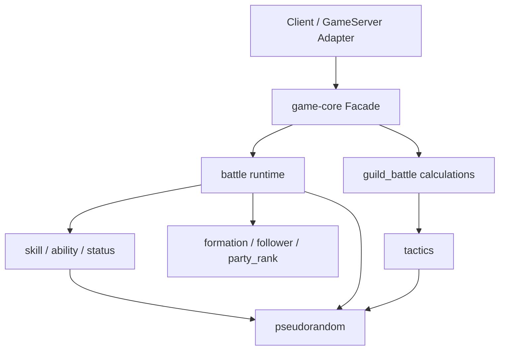

# 共通ゲーム計算の実装契約

## 目的と範囲

`game-core`はClientとGameServerで**同じ入力・同じSeed・同じ呼出順から同じ結果とPRNG最終状態**を生成する純粋計算crateとする。戦闘結果の正本はGameServer。HTTP、DB、WAL、Replayファイル、端末UI、音声、時刻取得、stdoutを含まない。

計算対象は戦闘、Skill、Ability、状態異常、編成、従者、パーティランク、Tactics、騎士団戦の数値計算である。Server側の受付・認可・永続化は呼び出し元のApplication責務。外部I/Oは行わず、現行ゲームルールは`specification/game/`と`design/game/`を正本とする。

## Moduleの依存方向

下位Moduleは上位のApplication / I/O Adapterを参照しない。相互参照が必要な処理は共通の論理型または上位の調停処理に持ち上げ、Module間の循環依存を作らない。

## 境界とデータの所有

1. 呼び出し元が取得したMasterData、Formation位置情報、編成、対戦Mode、初期状態、Seedまたは`Random`を入力する。`ProcessedMasterData`に含まれない固定データは呼び出し元が明示的に与える。DB Connectionや時刻取得関数は渡さない。
2. 入力AdapterはProtobuf / JSONの生成型を`common-types`等の検証済み論理型へ変換する。存在しないID、型範囲外、許可されないMasterData組合せ、非有限`f32`、不足した参照は**計算前に型付きError**として拒否する。計算途中で推定のDefaultを入れない。
3. 変更対象状態とPRNGは明示的に受け取り、成功時だけ新状態・結果・PRNG最終状態を返す。失敗時は呼び出し元の正本状態に部分変更が残らないよう作業状態上で演算する（全コピーを強制する意味ではなく、Commit境界を一つにする）。
4. Replay / UIに必要な演出対象・HP変動などはGame計算の**事実**から派生させて返す。演出用時間・座標やProtocol Buffers wire型を共通計算の入力仕様に混ぜない。
5. CPU計算の途中でI/O、乱数Seed取得、システム時計参照、ログ出力、プロセス例外を使用しない。

## 数値と再現性

- 戦闘の計算値は仕様どおりIEEE-754 `f32`で演算し、式の順序を固定する。代数変形・`f64`への昇格・積和最適化等による丸め時点の変化を勝手に導入しない。
- 整数化・Clamp・`ceil` / `floor`の適用位置は該当ゲーム仕様を参照する。HPダメージ反映での切り捨て、出撃Scoreの1回だけの切り捨て等を共通Helperの暗黙変換で変更しない。
- PRNGは`design/game/pseudorandom.md`の`Random`を使用する。`next_bounded`の呼び出し条件、同点候補の並べ方、効果ごとの乱数消費は独立の仕様値であり、集合Iteration順やThread Schedulingに委ねない。
- `HashMap`等の非決定的走査順を抽選候補順・イベント順に使用しない。仕様が求めるフォーメーション内部番号、PlayerID、陣営、スロット等で明示整列する。
- `panic!`や`unwrap`で不正データを処理しない。全パブリック境界は型付き`Result`または仕様で許された明示的な不成立を返す。内部不変条件は型で保証し、数値Overflow / Indexを検証する。

## 主要な論理処理の境界

| 領域 | 入力 | 出力・副作用の管理 | 詳細設計 |
|---|---|---|---|
| 編成 / Follower / PartyRank | Character編成と参照データ | Validation、補正済み編成時Status、PartyRank | `formation_stats.md` |
| 戦闘 | BattleRuntime、Mode、Random | 次の戦闘状態、行動結果、Random最終状態 | `battle_runtime.md`、`damage_and_targets.md` |
| Skill / Ability / 状態異常 | BattleRuntime、確定MasterData、Random | 効果状態・発動計数・解除結果 | `effects_and_status.md` |
| Tactics / GuildBattle計算 | 戦闘EventとGuildBattle状態の計算用Snapshot | 計算結果・消費量・次状態候補。永続化は行わない | `tactics_runtime.md`、`guild_battle_calculations.md` |
| PRNG | Seed、現在`Random` | 値と次の`Random` | `pseudorandom.md` |

## 単体テスト

各Moduleに正常・境界・不正入力・同一Seed再現テストを配置する。例：空編成拒否、HP0、Clamp上下限、複数状態異常の順序、Skillと通常攻撃の分岐、PRNGの最終状態、`f32`中間丸め、`max_activation_count`到達、入力不正時に状態と乱数を一切確定しないこと。Client・GameServer双方は**同じgame-coreのテスト資産**を使用し、Runtime差異を別途再現性テストで検出する。

規範: `../implementation_rules.md`、`../../../specification/game/battle.md`、`../../game/battle.md`、`../../game/pseudorandom.md`。
