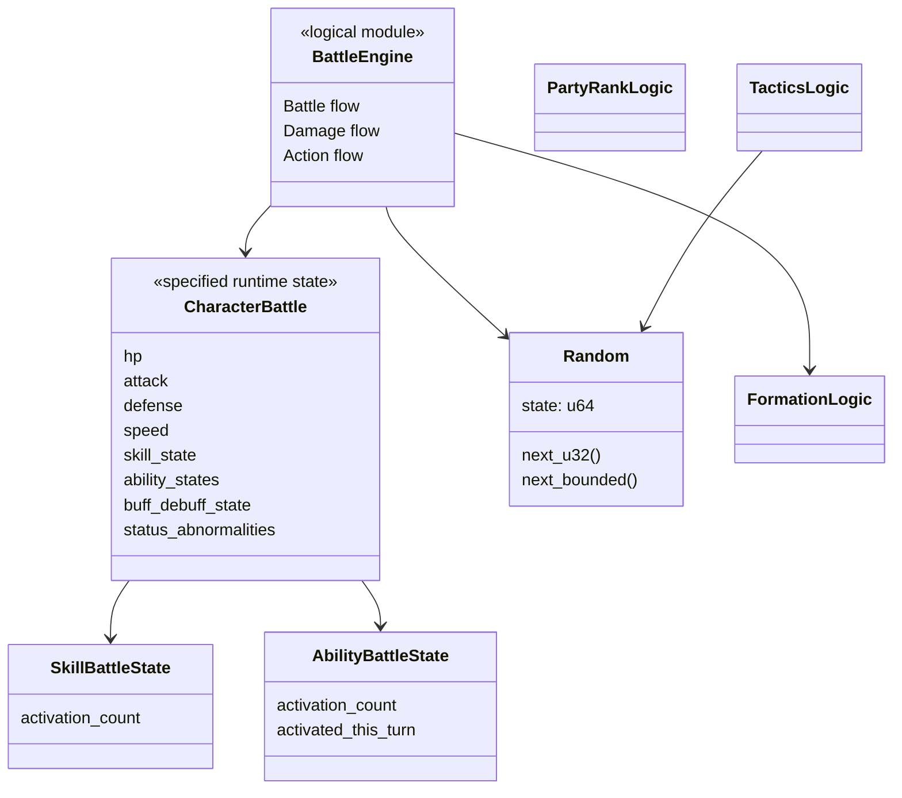

# game-core設計

## 概要

`game-core`はClientとGameServerで共有する、外部I/Oを持たない決定的ゲーム計算層とします。

戦闘結果の正本はGameServerですが、ArenaではClientが同一初期状態・Seed・Versionから同一結果を再現するため、戦闘ロジックとPRNGを共有します。

## Module構成

```text
game-core/src/
├── battle/
├── skill/
├── ability/
├── tactics/
├── status_abnormality/
├── formation/
├── follower/
├── party_rank/
├── pseudorandom/
└── guild_battle/（騎士団戦の純粋計算のみ）
```

## 論理クラス図



`BattleEngine`等は責務名で、具体的なRust型名を固定しません。`CharacterBattle`、`SkillBattleState`、`AbilityBattleState`、`Random`は既存資料に名称が定義されています。

## 入力と出力

`game-core`へ渡すものは、ゲーム計算に必要な初期状態、MasterData、Mode、Seed / Random状態です。

HTTP Context、Database Connection、System Clock取得、Kubernetes情報は渡しません。

## 戦闘状態

戦闘開始時に以下を初期化します。

- `SkillBattleState.activation_count = 0`
- 各`AbilityBattleState.activation_count = 0`
- 各`AbilityBattleState.activated_this_turn = false`

ターン開始時には全Abilityの`activated_this_turn`を`false`へ戻します。

キャッスルブレイク専用Abilityは戦闘ターンを生成せず, 選択キャラクターごと・効果種別（攻撃力補正`ABILITY_EFFECT_BUFF` / ダメージ補正`ABILITY_EFFECT_CASTLE_BREAK_DAMAGE_INCREASE`）ごとに当該CBで最大1度だけ判定します。両効果は独立して成立し, CB終了時に判定状態を破棄します。通常戦闘の`AbilityBattleState`は流用しません。

## 効果状態の分離

`BuffDebuffEffectState`はSkill / Ability由来の攻撃・防御補正だけを保持します。FormationやTactics補正をこの状態へ混在させません。

`StatusAbnormalityState[]`は状態異常ごとの経過ターンと毒周期を保持します。

## 詳細プログラミング設計

- `deterministic_contract.md`：純粋計算層の入出力、Commit境界、Error、AI実装と単体テスト。
- `formation_stats.md`：Formation、Follower、PartyRank、編成時Status。
- `damage_and_targets.md`：Arena / GuildBattleの`f32` Damage、対象選定、補正順序。
- `effects_and_status.md`：Skill / Abilityの条件・発動回数、Buff / Debuff、状態異常。
- `guild_battle_calculations.md`：GuildBattleの出撃・CB・Score・Item等の純粋計算境界。
- 既存の`battle_runtime.md`、`pseudorandom.md`、`tactics_runtime.md`を各実行順とPRNGの詳細正本として引き続き用いる。

各ModuleはI/Oを持たず、暗黙の時刻・乱数・プロセス例外を使用しない。外部入力の不備は型付きErrorで返し、失敗した計算から部分状態・PRNG変更を正本に反映しない。ClientとGameServerが同じ実装をリンクし、すべてのModuleに単体テストを持たせる。全体規約は`../implementation_rules.md`を参照する。

## I/O禁止境界

`game-core`へ以下を入れません。

- HTTP / TLS
- PostgreSQL
- Replay file
- Recovery file
- stdout / stderr
- Telemetry exporter
- Kubernetes API

## 参照資料

- `design/game/battle.md`
- `design/game/pseudorandom.md`
- `design/shared/types.md`
- `specification/game/skill.md`
- `specification/game/ability.md`
- `specification/game/status_abnormality.md`
- `specification/game/formation.md`
- `specification/game/follower.md`
- `specification/game/party_rank.md`
