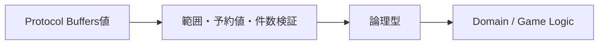
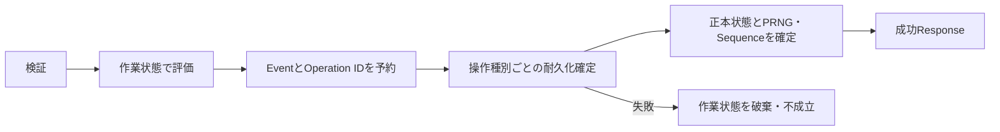

# 実装横断ルール

## 概要

複数Componentにまたがる実装で最も重要なのは、正本・順序・再現性・冪等性をコード上でも曖昧にしないことです。

## 1. 論理型を境界で検証する

wire型をそのままDomain値として使用しません。

- Protocol Buffersの`uint32`で受信する`u8` / `u16`論理型は範囲検証します。
- ID予約値を通常IDとして受け付けません。
- Enumは仕様定義値だけを受け付けます。
- 固定要素数の`repeated`はApplication層で件数検証します。

## 2. 時刻は状態値として扱う

仕様で絶対時刻を保持すると定義されているものは、残り秒数を定期減算して正本にしません。

- `TacticsActiveEffectState.expires_at`
- Sessionの`expires_at`
- GuildBattleの`start_at` / `end_at`

表示用残り時間は現在時刻との差から算出します。

## 3. PRNGは暗黙取得しない

再現対象のロジックは、対象の`Random`状態を明示的に受け取って消費します。

- Arena: 時刻ベースSeedから戦闘専用PRNGを作成します。
- GuildBattle: 本体PRNGを保持します。
- Join成立: 本体PRNGを消費して初期`RequestSequence`を生成します。
- ランダムTactics: 本体PRNGから1回だけ`next_u32()`して専用Seedを生成し、その後は専用PRNGだけを使用します。

## 4. 成立した操作だけ状態を進める

GuildBattleでは失敗した要求で`RequestSequence`を加算しません。通常非出撃Eventは作業状態で計算し、Replay Eventを予約した後、v2署名付きWAL耐久確定を待ってから正本の状態・PRNG・`RequestSequence`を更新します。出撃と酒場は個別に規定されたDB / Recoveryの確定境界に従います。Replayの非同期DB送信は成立判定ではありません。

## 5. Database更新は冪等Operationとして扱う

GuildBattle Lifecycleおよび騎士団戦中のDatabase状態変更は`X-Operation-ID`を必須とします。

同一論理操作では、初回送信・1回再試行・Recovery再送のすべてで同じ128bit UUIDを使用します。

## 6. Request処理順を変更しない

GameServerが受信する要求は先に到達した順に処理します。完全に同時と扱われる要求同士は処理系定義であり、乱数で順序を決めません。

## 7. Replayと通常Logを分離する

Replay Eventは破棄しません。System Log Queueは高負荷時に`DEBUG` / `INFO`を破棄可能です。したがって同じQueueや同じBackpressure規則へ統合しません。

## 8. Domain Validationは正本Componentで再評価する

Public APIで形式検証やToken検証を行っていても、Private API / GameServerは現在状態に基づくDomain判定を自分で行います。

## 参照資料

- `design/shared/types.md`
- `design/server/public_api_responsibility.md`
- `design/server/guild_battle.md`
- `design/server/data_base.md`
- `design/system/log.md`
- `design/game/pseudorandom.md`
- `specification/game/tactics.md`

## 9. 全コンポーネント共通のコーディング規約

本節はClient、GameServer、GuildBattleCoordinator、Public / Private API Server、Discord Bot、内部crate、開発用ツールに共通して適用する。ソース公開方針は`../system/source_publication.md`を参照する。

### panic・例外による制御の禁止

- 通常の実行経路で`panic!`、`unwrap()`、`expect()`、`todo!()`、`unimplemented!()`、`unreachable!()`、`assert!()`等を失敗処理に使用しない。`std::process::abort`、`unwrap_unchecked`、未検証の配列添字アクセスも代替手段として使用しない。`catch_unwind`でpanicを通常のエラーに変換する設計もしない。
- 失敗し得る操作は`Result<T, E>`、`Option<T>`または明示的な失敗値で呼び出し元へ伝搬し、正本のError境界で応答・取消・再試行・記録へ変換する。外部入力・MasterData・数値変換・インデックス・Overflow・タイムアウト・保存失敗を検証する。`?`は伝搬先でErrorに意味付けできる場合に使用する。
- 型の不変条件は検証済みConstructor・非公開フィールド・検証されたEnumで表現する。正常系を例外処理に依存させない。`assert!`、`assert_eq!`等は**テストコード内の検証目的に限り使用可能**。
- JavaScript / Browser境界でも`throw` / Promise rejectionを通常のゲームフローとして使わず、失敗を明示的な結果に変換する。Browser APIや第三者ライブラリが送出する例外はAdapter境界で受け取り、再送・拒否等の既定の失敗へ変換する。
- RustにおけるOOM、プロセス停止、他ライブラリ内のpanic等を完全に抑止できることは保証しない。自作コードから意図的なpanicを発生させず、外部依存による失敗は境界で検知・安全に失敗するように設計する。

### 標準出力・観測

- **デバッグ用途以外で標準出力を使用しない。** 本番Application・常駐Server・共有crateからの`println!`、`print!`および同等のstdout直接書込は行わない。構造化Logは既定の非同期Log経路や設定済みSinkへ送る。認証情報やTokenをLogへ出力しない。
- ローカルデバッグ用の明示されたDiagnostic出力に限りstdoutを許容する。通常のゲーム計算やAPIのデータ伝送をstdoutに依存させない。`game-core`にはLogや標準出力の依存を設けない。

### 非同期I/O

- Network、Database、OPFS、ファイル、Log、Telemetry等のI/Oは**原則非同期**とする。Server側は既存`tokio` Runtimeと非同期Clientを使用し、ClientはBrowser Promise / Futureを使用する。
- `game-core`はI/O自体を持たない同期的な純粋計算APIとする。非同期I/Oを導入するために計算関数を`async`化しない。
- `fsync`など耐久化に必要な同期API、非同期APIのない外部ライブラリ、Browser Worker内だけで実行可能な同期OPFS操作は専用Worker・blocking pool等に隔離し、主処理Thread・非同期Executor・UI Threadを停止させない。**非同期化を理由にWAL等の耐久化成功条件を緩和しない。**
- キューは有限容量・失敗通知・Cancellation・終了処理を持ち、所有権や正本状態の変更順序を変えない。

### AI実装を前提とする疎結合設計

- AIにコード生成・修正を担当させる前提で、**一Module一責務**、小さな関数、境界で検証する型、明示した入力・出力・Error・副作用、依存方向の一意性を維持する。
- Domain計算にHTTP Handler・Protobuf生成型・DB Model・Browser APIを直接渡さない。Adapterで検証済み論理型に変換し、`game-core`では呼び出し元に再現可能な状態だけを受け取る。
- 各変更は対応する仕様節、正常・境界・異常系の単体テストを同時に作成する。未確定のゲームルールをAIが補完してはいけない。既存ルールと衝突したら実装せず仕様の未決定として切り分ける。
- `unsafe`、グローバルな可変状態、隠れた乱数・時刻取得、暗黙のI/O、無制限の再試行を導入しない。必要性が確定した場合だけ、別の設計根拠を明示して扱う。

### マジックナンバーの禁止

- **意味を持つ数値を、意図の分からない数値リテラル（マジックナンバー）として処理の途中に直接記述しない。** ゲーム規則の係数・閾値・確率・上限、時刻・期間・容量、プロトコル値などは、名前付き定数、意味のある型、または検証済みの設定・MasterDataとして参照する。
- 定数名には意味と単位を表し、出典となる仕様節を追跡可能にする。同じ意味の値を複数Moduleへ重複定義せず、所有するModuleの責務に配置する。単位変換や計算途中の係数も、意図が読み取れない数値を埋め込まない。
- `0`や`1`などの数学的恒等元・添字操作の基本値や、テストで確認する具体的な期待値そのものは、文脈から意味が自明であればマジックナンバーとは扱わない。ただしゲーム仕様や業務上の意味を持つ`0`・`1`は名前付き定数または論理型で表現する。実装の都合でゲーム上の定数値を推測・新設しない。

### コメントの記載方針

- **コメントにはコードだけから判断できない理由、制約、前提を記載する。** 処理内容を日本語等で言い換えたコメント、コードから自明な説明、作業途中の一時メモや解決していない`TODO`を最終コードに残さない。必要な背景は該当する仕様・設計の根拠に結び付ける。
- **計算ロジックを実装する場合は、求める値を得るための計算式をコードコメントに必ず記載する。** 入力変数と出力値の対応、式中の係数・単位、演算順序、丸め・Clampの適用位置など、計算結果に影響する前提を実装箇所で読み取れるようにする。複数の計算経路がある場合は各経路の式を明示し、単に「仕様に従って計算」などの言い換えだけで済ませない。
- 計算式コメントは既存のゲーム仕様を忠実に表し、仕様にない式・定数・演算順序を創作しない。仕様とコードの計算式が食い違った場合は、片方を推測で修正せず不整合として扱う。式を変更したときはコメントと対応する単体テストも同時に更新する。

### 関数の行数と責務分割

- **100行以上の関数は原則として作成しない。** 通常は99行以下を目安とし、入力検証・計算・状態確定・I/O等の責務を適切な関数へ分離する。行数を減らすだけの無意味な分割や、処理順が読みにくくなる分割は行わない。
- **ロジック上分割できない場合、または分割によって可読性を損なう場合に限り例外を認める。** 例外時は分割できない理由・順序上の制約をコードコメントまたは対応する設計に記し、関数全体を単体テストの対象にする。一時的な長大関数を放置するための例外にはしない。
- 関数の行数は宣言から終端までの物理行数（空行・コメントを含む）で判定する。AI生成コードも同じ基準で確認する。

### 単体テストを必須とする

- **すべての独自コードのcrate / Applicationに単体テストを実装する。** 純粋計算は数値境界・分岐・PRNG最終状態まで、Adapterは入力Validation・I/O失敗・Cancellation・Error変換まで検証する。計算式コメントに記した演算順序・丸め・Clamp・境界値とテスト期待値を一致させる。
- テストは外部Serverがなくても実行できるFake / Stub等を使い、接続実験・負荷・統合テストは別工程に分ける。成功ケースのみで合格としない。
- CIでは少なくとも`cargo fmt --check`、`cargo clippy --workspace --all-targets -- -D warnings`、`cargo test --workspace --all-targets`を実行する。WASM依存の単体テストは別途対象Browser / WASM用のテスト環境で検証する。未確定の期待値を仮定してテストを通さない。
