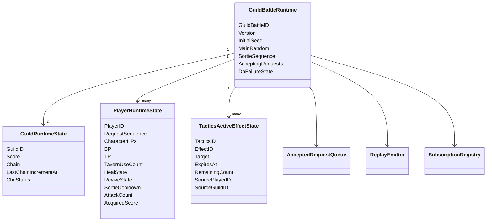
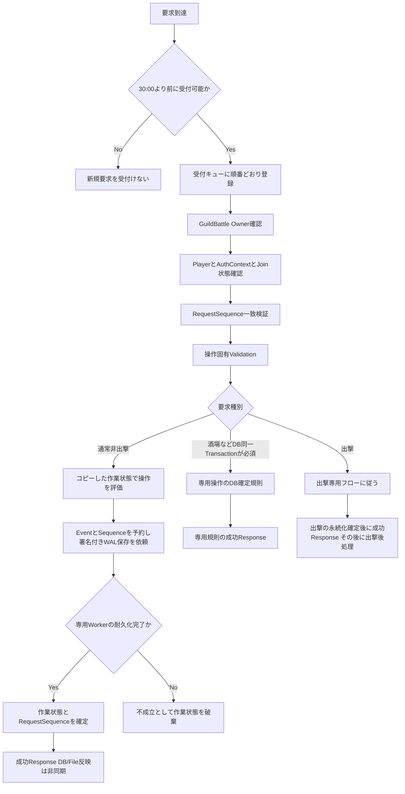
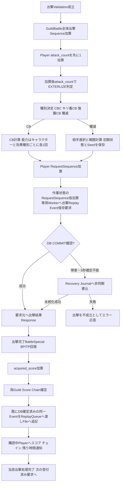
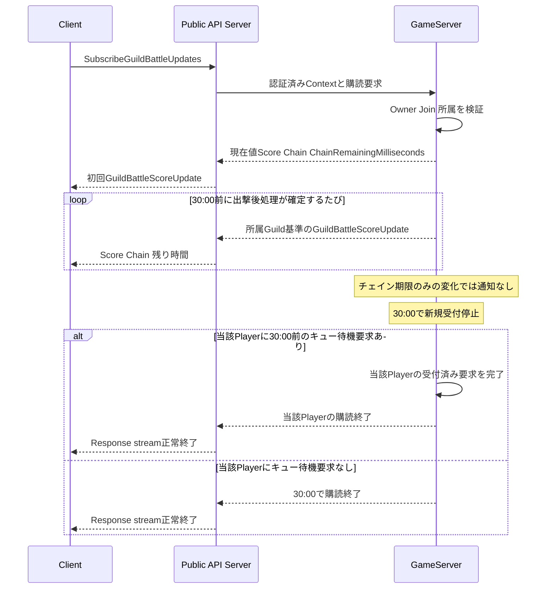
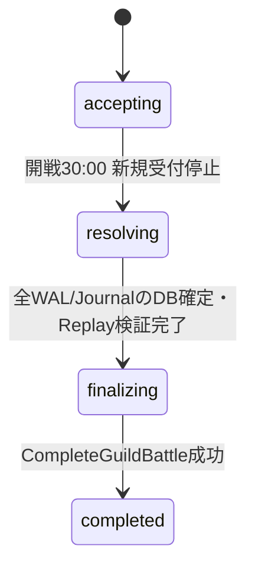

# GuildBattle Runtimeプログラミング設計

## 対象と正本

GameServerは`GuildBattleID`単位で1つのGuildBattle Runtimeを所有し, 受付済み状態変更要求を受信順に直列処理する. 戦闘・スコア計算の正本は`specification/game/`と`design/game/`, APIの入出力と処理順は`design/server/public_api.md`, `design/server/guild_battle.md`, `design/server/api_payload.md`を使用する. 本書では独自のゲームルールを定義しない.

`RequestSequence`はPlayerごとの要求順序であり, GuildBattle全体の出撃Sequenceとは異なる. 購読は読み取り専用で, いずれのSequenceも消費しない.

## Runtimeの状態と所有範囲



図は論理的な保持対象であり, 具体的なRustフィールド名・データ構造の新規規定ではない. Character, CBC, Heal, Revive, Tacticsの共有状態には`design/shared/common_data_struct.md`および`design/shared/types.md`の定義を用いる. `SubscriptionRegistry`はゲーム状態の正本ではなく, 認証済み接続の宛先と終了待ち状態だけを保持する.

## 初期化・Replay

PreloadではPrivate API経由でGuild / Member / Party / Item等の必要な情報を取得し, 各キャラクターの基礎攻撃力・基礎最大HP・基礎防御力へ所属騎士団の武器庫・食糧庫・鍛冶屋のレベルに応じた固定量を直接加算する. 加算済み3値を`GuildBattlePartyCharacter`の`facility_adjusted_*`に保持し, 開戦時の可変初期状態とともに`GuildBattleInitialSnapshot`へ固定する. 戦闘とReplay復元は記録済みの値を入力に使用し, 施設補正を再加算しない. InitialSeed, Version, GuildID, SnapshotのCreate Replayを最初のEventとする. `StartGuildBattle`成功時にCreate Replayの保存と`scheduled -> in_progress`を同一Database Transactionで確定する. Replay復元で現在のDatabaseの可変値を初期状態として使用しない.

成功した状態変更は成立順にReplay Eventとして記録する. Replayに記録するEventの意味と書式は`design/system/guild_battle_replay.proto`, 保存障害と再送は`design/system/log.md`を正とする.

## JoinとRequestSequence

初回Join成功時のみGuildBattle本体PRNGを1回消費し, 次を初期RequestSequenceとする.

```text
RequestSequence = main_random.next_bounded(1_000_000_000) + 1
```

Player間の数値重複は許す. 再Joinでは現在値を返し, PRNGを消費しない. Join成立順と初期Sequenceの消費はReplay対象. `ClientVersion`はGameServer Versionと照合し, Account Sessionは`ValidateAccountSession`で検証する. Client編成がPreload済みServer編成と一致しない場合, Server側をClientへ返して同期する.

## 受付・直列実行・共通Validation

GameServerが受信した要求は受信時刻の早い順に処理する. 完全同時の順序は処理系定義とし, 並び替えにPRNGを使用しない. 開戦30:00以降の新規状態変更要求は受付けないが, 30:00以前に受付キューへ入った要求は最後まで処理する.



失敗した操作はRequestSequenceを進めず, 成立Replay Eventを記録しない. **出撃はDB COMMIT（Recovery中は署名検証可能なローカル記録の耐久保存）の確定後、出撃後処理より前に成功Responseを返す特例**であり, 上図の「その他の変更操作」のReplay→Response順序を出撃に適用しない. DB更新を行う操作のTransaction / 冪等性 / RetryはPrivate API仕様を優先し, 共通処理で順序を変更しない. Clientの「通信中」表示状態をGameServerの独立したPlayer状態として追加しない.

## GetGuildBattleStatus

`GetGuildBattleStatus`はRequestSequence不要・Sequence不消費の状態参照で, 再接続時の正本同期に使用する. 当該要求者へ適用される酒場の使用残回数も返す. 現在HP, BP/最大BP, TP/最大TP, Heal/Reviveと残り時間, 出撃待機, Active Tactics Effects, Item残数, 両Guild Score, 所属Guild Chain, CBC, 現在RequestSequenceを返す. CharacterID, Follower, MainSkill, Ability, Formation等の静的編成はJoin時に同期済みのClient情報を利用し再送しない.

## 出撃専用処理



出撃種別は`GuildBattleSortieEventType`に従い, CBC→キリ番CB→強襲無効→強襲CB→殲滅の既定のフローで決める. `EX_DRIVE`, `SLASHER`, `ENDER_BREAK`のキリ番専用効果は`GUILD_BATTLE_SORTIE_EVENT_NUMBERED_CASTLE_BREAK`でだけ適用する. CB専用アビリティでは`ABILITY_EFFECT_BUFF`と`ABILITY_EFFECT_CASTLE_BREAK_DAMAGE_INCREASE`を独立に判定する. キャラクター1体につき各効果種別は当該CBで最大1度だけ判定し, 次のCBへ判定済み状態を持ち越さない. CB算式とフローは`specification/game/guild_battle.md`と`design/game/guild_battle.md`を正とする.

殲滅では`GuildBattleAnnihilationResponse`に戦闘開始時点の`OwnCharacters`, `EnemyCharacters`, `EnemyPlayerID`, `EnemyFormationID`, 戦闘に関係する`BattleTacticsEffects`, `Seed`を格納する. ClientはJoin時同期済み自身の編成とこの入力で同一`game-core`を実行する. 表示済みの古いHPやTacticsを流用せず, 関係しない継続効果・最終HP・行動履歴を追加送信しない.

出撃EventはGameServerが非同期I/O Workerを使ってPrivate APIの`SaveGuildBattleSortieLog`でDBへ先行永続化し、通常時はWorkerのCOMMIT確認後に成功Responseを返す。初回送信開始から5秒以内にCOMMIT確認できない場合はDB/NW障害として当該騎士団戦のDB送信を終了時まで停止し、永続ローカルJournalへの書込成功後に限って応答する。5秒の判定前に保存結果が確定不明な場合は、同一`X-Operation-ID`でPrivate APIの冪等記録を合計5秒以内に最大1回再照合する。明示的な確定失敗、再試行失敗、通算5秒経過時にRecoveryへ切り替える。5秒を超えた場合は即時再照合を止め、ローカルJournalに同一Operation IDで記録し、騎士団戦終了後の一括再送時にDB重複を照合する。正常送信中の確定不明では作業状態を保持し、同GuildBattleの後続状態変更要求を保留する。5秒超過でRecoveryへ移行した場合はJournal確定を持って次の要求の処理に進む。出撃EventはDB COMMIT（正常時）または署名付きJournal耐久確定（Recovery）まで成功応答を保留する。非出撃通常Eventは前Eventを追い越さないEvent番号でQueueへ登録し、専用Workerの署名付きReplay WAL耐久化完了で応答できる。DB保存完了は同期的に待たない。DB Workerは先行番号をCOMMITするまで後続番号のCOMMITを進めない。ただし後続操作の成功応答は先行番号の**成立確定**（通常EventならWAL耐久保存）を待てばよく、先行EventのDB COMMITを待たない。Event Hashは保存媒体に依存しないためWAL/Journal/DBの切替でも同一連鎖を保つ。出撃のPRNG計算と状態遷移は未確定の作業状態で算出し、通常時はDB COMMIT、Recovery時はローカルJournalの永続化完了によりRuntimeの正本へ反映する。DBへの未保存が確定した場合は作業状態を破棄し、PRNG・RequestSequence・攻撃回数を進めず要求を失敗とする。出撃結果ResponseはDBまたはRecovery Journalの耐久化より後で、以下の後処理より先に送るが, その後のBattle Special回復, `acquired_score`, スコア・チェイン確定, Replay Event追加まで同一出撃の直列実行範囲とする. GameServerにおける騎士団合計スコアの正本はResponseの未切り捨て`SortieScore`ではなくRuntimeの確定済み`Score`である.  先行保存した出撃Eventは後処理完了後のReplayQueueで同じ`event_index`を用い、Private APIでは既保存として重複書込みをしない。GameServer再起動時は保存済みEventを順にReplay適用してResponse後の未適用BP/TP・Score・Chain等を復元する。送信通知の失敗によって出撃を巻き戻さない.
出撃計算式はすべて`f32`で評価し, 出撃の最終`SortieScore`が負数・NaN・正負Infinityの場合は0.0へ正規化してからResponseとPlayerの`acquired_score`へ反映する. 出撃Responseの`Score`およびPlayerの`acquired_score`は`SortieScore`（`f32`）で保持する. 騎士団合計ptだけ, 1出撃ごとに小数点以下を切り捨てて`Score`（`u64`）へ加算する. 出撃成立回数`attack_count`を勝敗・参加判定へ渡す。通常Playerの勝敗数は出撃1回以上、参加回数は出撃3回以上を条件とする。個人累計戦績へ加算する値は騎士団戦終了時点の未切り捨て`acquired_score`を1回だけ小数点以下切り捨てして`u64`に変換する. `u64`へ変換する値と合計値には`u64::MAX`を上限とする飽和変換・飽和加算を使用する.


回復・復活・出撃待機がServer上で先に終了した場合は、そのPlayer宛て`SubscribeGuildBattleUpdates`の`GuildBattleScoreUpdate.timer_update`へ終了対象と残り0秒を設定して通知する。同一処理時点で複数種類が終了した場合は1種類につき1つの`GuildBattleScoreUpdate`を発行し、`HEAL`→`REVIVE`→`SORTIE_WAIT`の順とする。各通知に含めるスコア・チェイン情報は同一の確定済みスナップショットとする。Clientは`timer_update.kind`が示すタイマーだけを更新する。Client側が先に0と判断した場合は`GetGuildBattleStatus`で現在値を取得する。タイマーの定期通知は行わない。

## 通知購読とチェイン残り時間

`SubscribeGuildBattleUpdates`はJoin済みPlayerの認証済みHTTP/2 Response streamで, `RequestSequence`を使用しない. 初回と出撃後処理確定時の`GuildBattleScoreUpdate`には, 受信者の所属騎士団基準の`AllyScore`, `EnemyScore`, `Chain`と`ChainRemainingMilliseconds`を含める. 送信時点の現在状態を正本として確定し, `ChainRemainingMilliseconds`は0～300000の`uint32`で表す.

- Chain=0または前回チェイン加算から5分が経過し加算不成立のままリセットされた場合は残り時間を0とする.
- その他は`max(300000 - (送信値確定時刻 - 前回チェイン加算時刻)[ms], 0)`とし, 5分ちょうどの加算はリセット判定に含めない.
- 同じPlayerの連続出撃など, チェイン値を加算しない場合は前回加算時刻を新たな加算時刻として扱わない.
- 時間経過だけでチェインが0になる場合に追加のPush通知は送らない. Clientのタイマー減算は表示用途だけであり, Serverチェイン値を確定しない.
- 接続断の通知履歴を再送しない. 再接続時には`GetGuildBattleStatus`の正本を先に同期し, 新しい購読の初回スナップショットで残り時間を取得する.



他Playerの処理待ちによって当該Playerの購読終了を延期しない. 30:00以前に受付済みの当該Playerの要求が複数ある場合は, そのPlayerの受付済み処理がすべて完了した時点で終了する. 所有GameServerは接続ごとの通知対象判定と終了指示を行い, Public API ServerはmTLSで中継する. 他GuildBattleの状態は購読者へ送らない.

## Tactics・アイテム・治療・復活

`UseTactics`成立時にはUseCondition・TP・残使用回数を確認する. Random要素ありの場合だけGuildBattle本体PRNGから専用Seedを1回生成し, `Random::new(Seed)`のTactics専用PRNGで固有抽選を行う. Random要素なしはResponse Seedを0とするが, Seedの数値からRandom使用有無を判定しない. Active Effectsは`TacticsActiveEffectState`として, 終了時刻・残回数・発動元PlayerID/GuildIDとともに保持する. DURATIONは絶対時刻, COUNTは`remaining_count`と`count_consume_trigger`を使用し, `OPPONENT_PARTY`は各出撃時の現在の対戦相手へ解決する.

Item使用は**その対戦のCreate Snapshot**から得たPlayerのItem残数だけを仮検証し、1回消費した結果を作業状態に保持する。署名付きWAL耐久化後にRuntime残数・RequestSequenceを確定して成功Responseを返し、`SaveGuildBattleItemLog`からPlayer所持数のDB更新を後追いで冪等に反映する。Private API応答の待機をItem使用成功の条件にしない。 BP50回復薬の日次配布は現段階では実施しない. 酒場の`UseTavernRecovery`は通常のRequestSequence検証・直列処理・成功時Event記録に従う. GameServerは適用される利用回数を`TavernUseCount`（0～3）で管理し, Playerごとの残回数を0～3で保持し、2時間ごとに1回分の時間経過回復を適用する. 成立時はPlayerIDのストック行を排他し、経過補充適用・残回数確認・1回消費・Replay Event保存を同一DB Transactionで処理する。状態参照だけならDB行へ補充結果を保存せず、現在時刻から算出した値を返す。成立時はBPを最大BPへクランプし, 回復量が0でも1回使用として記録する. 回復後BP・残回数・次回回復時刻・RequestSequenceをClientへ返す. 成立操作のPlayerID・GuildID・時刻・回復後BP・使用後残回数・次回回復時刻をReplay Eventに保存し, 復元時は同じイベントを成立順に適用する.

Heal / Reviveは仕様の状態遷移と待機時間に従う. Start, Cancel, Completeが成立した場合だけRequestSequenceを加算しReplayへ記録する. 出撃待機時間はHeal / Reviveとは独立して保持する. 具体的な状態と時刻処理は`specification/game/guild_battle.md`および`design/server/guild_battle.md`の各APIシーケンスを正本とする.

### アイテム消費の後追い確定（WAL方式）

- Itemの初期在庫は開戦時のCreate Snapshotで確定し、Battle内で成立した消費だけをGameServerの対戦状態へ反映する。WAL署名・耐久化失敗時は消費・Sequenceを進めない。DBへの後追い適用はReplay WorkerからEvent番号順に行う。
- 酒場はPlayer単位のDB共有ストックを即時Transactionで更新する既存仕様のままとし、Itemの後追い方式を酒場に拡張しない。


## 30:00受付終了と永続終了



30:00で新規受付を停止し, 待機要求のないPlayerの通知ストリームを終了する. 30:00以前にキューへ受付済みの要求はすべて処理する. 処理待ちのPlayerの購読だけを当該Playerの全受付済み要求完了時まで延長する. `BeginGuildBattleResolving`で永続状態を`resolving`にしてから受付済みQueueを解消し, 最終スコア・勝敗を決定する. `CompleteGuildBattle`は受付済みキューの解決に加え、署名付きWAL/Journalに残る全成立EventのDB反映・Replay整合検証が完了した場合だけ実行する。1件でも失敗・隔離中なら`resolving`で保留し、完了結果を確定しない。`CompleteGuildBattle`成功時に当該対戦を`completed`へ更新する。

対戦Guildのmembership lockは当該騎士団戦の`completed`確定と同時に解除する. 除外Guildのmembership lockと除外一覧は, 元の`matching_target_date`/`matching_start_time`が同じ全対戦（再開で作成された新IDも含む）が`completed`・`canceled`・`replaced`の終端状態となったときに`CompleteGuildBattle`または`CancelPreloadFailedGuildBattle`のTransactionで解除・削除する. 別対戦が未完了の間は解除しない.

## DB障害・不変条件

騎士団戦中DB送信は初回開始から5秒以内に確定できない場合、または再試行の失敗が早く確定した場合にDB/NW障害状態へ移行し、当該Battle終了までDB送信を停止する。以降は専用Workerの永続ローカルJournal書込完了を成立条件とし、Battle終了後にEvent番号順で一括送信する。通常時の出撃は引き続きDB COMMIT完了が成功条件となる。 Replay / Recovery fileの書込・再送は専用Workerの責務とし, 正本仕様は`design/system/log.md`と`design/server/guild_battle.md`を参照する. `CompleteGuildBattle`の失敗処理は別の専用規則を使用する.

- 1つの`GuildBattleID`を同時に複数のGameServerが所有しない.
- 成功したPlayerの状態変更だけでRequestSequenceを進める.
- Join再実行と状態参照・購読でGuildBattle本体PRNGを消費しない.
- 出撃を同じ受付Queueで直列に扱い、永続化確定後の成功Responseとその後の出撃後処理の順を守り、後処理も次の出撃より前に完了する。
- Replay Eventは成立順で追加し, LiveとReplayで状態が一致する.
- 30:00以降は新規受付を増やさず, それ以前の受付済みQueueを最後まで解決する.

酒場ストックの正本キーは`PlayerID`単独とする。満量3・消費後0～2の状態から2時間ごとに1回分補充し、Guild全体で共有しない。`GetGuildBattleStatus.tavern_remaining_uses`は呼出元の残回数、`tavern_next_recovery_at`は次回補充のUTC epoch microseconds（満量では0）を返す。RuntimeのキャッシュはDB正本と成立Replay Eventで復元する。

## 参照資料

- `specification/game/guild_battle.md`
- `specification/game/ability.md`
- `specification/game/tactics.md`
- `design/game/guild_battle.md`
- `design/server/guild_battle.md`
- `design/server/guild_battle_lifecycle.md`
- `design/server/public_api.md`
- `design/server/api_payload.md`
- `design/shared/common_data_struct.md`
- `design/shared/types.md`
- `design/system/guild_battle_replay.proto`
- `design/system/log.md`
- `design/test/test_policy.md`

### 通常イベントの低遅延応答と保存保証

通常の非出撃操作は、作業状態に対して操作結果・PRNG・RequestSequenceを仮適用し、Event Index/Operation IDを直列予約したうえで専用Workerに署名付きReplay WAL保存を依頼する。`fsync`・原子的rename・親ディレクトリ同期を含む耐久書込の完了後にのみ作業状態を正本へコミットして成功Responseを返す。失敗時は作業状態と予約を破棄し、未成立番号を後続成功イベントへ引き継ぐ。通常イベントごとにDBのCOMMITを待たず、戦闘処理スレッドで同期I/Oを実行しない。Replay WorkerがGuildBattleID・event_index順にPrivate APIへ永続化し、Replay Fileの書込み失敗やDB障害時は既存のRecovery規則で処理する。順序キューは番号を追い越さない。ReplayQueue満杯時はイベントを捨てずに受付を待機し、恒久的な待ちや破棄を成功とみなさない。**通常Eventの応答はDB永続化完了の通知ではないが、Replay WALの耐久書込み完了を保証する**。停止時には署名・連続番号の検証に合格したWAL EventをDBへ冪等再適用する。WAL未保存のEventには成功応答を返さない。より強い保証を必要とする操作（出撃、およびDB側で原子的消費を必要とする酒場など）は各操作固有の確定条件を優先する。

### Recovery中の酒場利用制限

対象GuildBattleがRecovery中の場合、`UseTavernRecovery`を利用不可として応答し、消費・補充の確定処理を行わない。ローカルJournalによるPlayerストックの代替更新や復帰時の一括再適用は実装しない。DBが復旧しBattleが正常な状態へ戻った別の操作機会でのみ、Playerの正本ストックを再参照する。

### Replay Event Hash・応答境界の責務

GameServerのGuildBattle直列Sequencerは直前の成立Event Hashと操作IDを保持し、署名済みWAL/JournalまたはDB先行COMMITが完了したEventだけを確定する。Replay WorkerがDB COMMIT結果を後追いで確認しても、既に成立したEventのIndex/Hashを変更しない。DB側は`GUILD_BATTLE_REPLAY_LOG`と`GUILD_BATTLE_REPLAY_ANCHOR`を同じTransactionで前番号から順に更新する。署名Byte列や同一Eventの媒体間重複の検証規則は[ローカルReplay記録v2](../../system/replay_local_record_encoding.md)を正本とする。

## アイテム操作の実行境界

Item使用の正本は`design/server/guild_battle.md`の「アイテム使用の単一Owner・低遅延確定契約」とする。`PlayerRuntimeState`の対戦内残数とCreate Snapshotを使ってBattle単位の要求順序で評価する。Join時にPrivate APIへItem予約を要求せず、Battle中のGameServerキャッシュは対象対戦内の状態だけとする。通常非出撃Eventと同じWAL耐久化後に成功し、`SaveGuildBattleItemLog`によるDB減算はReplay Workerから非同期に冪等実行する。同期ポイントはBattle Owner内のイベント順序とPrivate APIのDB Transactionだけであり、GameServerインスタンス間同期は行わない。
