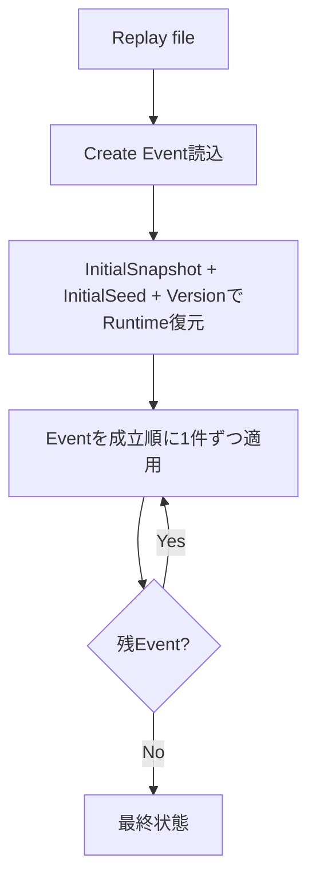
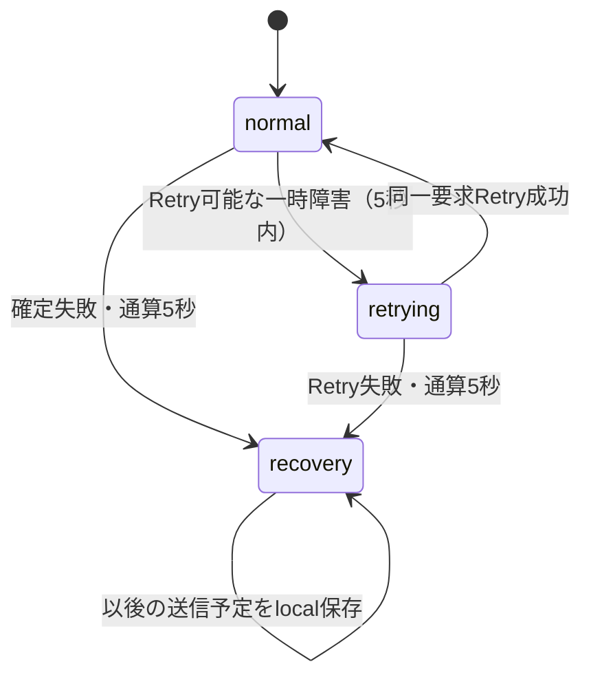

# Logging / Replay / Recoveryプログラミング設計

## 概要

System Log、GuildBattle Replay、DB Recoveryは目的と耐欠損性が異なるため、Queue・Worker・保存形式を分離します。GuildBattle Hot Pathは自身では同期I/Oを行わず、Replayだけは欠損禁止としてQueue満杯時にBackpressureを許容します。出撃は専用WorkerによるDB先行保存の完了通知を成功Responseの条件とします。

## 3系統の分離

```mermaid
flowchart LR
    Hot[GuildBattle Hot Path] -->|Log Event| LQ[System Log Queue]
    Hot -->|仮成立EventとOperation ID| RQ[ReplayQueue予約]
    Hot -->|DB送信予定| DBW[DB送信処理]

    LQ --> LW[Log Worker]
    LW --> OUT[stdout / stderr JSON]

    RQ --> RW[Replay Worker]
    RW --> WAL[/署名付きPersistent Replay WAL/ ]
    WAL --> FILE[Replay .pb]
    RW --> PA[Private API]

    DBW --> PA
    DBW -->|確定失敗・同一IDの1回Retry失敗・通算5秒| REC[Recovery Writer]
    RW -->|確定失敗・同一IDの1回Retry失敗・通算5秒| REC
    REC --> RF[/Persistent Recovery JSON/]
```

## System Log Queue

- bounded queueです。
- GuildBattle専用Threadは構造化前Eventを追加するだけです。
- JSON Serializeと`stdout` / `stderr`出力はWorkerが行います。
- 本番`DEBUG` / `TRACE`は既定無効です。
- Queue高負荷時は`DEBUG` / `INFO`を破棄可能です。
- `WARN` / `ERROR`優先領域を確保します。
- 破棄件数はMetricで保持します。
- Log Queue待ちでGuildBattle Threadを停止させません。

正常なゲームルール拒否を要求ごとにLogへ出さずMetric集約します。

## ReplayQueue

- bounded queueです。
- 通常非出撃Eventは仮状態と予約Indexを先にキューへ送り、WALの署名付き耐久書込後に正本状態とRequestSequenceを確定します。
- WALに耐久化できない予約は成立Eventとして扱わず、状態とSequenceを元に戻します。
- 追加順は処理成立順と一致させます。
- Eventを破棄しません。
- Queue満杯時だけ、空きができるまで要求処理を待機します。
- Replay WorkerがSerialize、署名付きWAL耐久書込、file追記、Private API保存を担当します。出撃Eventは成功Responseより前に同Worker経由でDB保存を完了し、後続の通常QueueではDBを重複書込みせずFile追記だけを行います。

System Log Queueの大量発生でReplayを阻害しないよう、Queueを共有しません。

## Replay file

仕様のファイル名を使用します。

```text
./log/guild_battle/<生成時刻(YYYY_MMDD_HHMMSS)(JST)>_<GuildBattleID>_replay.pb
```

Formatは`GuildBattleReplayEnvelope`のlength-delimited Protocol Buffers列です。

- 各Message前にprotobuf varint長を付与します。
- DBへのEvent先行確定が済んでもFile未追記の場合は、起動後にDBの`event_index`順に不足Eventを補完します。
- JSONへ変換しません。
- `process_type`と`oneof payload`を対応させます。
- 最初のEventは`event_index=1`のCreate Eventです。以降はGuildBattleIDごとにEvent番号を1ずつ増やし、DB/Fileへ同じ番号を記録します。
- Create EventにInitialSeed、Guild、`GuildBattleInitialSnapshot`、Versionを含めます。

## Replay復元

Replayの**最終的な欠損・破損判定**は、当該Battleの署名付きWALとRecovery Journalを先に検出し、署名・連鎖Hash・Event連番・Operation ID・DB確定Anchorを検証し、検証済み未反映Eventを既存Private APIの冪等Transactionで回収した**後**に行う。検証できないローカル記録は隔離し、未署名Fileを自動的なDB正本としない。途中段階のDB/File間の欠番は「復旧待機」であり即座に最終破損とみなさない。



復元時は現在のDB可変値を初期状態として使用しません。

上記のWAL/Journal検証・冪等DB回収が完了したBattleに限り、Replay fileは`event_index`を1から連続する順番で検証する。欠落・重複・順序異常・末尾の不完全なlength-delimited Envelopeは、DB側の同一GuildBattleID・同一番号のEventを照合して復元可能な場合だけ復旧する。DBとFile双方に該当番号がない場合は破損扱いとし、再生しない。DBとFileの同一番号でPayloadが異なれば自動採用せず破損扱いとする。DB側にも必要なデータがなければ、当該Replayを破損データとして扱い再生しない。出撃の成功Response後のClient通信状態はServer上の成立済み操作を巻き戻す条件としない。同一出撃の重複適用は既存のRequestSequenceとOperation IDの規則に従う。

## Credential Redaction

以下はSystem Logへ出しません。

- Password
- AccessToken
- RefreshToken
- DiscordAuthorizationToken
- Cookie全体
- Authorization相当Header
- mTLS秘密鍵

Request/ResponseをLog化する場合は該当fieldを削除または固定文字列化します。

## Request / Trace ID

Public APIがRequest IDを生成します。Trace対象ならTrace IDも生成・伝播します。

Clientが指定したIDを正本にしません。

## Security Event集約

RequestSequence不一致や不正ID等の高頻度Security EventはMemoryで集約し、最初の発生と一定期間ごとのSummaryをSystem Log Queueへ流します。

集約期間等の「推奨初期値」は運用Configurationであり、設計上の不変定数にはしません。

## DB送信Failure State

GuildBattle中のDB更新またはReplay保存が失敗した場合、Retry可能な一時的な失敗・Timeout・結果不明に限り、初回から通算5秒の枠内で同一Operation IDを最大1回だけ再試行します。確定失敗・再試行失敗・通算5秒経過のいずれかでRecoveryへ移行します。



Recovery状態では、それ以降の対象GuildBattle中DB送信を停止して送信予定データをGameServerの永続ローカルJournalへ保存します。ここでいう**Journal**とは、DB障害中に成立した操作をDB確定まで一時的に記録する、Event Index・Operation ID・元要求・チェックサム付きの追記型ログであり、通常のSystem LogやPlayer向けReplay画面ではありません。

## Event採番と耐久確定順序

同一GuildBattleの操作を単一の順序確定キューで受け付け、`event_index=1`はCreate、以降は単調連続採番する。**出撃**は従来どおりDB COMMIT（Recovery中はローカル耐久記録）確定後に成功Responseを返す。**非出撃の通常Event**は仮状態に操作を適用し、Event Index・Operation ID・Payloadを順序キューへ予約した後、**専用Workerが署名付きローカル先行ログ（Replay WAL）へ耐久化した時点でのみ正本状態・RequestSequenceを確定して応答**し、DB/File保存を非同期に進める。通常Eventの応答はDB COMMITを意味しないが、署名付きReplay WALの耐久保存完了を保証する。Workerは番号順に保存を進め、先行番号のDB保存確定前に後続番号をDBへCOMMITしない。処理スレッドはDB応答やディスクI/Oを同期実行せず、保存遅延・Queue高水位は監視し、Queue上限時だけ受付を待機する。DB障害でRecoveryに移行した後は、**新たな成立Eventの成功応答を返す前に**専用Workerが署名付きローカル記録の耐久化を完了する。各Eventの番号とOperation IDはDB・Replay File・回復レコード間で変えず、Retry/再送は冪等に照合する。非出撃の先行ログ書込みが未完了なら成功応答せず、プロセス停止時には耐久済みReplay WALを署名・連続番号で検証してDBへ冪等に反映する。DB確定前にWALを削除しない。

ローカルJournalはv2署名付きEventごとのJSON不変レコードとし、`/var/lib/game-server/recovery/guild_battle_<GuildBattleID>_<InstanceID>/event_<index>_<operation-id>.json`へ保存する。一時ファイル作成→固定したEnvelope/Request・Event Hash・Record Hash・署名書込→ファイル`fsync`→原子的rename→親ディレクトリ`fsync`完了を1レコードの成立境界とする。永続化が未完了なら成功応答を返さない。再起動時にはHash・Event Index・Operation ID・Payloadを検証し、未完成の一時ファイルは成立扱いしない。

## 低遅延Replay WAL（通常時の非出撃Event）

媒体非依存のEvent Hash、Record署名対象Byte列、Hash鎖の初期値、鍵世代と保存形式は「[ローカルReplay記録とEvent Hash v2](../../system/replay_local_record_encoding.md)」を正本とする。JSONのキー順序やProtocol Buffersの再Serialize結果を署名対象にしない。


GameServerはDB送信を待たずに非出撃の状態変更へ応答するため、`/var/lib/game-server/replay_wal/guild_battle_<GuildBattleID>_<InstanceID>/`にイベント単位の先行記録を持つ。専用Workerが`event_<index>_<operation-id>.json`を一時ファイルから書込み、v2 Canonical Encodingに従った正規Payload・Event Index・Operation ID・直前Eventの媒体非依存`event_hash`を含むRecordにEd25519署名し、ファイル`fsync`→原子的rename→親ディレクトリ`fsync`まで完了した時点を**通常Eventの受理確定**とする。ゲームの操作スレッドはディスクI/Oを実行せず、非同期完了通知を利用する。複数Eventを1回の`fsync`で確定するGroup Commitは順序を保持する場合のみ可能とし、DB往復による待機を受付の必須条件にしない。ストレージの遅延が大きい場合はローカルI/O完了待ちが残るため、恒常的な0ms応答は保証しない。

WALからJournalへ同一Eventを保全コピーするときは、`record_kind`を変更して再署名せず、署名済みv2記録をByte単位で複製する。Record Hashの違いを連鎖せず、Event Hashが同一か検証する。DBに先行COMMITしたCreate・出撃・酒場のEventも、Private APIが保存したEvent Hash/Operation IDで同じ連鎖に入れる。

署名検証用鍵はRecovery記録と同じ保護鍵体系を使用する。DBの同一Operation ID/番号へのCOMMITおよびReplay File追記が確認できるまで先行記録を消去しない。起動時はReplay WALを検証し、DBの確定済みEventとPayloadまで一致したものは二重適用せず、DB未反映のものは順序・署名照合後に既存Private APIの冪等Transactionで保存する。同番号異Payload・署名/連鎖不正は自動適用せず隔離する。Recovery中の専用Journalは別Pathに置き、二重記録の有無を同一Operation IDで照合する。通常Eventも耐久先行ログが保存できない場合は不成立として扱う。

## 永続Volume・検証アンカー・状態遷移

- Replay WALおよびRecovery Journalは**別ディレクトリの専用Persistent Volume**上に格納し、プロセス・Pod再起動で失われないことを前提にする。GameServer Instanceの署名秘密鍵はVolumeのログ本文には置かず、認可済み実行主体のみ参照できる別管理領域に保持する。検証公開鍵は鍵IDとともに保持し、署名後の古い鍵世代も未処理記録の検証が終わるまで残す。
- Battleごとに`GUILD_BATTLE_REPLAY_ANCHOR.(last_committed_event_index,last_event_hash)`をDB確定アンカーとして保持し、Replay行の`operation_id,prev_event_hash,event_hash`と照合する。**次のEventの前Hashには媒体別のRecord Hashではなく直前のEvent Hash**を使用する。WAL→Journal切替時に同一Eventを複製する場合は署名済み記録を不変のままコピーし、別Eventとして再採番・再署名しない。DB先行Eventの保存結果不明時は同じEvent Hash/Operation IDに紐付いたRequestを署名付きJournalへ保存する。署名鍵世代はRecord側で検証し、DBアンカーのEvent Hashとは別に扱う。
- Eventの保存状態は`wal_durable`、`db_unknown`、`db_committed`、`file_confirmed`、`recovery_pending`として扱い、同一`(GuildBattleID,event_index,OperationID,event_hash)`を全段階で追跡する。状態は更新可能なWorker管理情報であり、署名済み不変Record本文を書き換えない。DB結果不明時は同じ操作の確定照会・許可されたRetryで判定する。同一EventがWALとJournalの両方に存在する場合、同じ`event_hash`だけでなく署名、Envelope Byte列と元Private Requestの一致を検証する。異なるPayload、番号欠損、署名・Event Hash鎖の不正は隔離する。
- Volume容量上限・ファイル数上限・fsync/rename失敗では新規操作を成功扱いせず、受付にバックプレッシャーを掛ける。未検証レコードを自動削除しない。DBの同一Payload確定とReplay Fileへの反映を確認するまで対応WALを削除しない。再起動後は一時ファイルを不成立として分離し、WAL・Journal→署名/順序検証→既存DBアンカー/Operation ID照合→冪等DB追記→Replay File検証、の順で復旧する。検証不能な記録は削除・成功扱いせず隔離する。
- Recovery Journalも対応WALと同じく、**該当EventのDB冪等確定・Replay File反映確認・v2の署名/連鎖検証の全完了**まで保持する。DBのみ確定してFileが欠ける場合はDB正本からFileを補修・照合してから該当レコードを削除する。全件再送成功という事実だけではローカル先行記録を消去しない。
- Replay WALの保存要求に失敗した**未成立Event**は正本Runtime・PRNG・RequestSequenceを変更しない。直列キューは当該予約を解放し、同じ連続番号を次の**未成立**要求にだけ割り当て直す。既に成功応答済みのイベント番号は再利用しない。


## Recovery file

保存先:

```text
/var/lib/game-server/recovery
```

ファイル名:

```text
guild_battle_<GuildBattleID>_<GameServerInstanceID>/event_<EventIndex>_<OperationID>.json
```

UTF-8 JSONに以下を保存します。

- 元Private API名と固定したRequest Payload（protobuf生Byte列のBase64url）
- `X-Operation-ID`、GuildBattleID、Event Index、保存順序
- 固定したReplay Envelope Bytes、前Event Hash、Event Hash
- v2の`record_kind`・署名鍵ID・Record Hash・Ed25519署名（v2形式を正本とする）

本番ではPersistent Volumeへmountします。

## Recovery再送

騎士団戦終了時には対象Battleの保存済みEventを番号順で再送します。GameServer起動時はJournalの検証と状態照会を行い、**終了済みBattle**のEventのみ再送します。進行中Battleの保存Eventは保全し、Battle終了時までDB送信を再開しません。

- 保存済みOperation IDを変更しません。
- 1件でも失敗した場合、fileを残します。
- 全件DB再送成功**だけ**ではfileを削除しません。対応EventのDB冪等確定、Replay File反映およびv2署名・連鎖の照合をすべて確認できた該当Recordのみ削除します。DB先行でFileが欠けた場合はDB正本から修復・確認後に削除します。

Recovery file容量・file件数の仕様に記載された推奨値は監視・運用Configurationとして扱います。

## CompleteGuildBattle例外規則

CompleteGuildBattleは一般Recovery送信規則と別です。

- 初回失敗後、同一Operation IDで1回だけRetryします。
- Retryも失敗した場合、Error Logを保存します。
- 通知有効ならDiscord Botへ通知します。
- 原因調査・復旧は運営手動です。
- 完了Transactionが部分Commitされないことを保証します。

## 異常終了後のBattle終結

Owner消失時はCoordinatorが当該Battleへの新規操作の振分けを停止し、DBに確定済みの結果・イベントを維持する。**別Instanceによる旧OwnerのVolume再Attach、進行中Battleの引継ぎ・完全再現・未保存Queueの回収は現行要件にしない。**同じGameServerの再起動で利用可能な検証済みWAL/Journalが残る場合に限り冪等回収を試みてもよい。署名やDBとの照合ができなければ自動完了せず、`resolving`または障害状態で停止する。クラッシュで失われた未確定メモリ操作は回復対象にせず、消失し得ることを運営上許容する。

## Metrics

少なくとも仕様にある以下をCollectorへ渡します。

- API要求 / 拒否数
- GuildBattle処理時間
- RequestSequence不一致件数
- Owner不一致件数
- ReplayQueue要素数 / 高水位
- System Log破棄数
- DB送信失敗数
- Recovery file件数

PlayerID、GuildBattleID、Request ID等を高Cardinality Metric Labelにしません。

## 参照資料

- `design/system/log.md`
- `design/server/game_server.md`
- `design/server/guild_battle.md`
- `design/server/data_base.md`
- `design/system/guild_battle_replay.proto`
- `design/operation/operation.md`

## 5秒上限とBattle終了時の一括送信

- 騎士団戦のDB送信Workerは初回要求開始から5秒以内にCOMMIT確認できない場合、明示的な確定失敗または1回Retry失敗の場合に当該BattleをRecovery状態へ移行する。同BattleのDB送信は終了まで停止する。1回Retryは合計5秒の範囲内に限る。
- 正常時の出撃の成立条件はDB COMMIT、Recovery移行後は専用永続Journalのファイル`fsync`・原子的rename・親ディレクトリ`fsync`完了とする。ローカル保存に失敗した要求は成功応答しない。
- Eventの番号・Operation ID・要求Payloadを失わないようReplayQueueとRecovery Workerを連携し、DB結果不明時も同一Operation IDで保存する。Battle終了後にEvent番号順で一括再送し、DB側で既存COMMIT済みのEventを冪等に照合する。
- 旧図の「Retry失敗」だけでなく**5秒経過**もRecovery遷移条件とする。GameServer起動時に進行中BattleのDB送信を勝手に再開しない。

### Recovery中の酒場操作

`UseTavernRecovery`はPlayer単位のDB行ロックとReplay Eventを同一Transactionで確定する操作である。対象GuildBattleがRecovery状態のときは要求を**拒否**し、BP・残ストック・次回補充時刻・RequestSequenceを更新せず、酒場Replay Eventもローカル保存しない。Player単位の代替ローカル排他カウンターは設けず、終了後の一括再適用対象にも含めない。正常時に先行してDB確定していた酒場操作は、Operation IDによる既存の冪等性を保持する。

### Recovery記録の真正性と照合拒否

Recovery記録はDBの無条件の代替正本ではない。各JSON不変レコードの長さ・Schema・SHA-256に加え、**GameServerだけが保持する署名秘密鍵によるEd25519署名**を付与する。署名・Hash計算は`design/system/replay_local_record_encoding.md`のv2 Canonical Encodingだけを使用する。`prev_event_hash`は直前Eventの媒体非依存`event_hash`であり、`record_hash`は個々の媒体Recordの検証専用である。旧方式のRecord Hash連鎖を使用しない。検証用公開鍵を署名記録とは独立した管理領域に保持し、秘密鍵をJournal内・Client・System Logへ記録しない。再起動時は署名・連鎖Hash・イベントの連続番号を先に検証する。いずれかが不正なら**自動復旧せず隔離**する。DBに同一Operation IDまたは同一番号のEventがあればPayload一致を必須とし、異なる場合はDB側を勝手に上書きせず隔離・明示的な再調査対象とする。署名のあるローカル記録だけを理由に、DBの既存確定値より優先して採用しない。DBへ未確定の記録は署名検証および順序照合が完了した場合に限り、Private APIの冪等Transactionによる追記を試行する。保留・改ざん疑いを単純なSHA-256一致だけで復旧成功とみなさない。鍵紛失/検証不能時も自動承認しない。
