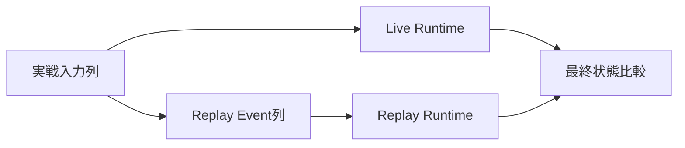

# テストプログラミング設計

## 概要

テストは、`game-core`の純粋計算、Component境界をまたぐ結合、PRNG再現性、GuildBattle Replay、障害復旧を分離します。仕様未確定事項を期待値として固定せず、同じ入力・Seed・Versionから同じ結果を得ることを最優先にします。

## 論理配置

```text
tests/
├── integration/
│   ├── account_session/
│   ├── guild/
│   ├── arena/
│   ├── guild_battle/
│   └── coordinator/
├── reproducibility/
│   ├── arena/
│   ├── guild_battle/
│   ├── ability_skill/
│   └── tactics/
├── replay/
└── failure/
```

`game-core`内部の単体テストは各Module内へ置いて構いません。上記は責務区分を示す論理配置です。

## 単体テスト

**全独自crate / Applicationで単体テスト必須**とします。Game / Server / Client / Pipelineを例外なく対象にし、AI生成コードも実装変更と同時にテストを追加します。共通計算は`../game/deterministic_contract.md`と各詳細設計の入力・出力・Error契約に基づき、成功・境界・失敗・再現性を検証します。API/DB/Browser Adapterの単体テストはStubで非同期I/O失敗、Cancellation、Timeout、Error変換、非同期Workerの容量超過を確認します。デバッグ以外のstdoutへの直接出力と、実行経路のpanic/unwrap/expect等は静的検査でも拒否します（テスト内assertは許容）。

CIでは`cargo fmt --check`、`cargo clippy --workspace --all-targets -- -D warnings`、`cargo test --workspace --all-targets`を基本とし、WASM Clientの対象端末/ブラウザ側テストを別途行います。第三者依存の必要な通知、MIT `LICENSE`とSecret非混入も公開前に確認します。

実装レビューでは`../implementation_rules.md`に従い、ゲーム規則等のマジックナンバー混入、コメントが処理の言い換えや一時メモになっていないこと、計算ロジックに実際の計算式（演算順序・丸め・Clampを含む）がコメントとして記載されていることを確認します。100行以上の関数は原則不適合とし、分割不能または分割によって可読性を損なう場合に限り、その根拠と単体テストを確認します。

外部I/Oを伴わない処理を対象にします。

### 数値・戦闘

- 入力Error時の正本状態/PRNG非変更と、GameServer・Clientでの同一結果検証
- Damage計算
- Skill Damage
- HP / BP / TP Clamp
- PartyRank
- Skill対象選択
- Ability発動条件・発動回数
- 双方に生存者がいて全員昏睡の場合, 行動なしの強制経過ターンで昏睡の経過ターン・解除判定・ターン数が進み, 攻撃・スキルの乱数は消費しないこと
- 同じターンに複数キャラクターの状態異常解除候補が存在する場合, フォーメーション内部番号→PlayerID→固定陣営順で処理し, 同Seedの解除結果とPRNG最終状態が一致すること
- 打属性2x2の命中数同点時は攻撃キャラクターの列を起点に決定し, 中央列から左右両方が候補となれば左＋中央列を選ぶこと（範囲選択時に乱数を消費しない）
- Tactics段階効果・終了条件
- Castle Break確率
- GuildBattle Score
- GuildBattleID生成
- CB専用Abilityのキャラクター別・効果種別別に各1回の判定と攻撃力UP/ダメージUPの独立成立
- CBイベント種別とキリ番専用Tacticsの適用条件・スコア計算フロー
- チェイン残り時間（ミリ秒）の0～300000 clampと5分ちょうど境界

IEEE-754 32bit浮動小数点として、仕様に記載された演算順を変えずに期待値を評価します。代数的に同値な別式への変形を前提にしません。

### PRNG

- `Random::new`
- `next`
- `next_u32`
- `next_bounded`
- Shuffle
- 重み付き抽選
- Seed生成

固定Seedに対する乱数列を検証し、PRNGを使わない処理で状態が変化しないことも確認します。

### Validation

- Version比較
- Arena / GuildBattle編成
- MasterData
- Skill Effect × Target Range
- Ability Effect × Condition × Target
- Tactics Battle Special許可組合せ
- Wire `uint32`から内部`u8` / `u16`等への範囲変換

## API通信・認証の結合テスト

- Public・Private・Control RPCのPath、Allowlist、HTTP Method、Protobuf wire schema、固定長・ID予約値・enum範囲、Error境界を確認する。
- Public APIのCORSは静的Client Originに限定し、CookieをCross-Origin送信しない。認証Originの第一者Cookie、Origin照合・CSRF token照合を確認する。
- ClientのCallback URI完全一致、PKCE S256・state検証、60秒失効、単回交換、同時交換の排他、コードやAccessTokenをURLへ残さないことを確認する。
- Stream切断時は現在値取得後に再購読する。認証期限切れ時・30:00終了時・Retry上限30秒を検証する。

## Client動作テスト

### Server未接続・認証不可時の機能判定

- Clientの機能を, 実行にServer通信と認証が必要な機能, 端末内で完結する機能に分けて試験します。通信必須機能だけが利用不可となり, **通信不要の機能すべてが使用可能であること**を合格条件とします。
- Serverを未接続にした状態とログイン不可の状態をそれぞれ用意し, サーバー側状態の取得・更新や戦闘結果の確定を行う操作が制限されることを確認します。接続・認証が回復した際には, 制限された機能が利用可能に戻ることを確認します。
- Server通信に依存しない画面遷移（必要アセット検証済みのタイトル⇔ホーム, アセット追加・クレジットからタイトルへの復帰）とタイトル上のローカル操作（キャッシュクリア, 保存済みアセット削除, クレジット表示）はServer未接続・ログイン不可でも使用できることを確認します。新規アセット取り込みも未ログインで手動指定により利用でき、Login後は取得済み辞書との照合・確認付き配置変更を実行できます。
- OPFS内の素材の選択・保存・削除, `./cache/`の消去, 同梱ライセンス情報の表示など, Server通信を必要としない端末処理についても利用可能であることを確認します。ただし外部の辞書の新規取得など通信を要する部分は, ローカル機能の合否に含めません。
- Server未接続の試験は, 必要なブラウザAPIが使用でき, 保存域が利用可能な条件で行います。別条件としてOPFS容量不足によるゲーム操作制限・容量不足表示・アセット削除の継続利用を検証します。

### 画面・入力・アセット・音声

- タイトルからログイン画面へ遷移し、認証成功時も有効辞書・検証済み代替画像の共通検査合格後にだけホームまたは初期騎士団作成画面へ進み、キャンセル・拒否時はタイトルへ復帰できることを確認します。未ログインでも同じ検査合格時はホームへ移動でき、Server通信不要の機能を操作できることを確認します。
- 有効なアセット辞書と検証済み代替画像が揃っている場合だけタイトルからホームへ遷移し、ホームからタイトルへ復帰できることを確認します。欠落時は未ログインでも遷移拒否し、ローカルの素材取込みは維持します。
- 「アセットの追加」から専用シーンへ遷移し, PNG/HCAの個別およびディレクトリ一括取り込み, `./assets/`への保存, 戻る操作を検証します。
- アセット辞書は元ファイル名の完全一致を第1段階とし、同名候補で`path`が空の場合だけ内容SHA-256と`paths`オブジェクトを照合する。一意な`path`が非空なら内容Hashを不要とし、キャッシュ内一時取込・未一致保留・一致素材のOPFS `./assets/`確定保存を検証する。辞書未取得など通信依存部分は別に検証します。
- 辞書に一致しない素材の区分選択, 既存Pathの上書き確認, 複数件の一括上書き・キャンセル, 素材の個別・一括削除, `./cache/`だけを消去するキャッシュクリアを確認します。元ファイルの「移動」は削除APIと権限のある環境でのみ行い, 未対応環境ではコピーを提供することを確認します。
- `createImageBitmap()`によるPNGのデコードとWebGL 2へのテクスチャ転送, 描画, `PointerEvent`によるタップ/マウス操作を確認します。画面比率・回転・Safe Area・入力座標は`design/client/web_application.md`に従って検証します。
- タイトルのクレジットからライセンス全文をスクロール閲覧し, 戻るボタンでタイトルへ復帰できることを確認します。Clientに同梱する`cargo-about`生成物とRust以外の必要表記も含め, Server通信なしに表示できることを検証します。

### Cloudflare Pages・オフライン・更新・アプリ表示

- Cloudflare Pagesへ配布するHTML/JavaScript/WASMの各ファイルを非圧縮bytesで個別検査し、各ファイル`25,000,000` byteは合格、`25,000,001` byteは不合格とする。複数ファイルの合計が25MBを超えても合格とし、分割JS、認証Callback HTML、Service Worker JSにも同じ単一ファイル制限を適用する。Cloudflare Pages自体の25MiB上限も検証し、PNG/HCA等の後続取得素材はプログラムのサイズ判定に含めない。
- 初回オンライン起動でOPFS `./game/`へプログラム一式が保存され、SW Cache Storageに同一Versionの起動静的ファイルが存在することを確認する。ネットワークを完全に遮断した状態でPWAを終了・再起動してHTML/JS/WASMとクレジット画面を表示できること、API必須機能をオフラインで成功扱いしないことを確認する。SW未制御/ストレージ消去時はオフライン起動不能を明示する。
- 更新時は`./game/`配下の旧ファイルが全量削除され新Versionの一式に置換される一方、`./assets/`・`./settings/`は保持されることを検証する。容量不足・更新途中の通信断・ブラウザ強制終了時には旧Versionで起動し、SWのActive CacheとOPFS `./game/`が混在Versionにならないことを確認する。更新中はキャッシュクリア・別更新操作を禁止する。
- Cloudflare Pagesの`client_origin`と認証Callback `<client_origin>/auth/callback/`・APIの許可Originが一致することを確認する。
- PWAで`display: fullscreen`および`orientation: landscape`を希望値として設定し、許可環境で全画面・横画面固定が適用されることを確認する。固定API非対応・拒否・通常ブラウザタブでの全画面拒否時でも既存の縦画面・可変レイアウトで動作し、画面外へのUI欠落がないことを確認する。

### ブラウザ実装・アセット・音声の検証

- iOS 16.3 / Safari 16.3, Android 8.0 / Chrome 120を下限の組合せとして扱い, 当該組合せでPWAのインストール・ホーム画面起動・ブラウザAPI利用・Clientの実行を確認します。
- `wasm32-unknown-unknown`を対象に依存を解決し, `Cargo.lock`固定後に`cargo tree --target wasm32-unknown-unknown`および`cargo build --target wasm32-unknown-unknown --release --locked`を確認します。`wasm-bindgen`生成ES ModuleとWASMのブラウザ起動を検証します。
- iPhone Safari/PWAおよびAndroid Chrome/PWAで, PNG/HCAのファイル・フォルダ取り込み, 辞書取得（Login完了時）, OPFSへの保存, 上書きと削除, `game_info.json`の現在Version形式を検証します。ブラウザの容量不足・保存失敗も別条件として検証します。
- `createImageBitmap()`からWebGL 2テクスチャへの転送と描画を確認し, 不要な画像の`ImageBitmap.close()`・`deleteTexture()`による資源解放を確認します。
- キャラクターのスプライト構成、ボーンと表示データの対応、モーション内のボーンタイムラインとフレームの順序、表示Index・座標・補間・色・ブレンド情報の保持、およびイベントに応じたアニメーション描画を確認します。データ型とフィールド番号は`design/system/sprite_animation.proto`に従います.
- アトラスデータのフレーム識別名、切り出し矩形、オフセット、元画像サイズ、テクスチャ参照値の読み取りと保持を検証します。各データ型・フィールド番号は`design/system/plist.proto`に従います。
- 40キャラクターと代表的エフェクトをWebGL 2で描画し, 開始10秒を除外した連続60秒の平均FPSが30以上かを測定します。GPU利用率とブラウザ全体のRAM消費は合否判定に使用せず, 可能な場合に参考値として記録します。
- HCA→PCMデコード後のWeb Audio再生を確認します。選定候補`cridecoder`のWASMビルド, iPhone Safariにおける再生とピークメモリの合格を最終採用条件として個別検証します。
- 短いSE・ボイスの`AudioBuffer`再利用, 長いBGM・ボイスのPCM逐次供給（`AudioWorklet` / `MessagePort`）, 長尺音声を全体PCM展開せず再生することを確認します。
- 22,050Hzの対象HCA, `./assets/sound/bgm/`（ディレクトリ境界と大文字小文字を区別し、配下のサブディレクトリを含む）HCAの全体ループと非BGMフォルダHCAの非ループ, 左右2チャンネルのステレオ再生, SE同時最大5, 欠音・遅延を検証します。長尺音声のPCM先読み初期500ms/残量250msを用い, `AudioWorklet.process()`内でHCAデコードや大容量確保を行わないことを検証します。
- GPUテクスチャ, デコード済みPCM, WASMヒープ, ブラウザ一時メモリを分けて観測します。iOS端末での長時間騎士団戦における強制再読込の有無を確認します。
- CIで`cargo build --release --locked --target wasm32-unknown-unknown`を実行し、配布HTML・JavaScript（Service Worker/分割JSを含む）・WASMの各ファイルの非圧縮サイズが25,000,000 byte以下であることと、Cloudflare Pagesの単一ファイル25MiB制限を検証します。合計サイズは制限しません。Client依存ライセンスの生成・同梱・表示も検証します。

#### ローカルファイルと通信失敗境界の追加テスト

- 取得辞書に絶対Path・親ディレクトリ参照・URL・制御文字がある場合、`assets/`外へ書き込めないことを検証する。
- 一括取込みの保存失敗・キャンセル時に既存ファイルを破損させず、完了分だけ残ること、素材削除後に参照が無効化されることを確認する。
- オフラインでもCache済みクレジット本文が閲覧できることを確認する。

## Public API通信

- ClientとPublic API Server間のHTTP/2 over TLS 1.3, Protocol Buffersの送受信, `SubscribeGuildBattleUpdates`のvarint長prefix付きResponse streamを検証します。Public API通信にWebSocketを使用しないことと, 実際のHTTP/2/TLS 1.3の接続ネゴシエーションを確認します。
- Cross-Site配布時はCookieを必要とするLogin/Refresh/Logoutを認証Originのトップレベルページで実行し, `SameSite=Strict`第一者Cookie, 一度限りの認可コード・PKCE S256, コード再利用拒否, 戻り先URIの完全一致, 許可Origin限定CORSの各条件を確認します。これらはPublic APIを使用する結合テストで確認します。

## 結合テスト

実Application境界の契約を対象にします。

### Account / Session

- Account + Player同一Transaction作成
- Login
- AccessToken発行
- Refresh rotation
- concurrent refreshで1件だけ成功
- previous token再利用時のSession削除
- Logout
- Discord Role喪失Session revoke
- AccessTokenがLogout後も`exp`までは署名上有効という仕様

### Guild

- Join申請・承認
- Invitation・承諾
- Leave / Guild移動
- Leader / Subleader更新
- 20人上限をTransaction内で再確認
- `membership_locked=true`時の変更拒否

### Arena

- Party登録からBattle開始
- ClientVersion mismatch
- 自身Arena Party未登録
- Friend対象Player不存在とParty未登録のError分離
- Server編成とClient編成同期
- Random候補にPlayerID `0`を含めない

### GuildBattle Lifecycle

- `scheduled -> preload_failed`
- `scheduled -> in_progress`
- `in_progress -> resolving`
- `resolving -> completed`
- 未許可遷移拒否
- Owner mismatch拒否
- `RetryPreloadFailedGuildBattle`
- Retry時, 旧IDを`replaced`, 新IDを`scheduled`で保持し, 開戦予定時刻とマッチング枠を別に持つこと
- 中止時, `CancelPreloadFailedGuildBattle`で`canceled`へ遷移させ, 終端状態と未完了状態の混在を判定すること
- `BP`の`u16`境界値255/256/500/65535とwire`uint32`入力の範囲検査
- `SortieScore`は`f32`, guild合計`Score`は`u64`で, 端数のある複数出撃結果を加算する場合に合計加算時だけ切り捨てること
- 城防御補正が`parameters.castle_level`を1度だけ参照すること
- `RematchPreloadFailedGuildBattles`
- 同一開始時刻の複数対戦中, 最初のCompletedでは除外Guildを解除せず, 最後のCompletedでのみロック解除・除外一覧削除（並行Completeを含む）
- `SubscribeGuildBattleUpdates`の初回スナップショット・所属基準の両Guildスコアとチェイン/残り時間・複数購読者への配信
- 出撃Replay EventのDB COMMIT（Recovery中はJournal耐久保存）を確認してから出撃Responseを送信すること。Response後の出撃後効果・同EventのReplay File追記・更新通知を、次要求処理前に完了すること。永続化失敗・結果不明時に成功Responseを返さないこと。
- チェイン時間経過リセットではPushしない, 通信断後はGetGuildBattleStatusの値へ再同期する
- 開戦30:00の購読正常終了と, 30:00以前のキュー待ちPlayerだけ処理完了後に終了する分岐

### Coordinator

候補選択順を次の順序で検証します。

1. ready
2. AvailableGuildBattleThreadCount降順
3. Thread使用率昇順
4. LastAssignedAt昇順
5. GameServerInstanceID昇順

未割当`scheduled`の再割当、Endpoint消失時のassigned scheduled再割当、`in_progress`を自動再割当しないことも確認します。

## 再現性テスト

### Arena

同一の以下からClient側とGameServer側で最終状態が一致することを確認します。

- Version
- MasterData
- 初期状態
- Seed

### GuildBattle本体PRNG

- 同一InitialSeedと同一成立Event列でPRNG状態が一致します。
- 初回Joinごとに成立順で1回だけ消費します。
- 再Joinでは消費しません。
- 出撃用Random生成・対象抽選の消費順が一致します。

### Battle

- Skill target random
- Ability同順位random
- Formation競合random
- Character selection
- Damage random

仕様で候補順序が固定されている箇所は、その順序も期待値として検証します。

### GuildBattle殲滅のClient/Server一致

`GuildBattleAnnihilationResponse`の`OwnCharacters`, `EnemyCharacters`, `EnemyPlayerID`, `EnemyFormationID`, `BattleTacticsEffects`, `Seed`とJoin時同期済み編成を同一入力として, Client/Serverの戦闘中の選択・最終HP・計算結果が一致することを検証します。最大HP依存回復, 効果持続, PlayerIDによる候補順についても検証し, Clientの直前表示HPを戦闘入力に使用しないことを確認します。

### Tactics

- Random要素ありでGuildBattle本体PRNGを1回だけ消費します。
- 取得SeedからTactics専用PRNGを生成します。
- 以後GuildBattle本体PRNGをTactics固有抽選へ使用しません。
- Random要素なしでは本体PRNG状態を変更しません。
- Seed値が`0`でもMasterData上Random要素ありならRandom利用として扱うロジックを検証します。

## Replayテスト



最低限以下を比較します。

- Guild Score
- Player HP
- BP
- TP
- Chain
- Active Tactics状態
- Item残数
- 勝敗結果

追加で以下を検証します。

- 最初のEventがCreate
- InitialSnapshotだけから開戦時可変状態を復元
- length-delimited Protocol Buffers読込
- `process_type`と`oneof`一致
- Join Eventで本体PRNGを1回消費
- Replay時に現在DB可変値を使わない
- Replay Versionに対応するgame logic / MasterDataを使う

## RequestSequenceテスト

Player単位で以下を確認します。

```text
初回Join -> random sequence
成功操作 -> +1
失敗操作 -> 変化なし
GetGuildBattleStatus -> 変化なし
再Join -> 現在値返却、PRNG消費なし
```

他Playerとの同値Sequenceをエラー扱いしません。

## DB冪等性テスト

同一Operation IDで次の順に実行します。

1. 初回更新成功
2. Response消失を模擬
3. 同一Operation IDでRetry
4. Domain更新が1回しか適用されないことを確認
5. 初回成功Response相当が返ることを確認

Recovery fileからの再送でも同じテストを行います。

## 障害テスト

- Preload中1 Player取得失敗で対象Battleだけ`preload_failed`
- 他Battle継続
- Scale要求失敗時は未割当`scheduled`維持
- DB送信1回失敗後、同一要求を1回Retry
- Retry可能な一時障害の1回Retry失敗、明示的確定失敗または合計5秒経過でRecoveryへ移行
- Recovery再送でOperation ID維持
- GameServer再起動後のRecovery scan / resend
- DBへの全件再送成功だけでRecovery Recordを削除せず、各EventのDB確定・Replay File反映・v2署名/連鎖検証を確認してから該当Recordを削除
- `CompleteGuildBattle`失敗時の全体Rollback
- Coordinator再起動後のDB Reconcile

## Queue / Logテスト

### System Log Queue

- boundedであること
- DEBUG / INFO drop時にMetric加算
- WARN / ERROR優先領域
- Credential redaction

### ReplayQueue

- boundedであること
- Eventをdropしないこと
- 満杯時Backpressure
- State / RequestSequence更新後にenqueueされること
- enqueue順が成立順と一致すること

## MasterData Pipelineテスト

- Parse
- Normalize
- Validation
- ProcessedMasterData生成
- DB fixed data生成
- Cross Check
- Character / Skill / Ability / Tacticsの同一Normalized source由来一致
- 未定義Effectへ値を補完しないこと

## Regressionルール

仕様変更により確定挙動が変化した場合、対応するテスト期待値も同じ変更単位で更新します。

仕様に記載されていない挙動について「現在の実装結果」をRegression期待値として固定しません。

## 参照資料

- `design/test/test_policy.md`
- `design/game/battle.md`
- `design/game/pseudorandom.md`
- `design/game/master_data_pipeline.md`
- `design/server/guild_battle.md`
- `design/server/guild_battle_coordinator.md`
- `design/server/guild_battle_lifecycle.md`
- `design/server/data_base.md`
- `design/server/session.md`
- `design/system/log.md`
- `design/system/guild_battle_replay.proto`
- 添付`rust_wasm_png_hca_library_selection(1).md`（2026-10-09）, 第1～7節.

## 更新仕様の確認

- 酒場使用回数がPlayerごとに最大3回で互いに独立すること、2時間経過ごとに1回分補充され、最大3で止まり、日付切替時の一括リセットがないことを検査する。
- 行動順が速度レベル昇順であること、`EVERY_N_TURNS`はターン0で発動しないことを検査する。
- ランダムアリーナ候補は毎回DBから取得し、GameServer候補キャッシュを使用しないことを検査する。
- Characterの順序意味を持たない関連ID配列はID昇順に出力することを検査する。
- 施設強化はGuild所属Playerが1操作で1Lvのみ上げ、必要ゴールドだけを消費すること、所持不足と最大Lvが専用Errorになることを検査する。
- ClientはLogin直後にDB保存Arena/GuildBattle編成を取得し、失効時にはローカルモードへ戻ることを検査する。
- ReplayのEvent番号はGuildBattleIDごとにCreate=1から連続し、DB/File片側欠損の復旧、同番号異内容の拒否を検査する。出撃は非同期WorkerによるDB COMMIT確認後にだけ成功Responseを返し、直後にServerが終了しても再起動時にReplayからScore等を復元する。現段階はPlayer向けReplay一覧/取得を拒否し、GameServer内の保存・検証を継続する。
- 開始時刻変更は団長のみ許可し、翌JST 0:00適用となることを検査する。

## フレンド・プロフィールとスプライトアニメーション

- 新規Playerの参加回数・勝利数・累計騎士団スコアが0であること、出撃成立0/1/2/3回で参加回数が0/0/0/1増え、1回以上で勝敗数が更新され、同一対戦で二重加算されないことを検証する。スコアの型はu64とする。
- 騎士団メンバーからのプロフィール表示、申請送信、ホーム通知への表示、承認による相互フレンド化、拒否による申請削除と拒否通知なし、Arenaのフレンド名一覧取得を検証する。ホームからのフレンド一覧遷移、本人による解除、双方の一覧更新を確認する。同方向再申請への申請済み応答、逆方向同時申請の許容、片方向承認後の他方操作に対する既にフレンド応答を検証する。
- ファイル名の拡張子を除く部分で`A-Z`・`a-z`・`0-9`・`_`・`-`・`(`・`)`以外を拒否し、元の大文字小文字を変えずに辞書照合することを確認する。
- 必須画像の欠落・読込失敗、未知フィールド値・必須構造欠落によるアニメーション読込失敗時は、事前に用意した画像へ切り替えて当該アニメーションを再生しないことを確認する。
- 個人スコアは対戦終了時に未切り捨て合計を1回切り捨てて`u64`で累計へ加算し、`u64::MAX`を超える場合は飽和させる。出撃ごとの切り捨てとは独立させることを検証する。
- スプライトアトラスの矩形・トリミング余白・元画像サイズ・無回転/時計回り90度格納の復元および未知・反時計回り指定の拒否、ピボット、ボーン親子成分継承、離散display_index、Z順、フレーム間補間・loop/停止を`design/client/sprite_animation_runtime.md`に照らして検証する。未知のフレームIndexや循環する親参照を正しく扱う。
- `kX`が変換行列の第2列、`kY`が第1列に作用することを、`kX`と`kY`が異なる姿勢で検証する。負倍率・非一様倍率・傾きが共存する親子ボーンについて、親行列と子行列の単純な積ではなく、位置変換後の倍率乗算・傾き加算からワールド行列を再構成した結果と一致することを確認する。スキン行列は完成したボーンワールド行列へ乗じる。
- アニメーションの論理60フレーム/秒、最終フレームの停止/ループ時の0への復帰、静止値とフレーム値の合成、画素Y下向きから骨格Y上向きへの変換、UVと画面の独立した座標変換を検証する。左右向き別の骨格・アトラスを使うキャラクターは、片側画像の左右反転ではなく、それぞれの参照データで描画する。
- 表示モーションは`design/client/character_motion_state.md`に従い、`attack`/`attack2`/`attack_in`/`attack_out`/`damage`/`dead`/`def_damage`/`def_wait`/`entry`/`escape`/`flatline`/`landing`/`run`/`skill_all`/`skill_in`/`skill_out`/`wait`/`win`の18名称を検証する。`def_damage`・`entry`・`skill_all`の役割は推定であり、根拠のない自動遷移を追加しない。
- 待機選択時は`wait`/`def_wait`/`flatline`の分岐と通常条件の`wait`フォールバックを確認し、未確定な条件を特定の状態異常ID・防御ルールへ決め打ちしない。`runTo`/`runExecute`要求時の`run`再生と、移動後に無条件で待機へ戻さないことを検証する。
- `attack`と条件付き`attack2`がそれぞれ再生完了イベントで攻撃処理完了へ進むこと、および完了後の待機復帰は呼出元の次アクション指示を必要とすることを確認する。`attack2`の判定式・確率や追加の攻撃モーション名を推測で固定しない。
- 前進側は`attack_out`再生→イベント種別`1`/`2`→跳躍移動→`landing`再生→イベント種別`1`/`2`→完了通知→待機選択へ進む。帰還側は`attack_in`→イベント種別`1`/`2`→跳躍移動→攻撃処理完了までで、`landing`・自動待機復帰を発生させない。
- 被弾処理の`damage`完了イベントと、条件付き`escape`完了コールバックから生死判定へ進み、生存時は待機選択、死亡時は`dead`へ進むことを確認する。`escape`の全再生で判定が必ず呼ばれるとみなさない。`dead`は関連アクション・エフェクトを停止し、未定義の死亡後自動復帰は追加しない。
- `useSkill`で`skill_in`を選択し、別途`endSkill`が指示された場合だけ`skill_out`へ切り替えることを確認する。`win`を勝利・回復・能力上昇・復活の演出で使用できること、`skill_out`/`win`の再生終了だけでは自動待機復帰させないことを検証する。
- 再生制御のイベント種別`1`/`2`は`FrameData.event_name`とは独立し、重複通知・古いモーションからの通知で跳躍移動・生死判定・完了通知が多重実行されないことを確認する。Client演出完了を`game-core`の計算結果・PRNG消費順に影響させない。
- 音源未配置またはデコードエラー時に無音とし、戦闘状態の確定を変更しないことを確認する。
- `game_info.json`のu32のmajor/minor/patch、前回値、初期値、不正な値からの再生成を確認する。

## 基本契約の整合テスト

- Friend ArenaはClientがフレンド一覧から選んだ場合でも、Serverで承認済みフレンド関係を要求時に再確認する。フレンド解除直後や任意OpponentIDの直接送信を検証し、未承認なら戦闘を開始しない。
- `GetGuildDetail`は時刻変更前の有効値と予約3フィールドを区別する。適用時刻到達後は現行値へ予約を反映し、予約フィールドを省略する。予約期間中の再変更でも最後の要求が適用される。
- 同時に複数タイマーが終了した場合、1種類ずつEnum順で通知され、Clientで対象種類だけ残り時間が0へ更新される。
- ログインから新規登録、認証後の初期騎士団作成要否判定、作成成功後のホーム遷移、応答喪失時の状態照会（重複CreateGuildを送らない）を検証する。
- `RespondFriendRequestRequest.approve`が欠落した場合はHTTP 400、明示的なfalseの場合は拒否操作として処理する。
- 拡張子と実体形式が異なるPNG/HCAは取り込まず、既存ファイルを上書きしない。静的配布の代替画像はユーザーOPFS素材なしでも表示可能にする。
- 複数アトラスで同名スプライトがあるとき、参照アトラスを限定できないものは曖昧として拒否する。

### 酒場・認可方式・DB障害の追補テスト

- 酒場ストック初期3→使用で2→2時間後3、連続3回使用後は2時間ごとに1回ずつ補充されることを確認する。追加使用が既存の補充予定時刻を延長しないこと、JST日付切替で補充されないことを検査する。
- 酒場Replay保存とDB Playerストックを同一COMMITで確定し、Operation ID重複とEvent Index重複でも二重減算しないことを検査する。
- 追加認可方式`DISCORD`/`POCKETBASE`/`NONE`でTokenの必要性・本人認証・Bindingを検証する。検証Adapter未実装の`OTHER`/`POCKETBASE`構成は起動拒否とし、追加認可を黙ってスキップしない。
- 確定失敗・Retry失敗・初回から5秒経過のいずれかで、その騎士団戦では以後DBへ送信せずJournalへ切り替える。Journal保存完了時だけ成功、保存失敗時は操作不成立、Battle終了後の一括再送は同一Operation IDで冪等となることを検証する。
- 辞書は元ファイル名を第1キー、`path`が空の場合だけ内容SHA-256を`paths`オブジェクトで照合し、一致しない素材が実行時に使用されないことを検査する。


## 回答反映後の境界試験

- `./config.cfg`のYAML既定値、更新停止、`latest`/固定tagのRelease選択、Release不存在・曖昧Asset・1回Retry・旧辞書復帰を検証する。
- 辞書JSONの`path`非空／空、`paths`のHash Object、非法Path、Hash不一致、元ファイル名の大文字/小文字、異なる同名ファイルを検証する。`./cache/temp/user_impoert/`→`./assets/`／`./cache/unknown_resouce/`の遷移を検査する。
- HCA 1ch→2ch複製、BGM専用フォルダに基づく全体ループ、鍵キャッシュ命中・旧鍵失効時再探索・復号失敗の無音を検証する。
- DB保存で一時障害→同一Operation IDの1回Retry成功、Retry失敗、明示的確定失敗、合計5秒TimeoutのRecovery遷移を検証する。
- Recovery Eventはファイル書込→fsync→atomic rename→directory fsync完了までは成功応答しない。部分一時ファイル・ハッシュ不一致は有効Eventとして扱わないことを確認する。
- GuildBattleごとのEvent Indexの順序確定、再起動時の終了済みBattleのみ再送、未完了Battleの保全、同一Operationの再送冪等性を確認する。
- 酒場では同一Playerからの同時要求が排他され、参照だけではDB行を書き換えず、2時間補充と成立消費が同一Transactionになることを検証する。
- `FrameData.display_index`の省略／明示0、時計回り90度格納、Characterの参照不足時の代替表示を検証する。

- タイトル「設定」から設定UIへ進み、配布`config.cfg`の上書き値とOPFS `config.cnf`の2つのトグルを保存・初期化できること。未登録名のアセットはoverride=trueでも使用できないこと。Hash衝突辞書に記載された候補Pathだけを明示選択できること。
- `allow_user_asset_override=false`で辞書一致の未配置Pathへ新規取込みは可能、同じ内容の再取込みは変更なし、**既存Pathへの異内容上書きは拒否**されること。`true`かつ確認操作がある場合のみ一意`path`方式の既存Pathへの異内容置換を許す。`paths`方式は設定ON・利用者確認があっても対象候補Hashと内容SHA-256が異なる新規取込み・上書き・候補Path手動選択を拒否すること。未登録ファイル名/Path・形式不正は設定ONでも拒否すること。一意`path`方式で配布元内容Hashを検証したと扱わないこと。
- Releaseの`asset_dictionary.json`に対して、同Releaseにある小文字SHA-256値をファイル名にした検査値AssetとのRaw Bytes照合を確認する。欠落・曖昧・不一致では旧Generationを保護する。`verify_asset_dictionary_sha256=false`で照合を省略してもSchema/Path検証を行う。
- ユーザー提供PNG/HCAのHashとClient描画構造からの画像参照の一括検証、既存ファイルの退避・切替失敗時ロールバック、再起動時の参照再解決を検証する。永続Manifestは使用せず、辞書未掲載の素材はRuntime使用不可とする。
- BGMの判定境界は`./assets/sound/bgm/`の大文字小文字・ディレクトリ区切りを区別し、サブフォルダは含める。
- Replay記録のv2 Canonical `event_bytes`/`record_bytes`を正本とし、固定したRaw EnvelopeとPrivate RequestのByte列、`prev_event_hash`/`event_hash`、`record_hash`およびEd25519署名を照合する。JSONのキー順序や再シリアライズ結果に署名を依存させず、Byte列1byteの改変・長さ違い・署名/鍵ID不一致を拒否すること。v1記録を生成・受理しないこと。

### 今回確定した境界条件

- `GetAdditionalAuthorizationConfig`で`DISCORD`/`POCKETBASE`/`OTHER`/`NONE`の表示を切り替え、認可Tokenの要否はServerが決める。未実装Adapter起動拒否と、Config取得失敗時に無認可へフォールバックしないことを確認する。
- Recovery移行中の`UseTavernRecovery`は拒否され、Playerの残ストック、RequestSequence、BP、Replay Eventが変化しないことを確認する。
- 出撃は永続化成功→Response→後処理の順、通常Eventは仮状態の評価→ReplayQueueでEvent番号とOperation IDの予約→専用Workerの署名付きWAL耐久保存完了→RuntimeとRequestSequenceの確定→成功Response→DB/Fileの非同期保存であることを確認する。通常Eventの署名付きReplay WAL耐久化→成功Response→DB非同期COMMITを検証する。WAL未確定Eventには成功応答を返さない。再起動後の署名・順序検証と重複適用拒否を確認する。
- `asset_dictionary.json`がないRelease/複数あるRelease/不正JSON/誤Path/途中ダウンロード失敗を受けても前Generationが維持されること、ログイン失敗時も手動素材取り込みが可能なことを確認する。
- 同名・内容違いのHCA鍵は混用されず、誤鍵キャッシュは探索へ戻す。BGMフォルダだけがループし、設定JSONの有無では挙動を変更しない。キャッシュクリアで辞書、保留割当、鍵探索キャッシュが消えることを確認する。
- Replay Recovery記録のPayload改変、署名/連鎖Hash不一致、DB側との同一番号異Payloadは自動適用せず隔離する。
- Recovery JournalはDB再送だけが成功した段階では残し、DB正本からReplay Fileを補修して反映・v2署名/連鎖検証を完了してから該当レコードを削除する。署名不正・DB/File不一致・File書込失敗時には自動削除しないこと。


- Itemは開戦時のCreate Snapshotを単一Ownerの対戦内初期残数として扱い、Join再送で再取得や予約をしないこと。`UseItem`は認証・RequestSequence・ItemID・Battle残数を検証し、WAL確定後に低遅延で成功し、後追いDB Transactionで`PLAYER_ITEM`減算とReplayが一度だけ確定すること。進行中Battle対象Playerの通常`UpdatePlayerItem`は拒否すること。開戦時DB在庫とSnapshotが不一致ならBattle開始を拒否すること。

## 回答反映後の境界テスト

- Recovery Replayの1件再送が失敗する場合、`CompleteGuildBattle`を発行せず`resolving`を保持すること。全件の署名・Hash鎖・Event Index・DB確定が成功した場合だけ完了要求すること。
- 通常Eventは受付→仮状態/番号予約→署名付きWALの耐久保存→Runtime/RequestSequence確定→成功応答→DB非同期保存の順となること。WAL書込・fsync・署名/空き容量に失敗した場合、PRNG/残数/RequestSequenceとEvent番号を進めず成功応答しないこと。
- 初回`JoinGuildBattle`は作業PRNGで初期Sequenceを仮決定し、v2 WALが耐久化してからJoin状態・PRNG・Sequenceと成功Responseを確定すること。再JoinはPRNGを消費せず、WAL失敗時は初回Join成立・成功Responseが発生しないこと。`UseTactics`・`Start/Cancel/CompleteHeal`・`Start/Cancel/CompleteRevive`も仮状態→ReplayQueue予約→WAL耐久化→正本確定→成功Responseの順とし、WAL障害時のTP/BP/HP・継続効果・待機時間・PRNG・Sequence不変更を検査すること。
- Item使用では対戦内Snapshotの残数を仮減算し、WAL確定後にのみ表示残数と成功応答を更新すること。`SaveGuildBattleItemLog`がSnapshotと先行Item Eventの数量連続性を再検証し、後追いTransactionでDB残数減算・Replay Eventを同時確定すること。Private APIでのRetryは同じOperation IDで二重消費しないこと。酒場利用はDB即時Transactionのまま、Recovery中には拒否すること。
- WAL/Journal跨ぎの鍵ID変更・連鎖Anchor不一致・途中Event削除・同一番号異Payload・署名不正を検出し、DBの確定値を上書きせず隔離すること。GameServer異常終了後、未確定Battleを無条件にcompletedへ遷移しないこと。
- BGM専用フォルダのHCAだけが音源全体ループし、その他の音源は非ループとなること。`hca_config.json`の存在有無で再生方法を変更しないこと。
- `SpriteAnimationData`・`PlistRoot`・参照PNGの端末内セット取り込みはPublic/Private RPCを呼ばず完結すること。壊れたFrame 1件でセット全体を拒否し、独立した正常セットは維持すること。Armature重複、Skin選択、`content_scale`、Atlas省略値を個別確認すること。
- ローカル`config.cnf`の既定値は辞書SHA-256照合ON・素材代替OFFであり、明示操作でのみ照合省略・**辞書登録名に限る**素材差替えを行えること。未検証時でもサイズ/構造/Path検証を省略しないこと。
- 表示モーションの取消済みコールバックで二重通知しないこと。`attack2`を恣意的に選ばないこと。演出引数不足時に既存戦闘結果を変更しないこと。

### Replay WAL/Journal・DBの媒体非依存Event Hash検証

- Create Eventの`prev_event_hash`がゼロ32byteであり、`StartGuildBattle`の初回Replay行と`GUILD_BATTLE_REPLAY_ANCHOR(1, event_hash)`が同一DB Transactionで確定すること。直後のDB先行出撃とWAL通常Eventの`event_hash`が媒体に依存せず直前のEvent Hashを連鎖すること。
- 通常EventのWAL fsync/rename/親ディレクトリ同期完了後は、DB Workerが先行EventのCOMMIT待機中でも順序を保ち後続Eventの成立応答が可能であること。後続DB COMMITは先行DB COMMITを追い越せないこと。WAL不成立ではPRNG・RequestSequence・Event Indexを確定しないこと。
- WAL→Journalで同一署名RecordをByteコピーしてもIndexと`event_hash`が変わらないこと。DB先行Eventの結果不明で同一Operation IDのv2記録をJournalへ残しても二重Replay/Item消費が発生しないこと。
- 同一EventをWAL/Journal両方へ配置し、署名済みEvent Hash・Envelope・元Requestが一致すれば単一Eventとして照合されること。Record Hashだけが異なる新規署名・別内容・Operation ID衝突・Event Hash不一致は隔離すること。
- DBの`GUILD_BATTLE_REPLAY_LOG.(event_index,operation_id,prev_event_hash,event_hash)`と`GUILD_BATTLE_REPLAY_ANCHOR`が同一Transactionで更新されること。再送・同一番号/同一Operation IDの冪等成功と、番号欠落/異Payload拒否を検証すること。
- v2のCanonical Byte順序・長さ・UTF-8・Event Hash・Record Hash・Ed25519署名を検証し、1byte変更・鍵世代不一致・切断・署名不正を拒否すること。DB確定済みAnchorと一致しないローカルRecordは自動DB適用しないこと。
- 完全に失われた未耐久メモリQueueを「署名が正しい」という理由で復元できると扱わず、GameServer異常終了時の完全復元を必須にしないこと。

### Item使用の単一Owner方式とゲーム開始検証

- Join時にItem予約RPCが発生しないこと、GameServerが当該Battle以外のItem在庫をキャッシュしないこと、異なるGameServer間でItem残数を通信・同期しないことを検証する。
- Create SnapshotのItem数量を開戦時DBと照合し不一致なら開始拒否。対戦中は外部の`UpdatePlayerItem`を拒否し、Item使用の連続要求をOwnerが直列処理することを検証する。Clientから在庫数やBPを改変してもGameServer結果が変わらないこと。
- 成功したUseItemのWAL耐久後の応答と、非同期DBのReplay・在庫減算の同一Transaction／冪等なRetryを検証する。WAL失敗なら状態・Sequenceが進まず、同一Sequenceの重複は二重使用しない。DB反映不能時に最終結果を確定しないこと。
- 有効辞書・代替画像のどちらかが欠ければゲームプレイへ入れず、タイトルの取り込み・削除等は継続できること。未取得状態の空辞書を有効辞書に偽装できないこと。
- タイトル画面の全ゲームプレイ導線（未ログインホーム、ログイン成功後の遷移を含む）が共通アセット検査を通ること。辞書差分退避・構成素材入替・Clientプログラム更新・ロールバック中はローディングで全操作を無効にし、処理終了後だけ再開すること。未ログインの取込み保留はできても有効辞書なしでRuntimeに投入しないこと。
- 構成素材の取込みは永続Manifestを要求せず、辞書に許可された既存ファイルの退避・入替・起動後復元を確認する。

### 辞書更新・Item在庫の回帰検証

- `StartGuildBattle`のSnapshot在庫照合と`UpdatePlayerItem`が競合するとき、同一PlayerIDのDBロックで直列化される。更新先行ならSnapshot不一致で開始拒否、開戦先行ならその通常更新が409となり、双方成功で異なる在庫を確定しない。未Joinの通常Playerも対象とする。GameServer間同期APIは用いない。
- `./assets/`にProtoBufを置いたり、ProtoBufを起動時に`./assets/`から列挙したりしない。描画モデルはClientが利用できる構造情報または当該セッションの検証済み入力だけから選ぶ。セッション限りの構造情報を再起動で復元したと偽らず、参照が切れた明示選択は代替画像へ切り替える。CharacterID/向きの明示選択を`./settings/character_display_selections.json`から検証付きで復元し、削除・辞書変更で無効化する。全Action対応表は生成しない。
- 辞書Pathが`./assets/characters/a.png`ならまさにそのRoot相対Pathを使用する。`./assets/assets/characters/a.png`を作らず、接頭辞欠落、`..`、不正セグメントを拒否する。
- 辞書更新時、旧検証済み辞書GenerationによるPath→元名の逆引きが一意な場合だけ来歴を確証し、`paths`方式では現存バイト列のSHA-256も一致確認する。旧Generationの消失・破損、同Pathの複数元名候補、Hash不一致では内容やPathから元名を推測せず`./cache/obsolete_assets/`へ退避してRuntime使用を禁止すること。永続Manifestを追加しないこと。
- 構造モデル読込み入口はPNG/HCAの通常取込みと独立し、同梱モデル・セッション読込みモデルへ同一の構造Validationを適用すること。未対応形式はエラーとし、登録失敗で既存モデルを失わないこと。`structure_ref`の異なるモデルへの重複割当、差替え後の旧ID誤参照、再起動後のセッション限定モデル誤復元を拒否し、参照失効時に代替画像へ切り替えること。
- 辞書更新時は新旧PathだけでなくPathに紐付く元ファイル名・内容Hash条件を比較する。旧辞書にしかないPathに加え、Pathが共通でも新条件に合わない既存実ファイルを`./cache/obsolete_assets/`へ退避し、現行の許可Pathから外す。`path`一意では提供されない期待Hashの照合成功を捏造せず、`paths`条件では内容Hashの再計算を行う。適合済み共通Pathは保持する。中断時は旧辞書/旧素材へロールバックする。ローディング中は操作を無効化し、キャッシュクリアもできない。キャッシュクリア後は退避素材が消える。
