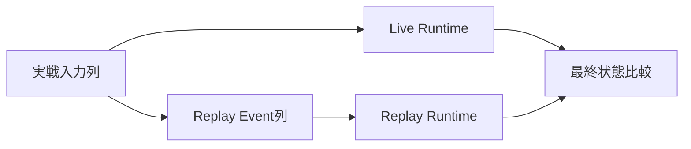

# テストプログラミング設計

## 概要

テストは、`game-core`の純粋計算、Component境界をまたぐ結合、PRNG再現性、GuildBattle Replay、障害復旧を分離します。仕様未確定事項を期待値として固定せず、同じ入力・Seed・Versionから同じ結果を得ることを最優先にします。

## 論理配置

```text
tests/
├── integration/
│   ├── account_session/
│   ├── guild/
│   ├── arena/
│   ├── guild_battle/
│   └── coordinator/
├── reproducibility/
│   ├── arena/
│   ├── guild_battle/
│   ├── ability_skill/
│   └── tactics/
├── replay/
└── failure/
```

`game-core`内部の単体テストは各Module内へ置いて構いません。上記は責務区分を示す論理配置です。

## 単体テスト

外部I/Oを伴わない処理を対象にします。

### 数値・戦闘

- Damage計算
- Skill Damage
- HP / BP / TP Clamp
- PartyRank
- Skill対象選択
- Ability発動条件・発動回数
- Tactics段階効果・終了条件
- Castle Break確率
- GuildBattle Score
- GuildBattleID生成
- CB専用Abilityのキャラクター別・効果種別別に各1回の判定と攻撃力UP/ダメージUPの独立成立
- CBイベント種別とキリ番専用Tacticsの適用条件・スコア計算フロー
- チェイン残り時間（ミリ秒）の0～300000 clampと5分ちょうど境界

IEEE-754 32bit浮動小数点として、仕様に記載された演算順を変えずに期待値を評価します。代数的に同値な別式への変形を前提にしません。

### PRNG

- `Random::new`
- `next`
- `next_u32`
- `next_bounded`
- Shuffle
- 重み付き抽選
- Seed生成

固定Seedに対する乱数列を検証し、PRNGを使わない処理で状態が変化しないことも確認します。

### Validation

- Version比較
- Arena / GuildBattle編成
- MasterData
- Skill Effect × Target Range
- Ability Effect × Condition × Target
- Tactics Battle Special許可組合せ
- Wire `uint32`から内部`u8` / `u16`等への範囲変換

## API通信・認証の結合テスト

- Public・Private・Control RPCのPath、Allowlist、HTTP Method、Protobuf wire schema、固定長・ID予約値・enum範囲、Error境界を確認する。
- Public APIのCORSは静的Client Originに限定し、CookieをCross-Origin送信しない。認証Originの第一者Cookie、Origin照合・CSRF token照合を確認する。
- ClientのCallback URI完全一致、PKCE S256・state検証、60秒失効、単回交換、同時交換の排他、コードやAccessTokenをURLへ残さないことを確認する。
- Stream切断時は現在値取得後に再購読する。認証期限切れ時・30:00終了時・Retry上限30秒を検証する。

## Client動作テスト

### Server未接続・認証不可時の機能判定

- Clientの機能を, 実行にServer通信と認証が必要な機能, 端末内で完結する機能に分けて試験します。通信必須機能だけが利用不可となり, **通信不要の機能すべてが使用可能であること**を合格条件とします。
- Serverを未接続にした状態とログイン不可の状態をそれぞれ用意し, サーバー側状態の取得・更新や戦闘結果の確定を行う操作が制限されることを確認します。接続・認証が回復した際には, 制限された機能が利用可能に戻ることを確認します。
- 通信に依存しない画面遷移（タイトル⇔ホーム, アセット追加・クレジットからタイトルへの復帰）とタイトル上のローカル操作（キャッシュクリア, アセット追加, アセット削除, クレジット表示）は, Server未接続・ログイン不可でも使用できることを確認します。
- OPFS内の素材の選択・保存・削除, `./cache/`の消去, 同梱ライセンス情報の表示など, Server通信を必要としない端末処理についても利用可能であることを確認します。ただし外部の辞書の新規取得など通信を要する部分は, ローカル機能の合否に含めません。
- Server未接続の試験は, 必要なブラウザAPIが使用でき, 保存域が利用可能な条件で行います。別条件としてOPFS容量不足によるゲーム操作制限・容量不足表示・アセット削除の継続利用を検証します。

### 画面・入力・アセット・音声

- タイトルからホームへ遷移し, ホームからタイトルへ復帰できることを確認します。
- 「アセットの追加」から専用シーンへ遷移し, PNG/HCAの個別およびディレクトリ一括取り込み, `./assets/`への保存, 戻る操作を検証します。
- ファイル名SHA-256の算出と二段辞書の照合では, 拡張子を含むUTF-8文字列と英字大小文字の区別, 同名複数候補の場合の内容SHA-256照合, 辞書Pathへの割り当て・OPFS保存・再読込みを確認します。辞書未取得など通信依存部分は別に検証します。
- 辞書に一致しない素材の区分選択, 既存Pathの上書き確認, 複数件の一括上書き・キャンセル, 素材の個別・一括削除, `./cache/`だけを消去するキャッシュクリアを確認します。元ファイルの「移動」は削除APIと権限のある環境でのみ行い, 未対応環境ではコピーを提供することを確認します。
- `createImageBitmap()`によるPNGのデコードとWebGL 2へのテクスチャ転送, 描画, `PointerEvent`によるタップ/マウス操作を確認します。画面比率・回転・Safe Area・入力座標は`design/client/web_application.md`に従って検証します。
- タイトルのクレジットからライセンス全文をスクロール閲覧し, 戻るボタンでタイトルへ復帰できることを確認します。Clientに同梱する`cargo-about`生成物とRust以外の必要表記も含め, Server通信なしに表示できることを検証します。

### ブラウザ実装・アセット・音声の検証

- iOS 16.3 / Safari 16.3, Android 8.0 / Chrome 120を下限の組合せとして扱い, 当該組合せでPWAのインストール・ホーム画面起動・ブラウザAPI利用・Clientの実行を確認します。
- `wasm32-unknown-unknown`を対象に依存を解決し, `Cargo.lock`固定後に`cargo tree --target wasm32-unknown-unknown`および`cargo build --target wasm32-unknown-unknown --release --locked`を確認します。`wasm-bindgen`生成ES ModuleとWASMのブラウザ起動を検証します。
- iPhone Safari/PWAおよびAndroid Chrome/PWAで, PNG/HCAのファイル・フォルダ取り込み, 辞書取得（Login完了時）, OPFSへの保存, 上書きと削除, `game_info.json`のバージョン差分移行を検証します。ブラウザの容量不足・保存失敗も別条件として検証します。
- `createImageBitmap()`からWebGL 2テクスチャへの転送と描画を確認し, 不要な画像の`ImageBitmap.close()`・`deleteTexture()`による資源解放を確認します。
- 40キャラクターと代表的エフェクトをWebGL 2で描画し, 開始10秒を除外した連続60秒の平均FPSが30以上かを測定します。GPU利用率とブラウザ全体のRAM消費は合否判定に使用せず, 可能な場合に参考値として記録します。
- HCA→PCMデコード後のWeb Audio再生を確認します。選定候補`cridecoder`のWASMビルド, iPhone Safariにおける再生とピークメモリの合格を最終採用条件として個別検証します。
- 短いSE・ボイスの`AudioBuffer`再利用, 長いBGM・ボイスのPCM逐次供給（`AudioWorklet` / `MessagePort`）, 長尺音声を全体PCM展開せず再生することを確認します。
- 22,050Hzの対象HCA, 辞書指定素材だけのループ, 左右2チャンネルのステレオ再生, SE同時最大5, 欠音・遅延を検証します。長尺音声のPCM先読み初期500ms/残量250msを用い, `AudioWorklet.process()`内でHCAデコードや大容量確保を行わないことを検証します。
- GPUテクスチャ, デコード済みPCM, WASMヒープ, ブラウザ一時メモリを分けて観測します。iOS端末での長時間騎士団戦における強制再読込の有無を確認します。
- CIで`cargo build --release --locked --target wasm32-unknown-unknown`を実行して非圧縮WASMサイズを確認し, 50MB超は最適化の検討契機, 500MB超はサイズ要件不合格として扱います。Client依存ライセンスの生成・同梱・表示も検証します。

#### ローカルファイルと通信失敗境界の追加テスト

- 取得辞書に絶対Path・親ディレクトリ参照・URL・制御文字がある場合、`assets/`外へ書き込めないことを検証する。
- 一括取込みの保存失敗・キャンセル時に既存ファイルを破損させず、完了分だけ残ること、素材削除後に参照が無効化されることを確認する。
- オフラインでもCache済みクレジット本文が閲覧できることを確認する。

## Public API通信

- ClientとPublic API Server間のHTTP/2 over TLS 1.3, Protocol Buffersの送受信, `SubscribeGuildBattleUpdates`のvarint長prefix付きResponse streamを検証します。Public API通信にWebSocketを使用しないことと, 実際のHTTP/2/TLS 1.3の接続ネゴシエーションを確認します。
- Cross-Site配布時はCookieを必要とするLogin/Refresh/Logoutを認証Originのトップレベルページで実行し, `SameSite=Strict`第一者Cookie, 一度限りの認可コード・PKCE S256, コード再利用拒否, 戻り先URIの完全一致, 許可Origin限定CORSの各条件を確認します。これらはPublic APIを使用する結合テストで確認します。

## 結合テスト

実Application境界の契約を対象にします。

### Account / Session

- Account + Player同一Transaction作成
- Login
- AccessToken発行
- Refresh rotation
- concurrent refreshで1件だけ成功
- previous token再利用時のSession削除
- Logout
- Discord Role喪失Session revoke
- AccessTokenがLogout後も`exp`までは署名上有効という仕様

### Guild

- Join申請・承認
- Invitation・承諾
- Leave / Guild移動
- Leader / Subleader更新
- 20人上限をTransaction内で再確認
- `membership_locked=true`時の変更拒否

### Arena

- Party登録からBattle開始
- ClientVersion mismatch
- 自身Arena Party未登録
- Friend対象Player不存在とParty未登録のError分離
- Server編成とClient編成同期
- Random候補にPlayerID `0`を含めない

### GuildBattle Lifecycle

- `scheduled -> preload_failed`
- `scheduled -> in_progress`
- `in_progress -> resolving`
- `resolving -> completed`
- 未許可遷移拒否
- Owner mismatch拒否
- `RetryPreloadFailedGuildBattle`
- Retry時, 旧IDを`replaced`, 新IDを`scheduled`で保持し, 開戦予定時刻とマッチング枠を別に持つこと
- 中止時, `CancelPreloadFailedGuildBattle`で`canceled`へ遷移させ, 終端状態と未完了状態の混在を判定すること
- `BP`の`u16`境界値255/256/500/65535とwire`uint32`入力の範囲検査
- `SortieScore`は`f32`, guild合計`Score`は`u64`で, 端数のある複数出撃結果を加算する場合に合計加算時だけ切り捨てること
- 城防御補正が`parameters.castle_level`を1度だけ参照すること
- `RematchPreloadFailedGuildBattles`
- 同一開始時刻の複数対戦中, 最初のCompletedでは除外Guildを解除せず, 最後のCompletedでのみロック解除・除外一覧削除（並行Completeを含む）
- `SubscribeGuildBattleUpdates`の初回スナップショット・所属基準の両Guildスコアとチェイン/残り時間・複数購読者への配信
- 出撃Response送信後に出撃後効果・Replay・更新通知, 次要求処理の前に後処理完了
- チェイン時間経過リセットではPushしない, 通信断後はGetGuildBattleStatusの値へ再同期する
- 開戦30:00の購読正常終了と, 30:00以前のキュー待ちPlayerだけ処理完了後に終了する分岐

### Coordinator

候補選択順を次の順序で検証します。

1. ready
2. AvailableGuildBattleThreadCount降順
3. Thread使用率昇順
4. LastAssignedAt昇順
5. GameServerInstanceID昇順

未割当`scheduled`の再割当、Endpoint消失時のassigned scheduled再割当、`in_progress`を自動再割当しないことも確認します。

## 再現性テスト

### Arena

同一の以下からClient側とGameServer側で最終状態が一致することを確認します。

- Version
- MasterData
- 初期状態
- Seed

### GuildBattle本体PRNG

- 同一InitialSeedと同一成立Event列でPRNG状態が一致します。
- 初回Joinごとに成立順で1回だけ消費します。
- 再Joinでは消費しません。
- 出撃用Random生成・対象抽選の消費順が一致します。

### Battle

- Skill target random
- Ability同順位random
- Formation競合random
- Character selection
- Damage random

仕様で候補順序が固定されている箇所は、その順序も期待値として検証します。

### GuildBattle殲滅のClient/Server一致

`GuildBattleAnnihilationResponse`の`OwnCharacters`, `EnemyCharacters`, `EnemyPlayerID`, `EnemyFormationID`, `BattleTacticsEffects`, `Seed`とJoin時同期済み編成を同一入力として, Client/Serverの戦闘中の選択・最終HP・計算結果が一致することを検証します。最大HP依存回復, 効果持続, PlayerIDによる候補順についても検証し, Clientの直前表示HPを戦闘入力に使用しないことを確認します。

### Tactics

- Random要素ありでGuildBattle本体PRNGを1回だけ消費します。
- 取得SeedからTactics専用PRNGを生成します。
- 以後GuildBattle本体PRNGをTactics固有抽選へ使用しません。
- Random要素なしでは本体PRNG状態を変更しません。
- Seed値が`0`でもMasterData上Random要素ありならRandom利用として扱うロジックを検証します。

## Replayテスト



最低限以下を比較します。

- Guild Score
- Player HP
- BP
- TP
- Chain
- Active Tactics状態
- Item残数
- 勝敗結果

追加で以下を検証します。

- 最初のEventがCreate
- InitialSnapshotだけから開戦時可変状態を復元
- length-delimited Protocol Buffers読込
- `process_type`と`oneof`一致
- Join Eventで本体PRNGを1回消費
- Replay時に現在DB可変値を使わない
- Replay Versionに対応するgame logic / MasterDataを使う

## RequestSequenceテスト

Player単位で以下を確認します。

```text
初回Join -> random sequence
成功操作 -> +1
失敗操作 -> 変化なし
GetGuildBattleStatus -> 変化なし
再Join -> 現在値返却、PRNG消費なし
```

他Playerとの同値Sequenceをエラー扱いしません。

## DB冪等性テスト

同一Operation IDで次の順に実行します。

1. 初回更新成功
2. Response消失を模擬
3. 同一Operation IDでRetry
4. Domain更新が1回しか適用されないことを確認
5. 初回成功Response相当が返ることを確認

Recovery fileからの再送でも同じテストを行います。

## 障害テスト

- Preload中1 Player取得失敗で対象Battleだけ`preload_failed`
- 他Battle継続
- Scale要求失敗時は未割当`scheduled`維持
- DB送信1回失敗後、同一要求を1回Retry
- 2回失敗でRecoveryへ移行
- Recovery再送でOperation ID維持
- GameServer再起動後のRecovery scan / resend
- 全件成功したfileだけ削除
- `CompleteGuildBattle`失敗時の全体Rollback
- Coordinator再起動後のDB Reconcile

## Queue / Logテスト

### System Log Queue

- boundedであること
- DEBUG / INFO drop時にMetric加算
- WARN / ERROR優先領域
- Credential redaction

### ReplayQueue

- boundedであること
- Eventをdropしないこと
- 満杯時Backpressure
- State / RequestSequence更新後にenqueueされること
- enqueue順が成立順と一致すること

## MasterData Pipelineテスト

- Parse
- Normalize
- Validation
- ProcessedMasterData生成
- DB fixed data生成
- Cross Check
- Character / Skill / Ability / Tacticsの同一Normalized source由来一致
- 未定義Effectへ値を補完しないこと

## Regressionルール

仕様変更により確定挙動が変化した場合、対応するテスト期待値も同じ変更単位で更新します。

仕様に記載されていない挙動について「現在の実装結果」をRegression期待値として固定しません。

## 参照資料

- `design/test/test_policy.md`
- `design/game/battle.md`
- `design/game/pseudorandom.md`
- `design/game/master_data_pipeline.md`
- `design/server/guild_battle.md`
- `design/server/guild_battle_coordinator.md`
- `design/server/guild_battle_lifecycle.md`
- `design/server/data_base.md`
- `design/server/session.md`
- `design/system/log.md`
- `design/system/guild_battle_replay.proto`
- 添付`rust_wasm_png_hca_library_selection(1).md`（2026-10-09）, 第1～7節.
