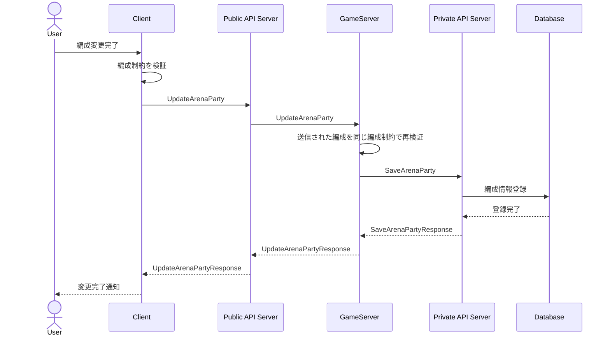
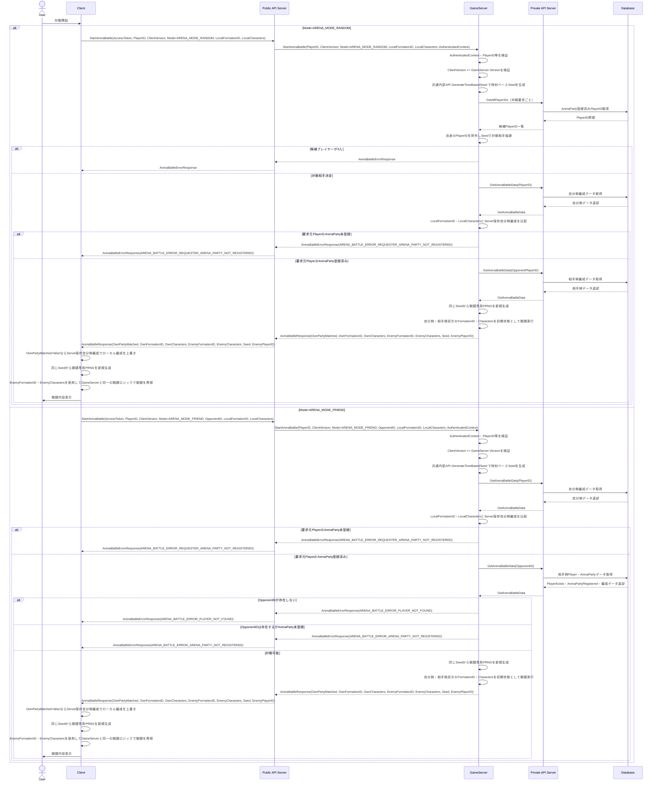

## シーケンス

### 編成登録時

### 対戦時

## ランダム対戦候補の取得

Random Arenaの対戦相手抽選では、要求ごとにPrivate API `GetAllPlayerIDs`を呼び、Database上にArenaPartyが登録されている通常PlayerのIDをPlayerID昇順で取得する。GameServerは候補一覧を保持・同期するキャッシュを設けない。要求元PlayerIDとシステムダミーPlayerID `0`を除いて、既存のSeedを用いた抽選を実行する。