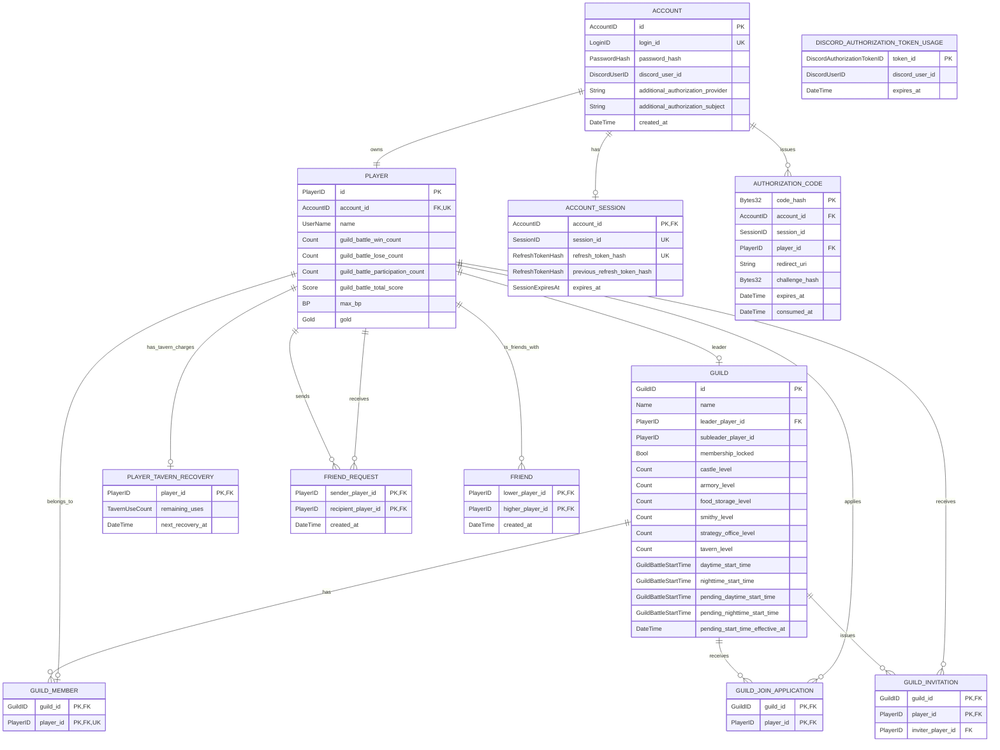
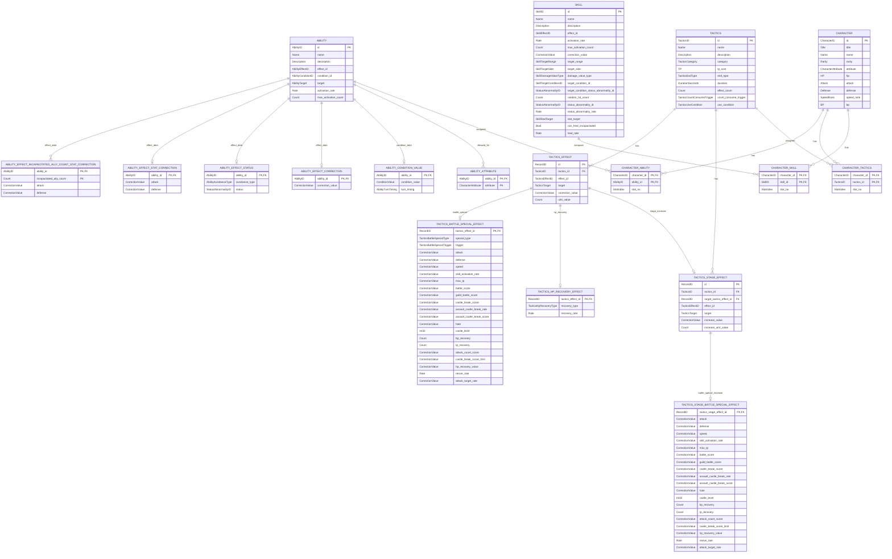
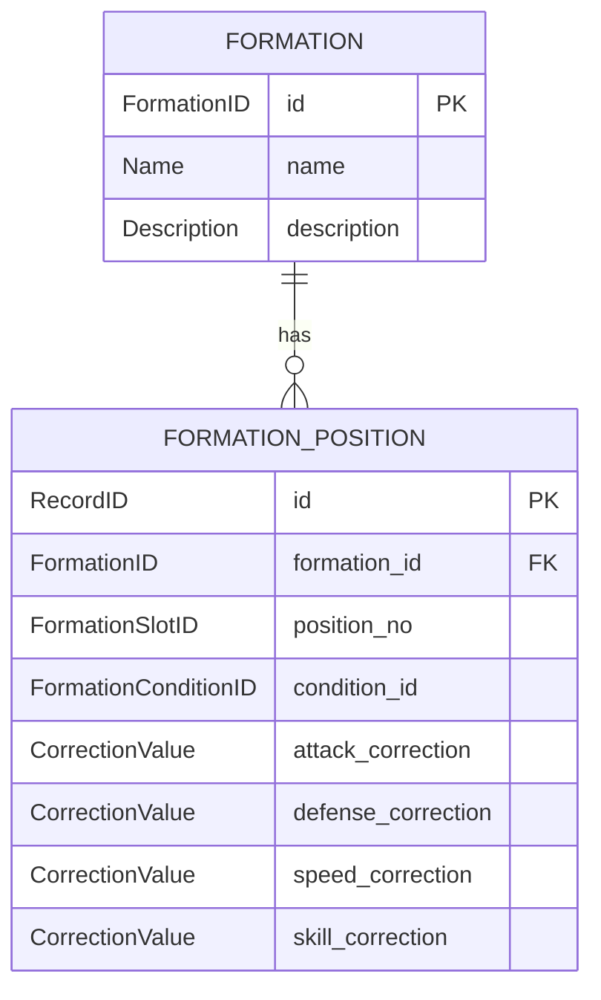
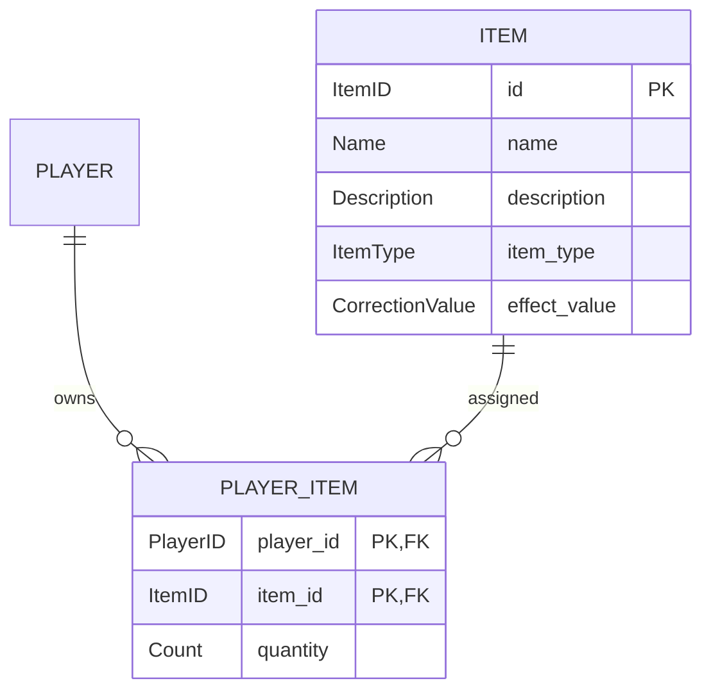
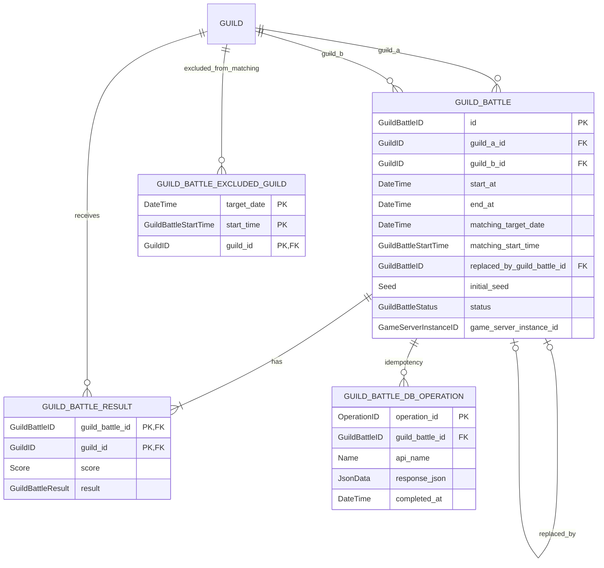
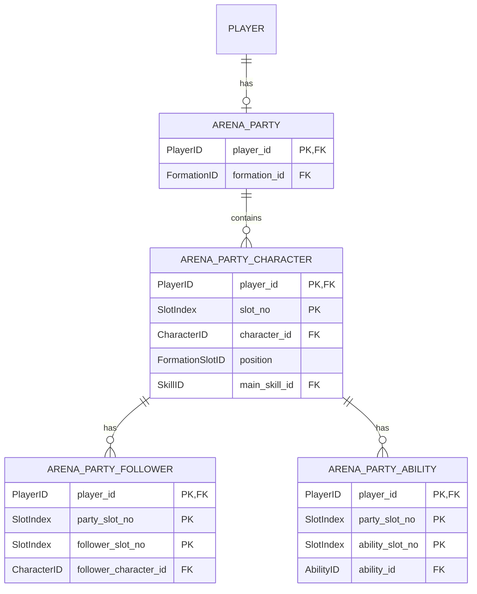
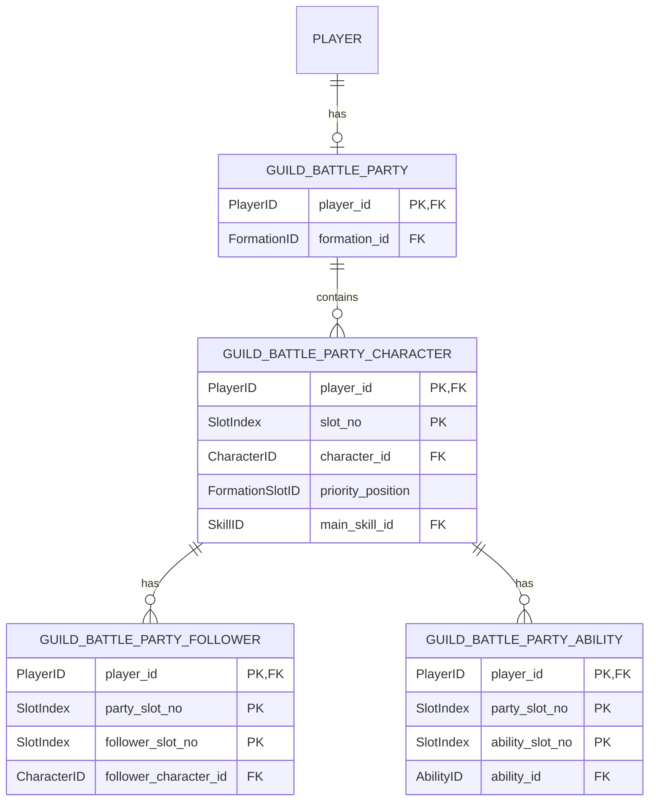
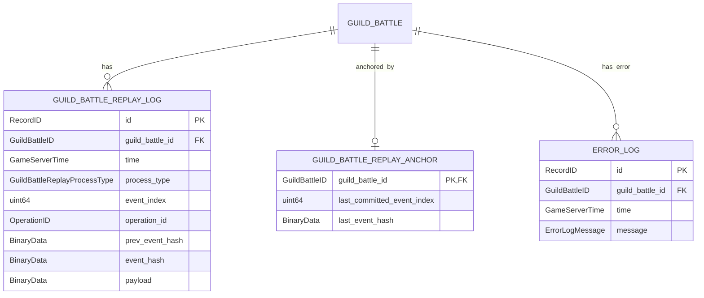

# データベース

PostgreSQLを使用する.
各カラムの論理型およびPostgreSQL物理型への対応は「[型定義](../shared/types.md)」を参照する.

## テーブル設計

### 全体共通

`AUTHORIZATION_CODE`は認証コード32byteのSHA-256値を`code_hash`へ格納し、コード自体はDBに保存しない。登録済みRedirect URI、PKCE S256 digest、発行元SessionID・PlayerID、期限、消費時刻を保持する。Private APIはRefreshTokenのHashから有効Sessionを検索して発行し、コード交換はコード行の排他Lock・Session有効性・URI完全一致・S256照合・未消費・60秒以内の全条件を単一Transactionで検証して一度だけ成立させる。

`ACCOUNT.login_id`は一意制約を設定する. Passwordの平文は保存せず, Argon2idのパラメータ, Passwordごとの16byte以上の暗号学的乱数Salt, Hashを含む`password_hash`だけを保存する.
`ACCOUNT.additional_authorization_provider`は`DISCORD`、`POCKETBASE`、`OTHER`、`NONE`を保存し、`additional_authorization_subject`は追加認可ありの場合に非空の検証済み値とする。`NONE`では空値とする。Providerが異なる主体を本人と推定して連携しない。Login時はClientが選択してServerが検証したProviderと保存済みProviderを完全一致させ、`NONE`の場合も保存済みProviderが`NONE`であることを必須とする。別Providerへの自動Binding変更は行わない。`ACCOUNT.discord_user_id`はNULLを許可する. `AdditionalAuthorizationProvider=DISCORD`でAccountを作成した場合は`DiscordAuthorizationToken.sub`のDiscordUserIDを保存し, Login時の追加認可Bindingに使用する. `AdditionalAuthorizationProvider=NONE`で作成したAccountではNULLを許可する.
`ACCOUNT`と`PLAYER`は1対1とし, Account作成時に同一トランザクションで作成する.
`ACCOUNT_SESSION.account_id`を主キーとし, 1つのAccountが同時に複数のRefresh Sessionを保持できないようにする.
`ACCOUNT_SESSION.refresh_token_hash`には`SHA-256(RefreshToken)`だけを保存し, RefreshTokenの平文を保存しない.
`ACCOUNT_SESSION.previous_refresh_token_hash`はNULLを許可する. RefreshToken Rotation成功時は更新前`refresh_token_hash`を`previous_refresh_token_hash`へ保存してから新しいHashを`refresh_token_hash`へ保存する.
Login成功時は既存`ACCOUNT_SESSION`を削除してから新しいSessionを保存し, `expires_at`をLogin成功時刻から24時間後とする. 騎士団戦参加およびRefreshToken更新では`expires_at`を延長しない.
RefreshToken更新時は対象`ACCOUNT_SESSION`を排他的に更新する. 受信TokenのHashが`previous_refresh_token_hash`と一致した場合は再利用として対象`ACCOUNT_SESSION`を削除する.
Logout時は対象`ACCOUNT_SESSION`レコードを削除する.
`DISCORD_AUTHORIZATION_TOKEN_USAGE.token_id`には成功したAccount新規作成またはLoginで使用した`DiscordAuthorizationToken.jti`を保存する. 同一`token_id`を複数回成功させない. `expires_at`経過後のレコードは削除してよい.
Discord Botから`RevokeDiscordSessions`を受信した場合は, 指定DiscordUserIDと一致する`ACCOUNT.discord_user_id`を持つAccountの`ACCOUNT_SESSION`を削除する.

`PLAYER.guild_battle_win_count`、`PLAYER.guild_battle_lose_count`、`PLAYER.guild_battle_participation_count`、`PLAYER.guild_battle_total_score`の初期値はすべて`0`とする。`guild_battle_total_score`は`numeric(20,0)`で`u64`全域を表現する。
`PLAYER.max_bp`の新規プレイヤー作成時初期値は`200`とする.
`PLAYER.gold`は通常Playerごとのゴールド残高の正本とし, `0..4294967295`の整数だけを保存する. 新規Player作成時は`0`で初期化する.

初期Guild作成フローの完了判定の正本は、通常Playerに対応する`GUILD.id=PLAYER.id`行の有無とする。専用の「新規プレイヤーフラグ」を別途永続化しない。作成済みの場合は同じ初期Guildの再作成を拒否する。

## フレンドの永続化

* `FRIEND_REQUEST`は未処理の申請だけを保持する。送信者・受信者の組を主キーとし、両IDは存在する通常Player、かつ異なるIDでなければならない。申請に期限は設けず、同一方向の再送は申請済みとして扱う。逆方向の未処理申請は同時に保存できる。
* 承認時は申請行を排他Lockし、`FRIEND`に両PlayerIDを数値昇順の組（`lower_player_id < higher_player_id`）で一意に保存し、同一トランザクションで申請行を削除する。双方で同一の1件を参照する。逆方向の未処理申請は残し、その申請へ後で応答したときは既存フレンドと判定して「既にフレンド」を返し、残存申請を削除する。再度フレンドの作成・取消を行わない。
* 拒否時は受信者本人の未処理申請行を削除する。申請者向けの拒否通知レコードは作成しない。
* 未処理申請の受信一覧をホームの通知一覧のフレンド申請部分の正本とする。承認・拒否の操作対象は通知を受け取ったPlayerに限る。
* フレンド一覧は`FRIEND`から現在のPlayerIDを含む組を検索し、相手の`PLAYER.name`を付して返す。本人による解除は当該ペアの`FRIEND`行を削除し、逆方向の残存申請があれば同時に削除する。双方の一覧への反映は次の一覧取得時から行う。

## GUILD / GUILD_MEMBER 制約

* `GUILD.name`はUTF-8, 最大10文字, 空文字不可とし, 騎士団間の重複を許可する.
* 所属変更禁止状態の正本は`GUILD.membership_locked`とする. GameServer上の一時状態だけを正本として使用しない.
* プレイヤーの初期騎士団は`GUILD.id = PLAYER.id`となるように作成する.
* 初期騎士団作成時は`castle_level`, `armory_level`, `food_storage_level`, `smithy_level`, `strategy_office_level`, `tavern_level`をすべて1で保存する.
* 初期騎士団は, その所有プレイヤーが別の騎士団へ所属している間も`GUILD`レコードを削除しない.
* 初期騎士団作成時の`leader_player_id`は所有プレイヤー, `subleader_player_id`は`0`, `membership_locked`は`false`とする. `subleader_player_id=0`は副団長未設定を表し, 0以外の場合だけ実在するPlayerIDを指定する. 作成後は通常の騎士団と同様に役職変更できる.
* 初期騎士団については, 所有プレイヤーが別の騎士団へ所属している間に限り`GUILD_MEMBER`が0件となる状態を許可する.
* `player_id`には一意制約を設定し, 1つのPlayerIDが同時に複数騎士団へ所属できないようにする.
* 所属変更時は, 対象PlayerIDの既存`GUILD_MEMBER`行を削除してから新しいGuildIDの行を挿入する処理を同一トランザクションで行う.
* `LeaveGuild`では新しい`GUILD`レコードを作成せず, `guild_id = player_id`の既存初期騎士団へ`GUILD_MEMBER`を戻す. 初期騎士団の団長を別Playerへ交代済みの場合は, 脱退Playerと当該初期騎士団の現在団長の所属GuildIDをスワップし, 初期騎士団の団長を戻った所有Playerへ変更する. これらは同一トランザクションで行う.
* 団長・副団長変更時は`GUILD.leader_player_id`および`GUILD.subleader_player_id`を更新し, 加工済みマスターデータへは保存しない. 変更後の団長・副団長は対象Guildの`GUILD_MEMBER`に存在するPlayerだけを許可し, 両PlayerIDは同一値を禁止する.
* `GUILD_JOIN_APPLICATION`は未承認の加入申請だけを保持する. 申請承認で加入が成立した場合は対応行を削除する. 加入申請を承認できるのは対象Guildの現在の団長または副団長だけとする.
* `GUILD_INVITATION`は未承諾の招待だけを保持する. 招待承諾で加入が成立した場合は対応行を削除する. `inviter_player_id`は招待送信時点の団長または副団長PlayerIDを保持する.
* 加入申請作成時および招待作成時は, 移動対象Playerが現在所属Guildの団長かつ当該Guildに団長以外のメンバーが存在する場合は作成しない. 副団長にはこの移動制約を適用しない. 加入承認・招待承諾時にも同条件を再確認する.
* 加入申請承認および招待承諾では, 対象Guildの所属人数が20未満であること, 加入元Guildと加入先Guildの`membership_locked=false`であることをDatabaseトランザクション内で再確認してから`GUILD_MEMBER`を更新する. 20人の場合またはいずれかのGuildがロック中の場合は更新しない.
* `LeaveGuild`では脱退元Guildおよび復帰先の初期Guildの`membership_locked=false`を同一トランザクション内で確認する. いずれかがロック中の場合は所属変更・所属スワップを行わない.
* `GUILD.daytime_start_time`は`GUILD_BATTLE_START_1130`, `GUILD_BATTLE_START_1215`, `GUILD_BATTLE_START_1300`のいずれか1つとする.
* `GUILD.nighttime_start_time`は`GUILD_BATTLE_START_2100`, `GUILD_BATTLE_START_2200`, `GUILD_BATTLE_START_2300`のいずれか1つとする.
* `PlayerID=0`および`GuildID=0`は騎士団戦用のシステムダミー専用とする. 通常のAccount・Player・Guildへ割り当てない.
* システムダミーPlayerは`PLAYER.id=0`, `max_bp=500`とし, 認証対象ではないため`account_id`はNULLを許可する. `PLAYER_ITEM`は保持しない.
* システムダミーPlayerID `0`は`ACCOUNT`との1:1関係の例外とし, `PLAYER.account_id=NULL`を許可する. 通常Playerでは`account_id`を必須とし1:1関係を維持する.
* システムダミーGuildは`GUILD.id=0`, `leader_player_id=0`, `subleader_player_id=0`, `membership_locked=false`とし, 城・武器庫・食糧庫・鍛冶屋・兵法所・酒場の各Levelをすべて100とする. `GUILD_MEMBER`には`guild_id=0, player_id=0`のシステム用所属を保持してよい.
* システムダミーPlayer/Guildは通常のArena候補および通常の騎士団戦マッチング候補へ含めない.

`SKILL.activation_rate`は基本スキル発動率`0.2`へ加算する値とする. `SKILL.max_activation_count`は1戦闘中の最大発動回数とし, `u32::MAX`は回数無制限を表す. `SKILL.target_side`は味方パーティ・敵パーティ・自身の対象候補を表す. `SKILL.damage_value_type`は攻撃スキルの`correction_value`が割合補正か固定ダメージ値かを識別する. `SKILL`の効果別フィールドは加工済み`SkillMasterData.effect_data`の`oneof`に対応して格納する. 該当しない効果別フィールドは未使用とし, DatabaseではNULLを許可する. `SKILL.target_condition_status_abnormality_id`は`target_condition_id=SKILL_TARGET_CONDITION_STATUS_ABNORMALITY`の場合のみ使用する. `SKILL.heal_rate`は対象の最大HPに対する回復割合とし, `SKILL.effect_id=SKILL_EFFECT_HEAL`では`SKILL.correction_value`を使用しない.
`SKILL.effect_id`は「[型定義](../shared/types.md)」の`SkillEffectID`, `ABILITY.effect_id`は`AbilityEffectID`, `TACTICS_EFFECT.effect_id`は`TacticsEffectID`を使用する. これら3つは相互に別の列挙型とする. `ABILITY.condition_id`は発動条件を保持し, `ABILITY.target`は`AbilityTarget`を保持する. 具体値が必要な場合だけ`ABILITY_CONDITION_VALUE.condition_value`を使用する. `ABILITY_CONDITION_VALUE.turn_timing`は`ABILITY_CONDITION_EVERY_N_TURNS`の場合に評価タイミングを保持し, それ以外では使用しない. `ABILITY`の効果固有値は加工済み`AbilityMasterData.effect_data`の`oneof`に対応する詳細テーブルへ格納する. `no_parameter`を使用するAbilityEffectIDでは効果詳細テーブルを使用しない. `ABILITY_EFFECT_STATUS.avoidance_type`は`ABILITY_EFFECT_AVOIDANCE`で必須とし, `ABILITY_AVOIDANCE_TYPE_NORMAL_ATTACK`または`ABILITY_AVOIDANCE_TYPE_STATUS_ABNORMALITY`を保持する. 通常攻撃回避では`ABILITY_EFFECT_STATUS.status`をNULLとし, 状態異常回避では対象`StatusAbnormalityID`を保持する. `ABILITY_EFFECT_STATUS_ABNORMALITY_ATTACK`では`avoidance_type`を使用せず, `status`へ付与状態異常IDを保持する. 加工済みMasterDataの`AbilityStatusAbnormalityData`に対応する値を使用する. 発動条件値と効果詳細は独立して保持するため同時に存在できる. `ABILITY_EFFECT_INCAPACITATED_ALLY_COUNT_STAT_CORRECTION`では`ABILITY_EFFECT_INCAPACITATED_ALLY_COUNT_STAT_CORRECTION`へ戦闘不能味方人数0～4の各補正値を保持する. `SKILL.can_heal_incapacitated=true`はHP0専用回復, `false`はHP1以上専用回復として扱う.
同一`TacticsEffectID`系列の効果値はすべて加算する. 段階レベル`n`の最終効果値は`基本効果値 + (n - 1) * 増加値`で算出する. `TACTICS_STAGE_EFFECT.target_tactics_effect_id`は段階補正対象となる`TACTICS_EFFECT.id`を一意に指定する. 加工済みマスター生成時は同一Tactics内の`TACTICS_EFFECT`を`TACTICS_EFFECT.id`昇順へ並べ, 対象行のIndexを`TacticsStageEffectData.effect_index`へ変換する. `TACTICS_STAGE_EFFECT.effect_id`および`target`は対象`TACTICS_EFFECT`と一致必須とする. `TACTICS_STAGE_EFFECT.increase_value`は浮動小数点効果, `increase_uint_value`はBP固定回復等の整数効果に使用する. `TACTICS_EFFECT_BATTLE_SPECIAL`の段階上昇量は`TACTICS_STAGE_BATTLE_SPECIAL_EFFECT`へ`TacticsBattleSpecialParameters`に対応する各数値として保持する. `TACTICS_EFFECT.correction_value`は浮動小数点効果, `TACTICS_EFFECT.uint_value`はBP固定回復等の整数効果に使用する. `TACTICS_EFFECT_HP_RECOVERY`は`TACTICS_HP_RECOVERY_EFFECT`, `TACTICS_EFFECT_BATTLE_SPECIAL`は`TACTICS_BATTLE_SPECIAL_EFFECT`へ効果固有値を保持する. Battle Specialの効果対象は`TACTICS_EFFECT.target`を唯一の正本とし, `TACTICS_BATTLE_SPECIAL_EFFECT`へ別Target列を持たない. 使用しない値列はNULLとする. `TACTICS.end_type=TACTICS_END_TYPE_COUNT`の場合は`TACTICS.count_consume_trigger`で残り回数を消費するイベントを指定する. `TACTICS.use_condition`はタクティクス使用要求時の追加条件を保持する.

`FORMATION` / `FORMATION_POSITION`および`ITEM`はDatabase上の固定参照データとして保持するが, `ProcessedMasterData`には含めない. 騎士団・Player・所属・役職などの実行時可変データも`ProcessedMasterData`には含めない.

`FORMATION_POSITION.condition_id`の`FormationConditionID`条件と配置キャラクターの属性条件が一致する場合のみ, その位置の攻撃・防御・速度・スキル補正を適用する. 条件不一致時はその位置の補正を適用しない.

### 騎士団戦Item在庫の正本と排他境界

`PLAYER_ITEM`を永続在庫の正本とし、対戦専用の予約テーブルは設けない。GameServerは開戦時Create Snapshotを当該BattleのItem初期状態として保持する。`StartGuildBattle`はSnapshotに含まれる通常PlayerのItemID・数量をDBの`PLAYER_ITEM`と照合し、一致しない場合は開戦を拒否する（ダミーPlayerのItemは空）。

対戦`in_progress`または`resolving`の参加対象Playerに対する`UpdatePlayerItem`等の**通常在庫更新**はPrivate APIで拒否し、未確定消費との競合を作らない。Battle専用の`SaveGuildBattleItemLog`だけが署名付きReplayからの検証済み使用分をDBへ反映できる。Private API以外の任意の直接書込みは許可しない。異なるGameServer間のキャッシュ同期・予約・残数共有は行わない。

BP50回復薬の日次配布は現段階では実施しないため, 日次配布実績テーブル`PLAYER_ITEM_DAILY_GRANT`は新規設計の対象外とする.

### 騎士団戦専用

`GUILD_BATTLE.game_server_instance_id`は未割当時NULLを許可する. `matching_target_date`と`matching_start_time`は元のマッチング枠を示し, 再開した場合も変更しない. `replaced_by_guild_battle_id`は後継IDを参照するNULL許容外部キーとする. 同枠のComplete・Retry・Cancelは`pg_advisory_xact_lock(YYYYMMDD, GuildBattleStartTimeEnumValue)`を共通して取得する. ID生成用の再開専用Sequenceは再利用せず原子的に採番する.
GuildBattleCoordinatorはPrivate API経由で未割当の騎士団戦を選択したGameServerへ原子的に割当し, 割当成功時に対象`GameServerInstanceID`を保存する. GameServer自身は未割当騎士団戦を自己割当しない. 既に他GameServerへ割当済みの場合は上書きしない. `status`, `start_at`, `game_server_instance_id`を使用する割当検索にIndexを設定する.
`SaveScheduledGuildBattles`保存時に`start_at`を`TargetDate`と`GuildBattleStartTime`からJSTで生成し, `end_at = start_at + 30分`として保存する. 同時に`matching_target_date=TargetDate`, `matching_start_time=StartTime`を保存し, 後継対戦にもこの2値を引き継ぐ. `replaced_by_guild_battle_id`は置換されない場合NULLとする. `initial_seed`は開戦前Preload完了まではNULLを許可し, Preload成功後の`StartGuildBattle`でCreate Replay保存と`status=in_progress`更新と同一トランザクションにより保存する.
`GUILD_BATTLE_EXCLUDED_GUILD`はマッチング生成時に所属0人のため除外したGuildを対象日・開始時刻単位で保持する. 通常終了時は`CompleteGuildBattle`が当該対戦2Guildの所属ロックを解除する. 同`matching_target_date`・`matching_start_time`の全対戦（後継対戦を含む）が`completed`・`canceled`・`replaced`の終端状態となり, 未完了対戦が存在しない時点の`CompleteGuildBattle`または`CancelPreloadFailedGuildBattle`が, 同一トランザクションで除外Guildのロックを解除し除外一覧を削除する. マッチング生成中止時はGuildBattleCoordinatorが既存の取得・削除APIを使用する.
Public API Serverは騎士団戦要求を中継する際に`GuildBattleID`から`game_server_instance_id`を取得できる. Public API Serverは取得結果をローカルキャッシュしてよいが, キャッシュは正本として扱わない.

## アリーナ

`SaveArenaParty`は対象PlayerIDのアリーナ編成を上記テーブルへ保存する. 既存編成がある場合は同一PlayerIDの編成を置換する.

酒場残回数の正本は`PLAYER_TAVERN_RECOVERY`の`PlayerID`（主キー）とする。消費要求は当該PlayerID行を`SELECT ... FOR UPDATE`相当で排他し、当該Transactionで「経過2時間の補充→残数検証→1回消費→Event/OperationID記録→残数・次回時刻更新」を確定する。初回行作成競合もPlayerID一意制約で排他する。`GetGuildBattleStatus`等の参照では、保存行を変更せず現在時刻から算出した論理残数・次回補充時刻を返す。`remaining_uses`（`u8`, 0～3、初期3）、`next_recovery_at`（UTC時刻、満量ならNULL）を保持し、GuildIDおよびJST日付はキーに含めない。成立イベント保存と残回数・時刻更新は`SaveGuildBattleTavernRecoveryLog`を介して同一Transactionで確定する。読取時は`now >= next_recovery_at`の間、残回数を1回分増やして`next_recovery_at`へ2時間を加算する（残回数3に達したら時刻NULL）。満量3から初回消費した場合は`now+2時間`を設定し、補充待機中に追加消費しても既存の`next_recovery_at`をリセットしない。成立消費時の状態確定とReplay保存は一体化し、未保存Eventを二重消費しない。

騎士団戦開始時刻の変更要求は、昼・夜の設定値と適用開始JST日付を保留値として保持する。翌日JST 0:00以降に対象日でマッチングする際は保留値を有効値として使用する。すでに作成済みの対戦を変更しない。

施設レベルアップは`GUILD`対象行とCallerの`PLAYER.gold`を同一Databaseトランザクションで排他更新する。必要額は更新後レベルの費用表を使用する。`offered_gold >= required_gold`かつ`PLAYER.gold >= required_gold`の場合だけ`PLAYER.gold -= required_gold`、対象施設Lvを1加算してCOMMITする。Lv150なら状態を変更せず最大Lvの専用Errorを返す。強化権限は`GUILD_MEMBER`所属全員が持つ。

## 騎士団戦編成

`SaveGuildBattleParty`は対象PlayerIDの騎士団戦編成を上記テーブルへ保存する. 既存編成がある場合は同一PlayerIDの編成を置換する.

## ログ

`ERROR_LOG.guild_battle_id`はNULLを許可する. 騎士団戦自体がまだ生成されていない時間帯単位のエラーではNULLとして保存する.

`GUILD_BATTLE_REPLAY_LOG.payload`には, 「[騎士団戦リプレイProtocol Buffers定義](../system/guild_battle_replay.proto)」の`GuildBattleReplayEnvelope`をProtocol BuffersでSerializeしたバイナリを`bytea`として保存する. `GUILD_BATTLE_REPLAY_LOG.process_type`は検索用の索引値とし, Serialize済みEnvelopeの`process_type`と必ず一致させる. `event_index`もEnvelope内の番号と一致させ、`UNIQUE(guild_battle_id, event_index)`を適用する。`event_index=1`をCreateとし、後続Eventは同一GuildBattleIDで欠番なく1ずつ増加する。`operation_id`は`X-Operation-ID`と同じ値を保持し、`UNIQUE(guild_battle_id,operation_id)`を適用する。同一番号/Operation IDでRaw EnvelopeとEvent Hashが一致すれば冪等成功とし、異なる場合は拒否する。`prev_event_hash`・`event_hash`はいずれも32byteであり、[Event Hashと署名対象v2](../system/replay_local_record_encoding.md)の媒体非依存式で決定する。これらはReplayの署名済みローカルRecord Hashではない。

`GUILD_BATTLE_REPLAY_ANCHOR`を`guild_battle_id`主キーで保持し、`last_committed_event_index`と`last_event_hash`をDB確定済みprefixの正本とする。`StartGuildBattle`のCreate Event番号1・ゼロ前Hash・`GUILD_BATTLE`の開始状態更新とAnchor `(1, create_event_hash)` は**同一Transaction**で確定する。以降のReplay保存では当該Anchor行をロックし、直前Event Index/Hashの連続性を検証してからReplay行・Operation ID冪等行・Anchorを同一Transactionで更新する。未成立の先行番号を飛ばしてDBへCOMMITしない。

**成立確定**とはGameServerが成功応答可能になる確定点（通常非出撃Eventは署名付きWAL耐久保存、出撃は正常時DB COMMIT・Recovery中Journal耐久保存、酒場はDB Transaction）であり、**DB反映確定**とはPrivate APIがReplay行/AnchorをCOMMITしたことを指す。後続Eventの応答は直前Eventの**成立確定**を必要とし、通常Eventについて直前EventのDB反映確定までは要求しない。DB Workerだけが連続した番号で順にCOMMITする。

## 5秒のDB/NW障害判定とローカル保存

騎士団戦中のPrivate API経由DB保存は、開始から**5秒**以内に最終的なDB確定を確認できない場合をDBまたはネットワーク障害と判定する。5秒は同一論理操作の最初の送信開始から測る上限であり、Retryで新たに5秒を追加しない。5秒未満の確定失敗も障害移行条件とする。

- DBの一時的な接続断・Timeout・結果不明は、同一Operation IDで初回から通算5秒以内に最大1回だけ再送／確定照会する。明示的な確定失敗、再試行失敗、または通算5秒上限で当該GuildBattleを`recovery`状態へ遷移し、**以後の当該騎士団戦中はDB送信を再試行しない**。DB送信Workerの未完了要求は同じOperation IDで管理し、返信が遅れて届いても既存Eventを二重確定しない。
- `recovery`中の新規成立操作はGameServer専用Persistent VolumeのRecovery Journalへ、GuildBattleID・Event Index・Operation ID・元RPC名・protobuf要求のバイト列（Base64表現）・成立順を含む**独立した不変レコードとして非同期Workerで耐久保存**する。レコードにSHA-256チェックサムを付け、一時ファイル書込→ファイル`fsync`→同じファイルシステム内で原子的rename→親ディレクトリ`fsync`がすべて完了してからClientに成功を返す。ゲーム処理Thread自身はファイルI/Oを実行しない。
- 正常時の出撃は従来どおりDBのCOMMIT完了を成功条件とする。`recovery`移行後の出撃に限り**ローカルJournalの耐久化完了**を成功条件とする。ローカル保存も失敗した場合、当該新規操作は成功扱いしない。Operation ID・RequestSequence・Event Indexによって同じ出撃を再適用しない。
- DBへの送信途中でTimeoutしたEventはDB側で確定した可能性があるため、ローカルにも同じOperation ID・Event Indexで保留記録する。再送時はPrivate APIの冪等性で既存COMMITを照合し、二重加算しない。
- 騎士団戦終了後、同BattleのJournalをEvent Index/成立順に検証した後DBへ一括転送してから最終結果の確定を要求する。転送が途中失敗した場合はファイルを保持し、DB完了済みとして表示しない。通常の`CompleteGuildBattle`専用の失敗処理は維持する。
- 再起動後に残存Journalがある場合、終了済みBattleでは再送できる。進行中BattleのJournalについては、当該Battle中に再度DB送信を開始せず、終了処理の時点で転送する。失われたGameServerメモリの進行中Battle状態を自動で再開できることは保証しない。

この例外は「通常時の出撃成功応答はDB COMMIT保証」の規則より優先し、DB/NW障害時だけ正本を永続ローカルJournalへ一時退避する。Journalからの確定後はDatabaseを正本とする。

## 騎士団戦DB送信失敗時

騎士団戦中のDatabase更新・ログ保存要求は同一要求を原則1回だけ再試行するが、初回送信開始から合計5秒以内にDB確定を確認できない場合はその時点でDB/NW障害としてRecovery状態へ移行し、当該Battle中はDB送信を再開しない。 通常のリプレイログ保存要求はReplay Workerから非同期送信する。出撃に限り、成功応答前に専用非同期Workerから同一Replay EventをPrivate APIへ保存し、DB COMMITの完了通知を受けてから成功を返す。騎士団戦実行スレッド自身は同期I/Oを実行しない。保存結果が不明な場合は同じ`X-Operation-ID`で照合し、DB確定済みの出撃を取り消さない。未保存を確認できた場合のみ出撃を失敗扱いにする。 Retry失敗または5秒の確定待機上限に達した場合、GameServerはDB障害状態へ移行し、 それ以降の騎士団戦中DB送信を停止して送信予定データをローカル保存する.
ローカル保存は`/var/lib/game-server/recovery`配下のUTF-8 JSONファイルとして行う. 本番Kubernetes環境では同PathをGameServer専用Persistent Volumeへmountし, GameServer再起動後も保持する.
Recovery記録は`guild_battle_<GuildBattleID>_<GameServerInstanceID>/event_<EventIndex>_<OperationID>.json`の不変Eventファイルとする。同名の一時ファイルを完全保存した後、renameとディレクトリ同期で確定する。ファイルには元のPrivate API名、Operation ID、Event Index、要求Payload、成立順、検査用SHA-256を保持する。検証に失敗したファイルを成立Eventとして再送しない。
騎士団戦終了時にローカル保存データをEvent Indexおよび保存順にDatabaseへ一括再送し、全件確定後に最終結果保存を実行する。 GameServer起動時にもRecoveryディレクトリを走査するが、**終了済みGuildBattleだけ**を保存順に再送する。進行中GuildBattleのJournalは検証・保全し、Battle終了までDB送信を再開しない。 再送に失敗したEventファイルは残し、各EventのDB確定に加え、Replay Fileへの反映と署名・連鎖検証まで確認した後にだけ該当ファイルを削除できる。

`CompleteGuildBattle`はこの一般規則とは別に, 初回失敗後1回だけ同一`X-Operation-ID`で再試行し, 再試行も失敗した場合はErrorLogを保存し, `DiscordNotificationEnabled=true`の場合はDiscord Botへ通知する. その後の原因調査・復旧は運営が手動で行う. 最終結果保存, Player勝敗数更新, `GUILD_BATTLE.status=completed`, 当該対戦2Guildのmembership lock解除は同一Databaseトランザクションで確定する. 同一`matching_target_date`・`matching_start_time`の全対戦が終端状態（`completed`・`canceled`・`replaced`）となった場合だけ除外Guild解除と除外一覧削除も同一トランザクションに含め, いずれか失敗時は全体をRollbackする.

### 騎士団戦Database更新の冪等性

騎士団戦中にDatabase状態を変更するPrivate API要求は`Operation ID`を必須とする. `Operation ID`は同一論理操作について初回送信, 1回再試行, Recoveryファイルからの再送で同じ値を使用する.

Private API Serverは更新対象Databaseトランザクション内で`GUILD_BATTLE_DB_OPERATION.operation_id`の存在を確認する. 未処理の場合だけ本来の更新と`GUILD_BATTLE_DB_OPERATION`追加を同一トランザクションでCOMMITする. 処理済みOperation IDを受信した場合は更新を再適用せず, `response_json`に保存した初回成功時レスポンスを返す. これによりResponse消失後の再試行でも加算・ログ追加・状態更新を二重適用しない.

## GUILD_BATTLE生成規則

対象日・`GuildBattleStartTime`ごとに, その開始時刻を設定している騎士団を抽出し, 疑似乱数の「抽選」を使用して順序を決める. 先頭から2騎士団ずつペアにし, 奇数の場合は最後の騎士団を事前作成済みダミープレイヤーの初期騎士団と組み合わせる. 各ペアについて`GUILD_BATTLE`を`scheduled`状態で作成する.

`GuildBattleID`は`u64`で, 通常のマッチング生成時は`GuildBattleID = YYYYMMDD * 10^11 + GuildBattleStartTimeEnumValue * 10^8 + PairIndex`とする. これは`<YYYYMMDD 8桁><GuildBattleStartTime Enum値 3桁><PairIndex 8桁>`を10進連結した値に相当する. Preload失敗後の同一ペア再開では通常IDを再利用せず, Private API ServerがDatabaseの再開専用Sequenceから一意の連番（1～`2^63-1`）を採番し, `2^63 + 連番`で新規IDを作成する. 専用Sequenceの値はDatabaseのトランザクションRollbackで巻き戻さない. 通常IDと再開用IDを区別するため通常IDは`2^63`未満とする. 新旧`GUILD_BATTLE`を別レコードで保存し, 旧レコードの`replaced_by_guild_battle_id`で新IDを参照する.

## 騎士団戦開始時刻の予約値と取得

`GUILD.pending_start_time_effective_at`は予約更新が存在するときだけ値を持ち、未予約時はNULLとする。予約中の`pending_daytime_start_time`と`pending_nighttime_start_time`は同じ適用時刻に対する一組である。団長が適用前に再変更した場合は、この一組の予約値を新しい要求値で置換し、適用開始はその再変更要求を受けたJST日付の翌日0:00とする。

開始時刻を参照・マッチングに使用するトランザクションでは、現在時刻が`pending_start_time_effective_at`以上であれば、予約値を`daytime_start_time`・`nighttime_start_time`へ確定し、予約3カラムをNULLに戻す。その後の`GetGuildDetail`は有効値を通常フィールドへ返し、予約中の場合に限り3つの`pending_*`フィールドを返す。適用前の読み取りは現行値と予約値を混同しない。作成済みの対戦レコードは変更しない。

### DB障害中の酒場ストック

対象GuildBattleがRecoveryへ移行した場合、その間の`UseTavernRecovery`を拒否する。残数更新をGameServerのローカル記録へ振り替えず、後からストック消費をDBへ一括適用しない。正常時は従来どおりPlayerID行の排他・時間経過補充・消費・Replay記録を同一Transactionで確定する。

## Replay確定アンカーとItem後追い更新

- DBの検証済み確定アンカーは`GUILD_BATTLE_REPLAY_ANCHOR.(last_committed_event_index,last_event_hash)`であり、保存媒体に依存しないEvent Hashだけを連鎖する。各Replay行の`operation_id`・`prev_event_hash`・`event_hash`は同一Transactionで確定し、ローカル署名RecordをDBアンカーの代わりとしない。署名検証鍵IDはGameServer側の検証鍵台帳で管理する。Hashまたは署名だけを正本性の唯一の根拠とはせず、DBの既存確定値と異なるEventは隔離する。
- `CompleteGuildBattle`前に当該Battleで成功応答済みの全WAL・Journal Eventの署名/番号/DB反映とReplay File整合性を検証する。未反映が1件でもあれば`resolving`のままにして結果を確定しない。

### ItemのReplayとDB在庫の関係

`GuildBattleItemLogPayload.quantity_before/after`は**Battle RuntimeのItem残数**であって、各Event時点のDB全体数量を示さない。ReplayのCreate Snapshotを初期値としてEvent Index順に検証し、同一Player/Itemの使用履歴と一致する場合に限り反映する。DB更新では`PLAYER_ITEM`行をLockして`quantity >= 1`を条件に1減算する。Replay Event行・Event Hash・Operation IDの冪等記録・所持数減算を同一Transactionで確定し、元のDB数量をReplayの`quantity_before`で上書きしない。成功応答済みでもDB反映不能ならWAL/Journalを保持し、Battle完了を保留する。

### 開戦時Item Snapshotと通常在庫更新の排他

`StartGuildBattle`と`UpdatePlayerItem`を含む通常在庫書込みは、PostgreSQLの**同じPlayerID単位Transactionロック**を使用する。対象PlayerIDが複数なら昇順に取得し、ロック取得後に`PLAYER_ITEM`の対象行を`(PlayerID,ItemID)`昇順に`SELECT ... FOR UPDATE`する。対戦状態の確認、Create Snapshotと現在在庫の完全一致検査、Create Event/Anchor保存と`scheduled -> in_progress`を`StartGuildBattle`の同一Transactionで確定する。`UpdatePlayerItem`等は同じPlayerロック内で対象Playerが`in_progress`/`resolving`の対戦に含まれないことを確認し、該当するなら409として在庫に手を触れない。並行要求はロック解放後のDB正本を読み直して判定する。Transaction失敗時はStatus/Item/ReplayのすべてをRollbackする。

ロックの実現には`pg_advisory_xact_lock`等のTransaction範囲のPostgreSQL機構を用い、同じPlayerIDに対してStartと通常書込みが同じキーを必ず使う。これはPrivate API内部のDB排他であり、GameServer同士のキャッシュ共有や同期APIではない。参加対象はCreate Snapshot内の通常Player全員（未Joinを含む）とし、Dummyは含めない。既存のBattle専用`SaveGuildBattleItemLog`の冪等減算は許可する。
