## シーケンス

騎士団戦参加時, GameServerは`GuildBattleID`単位で`PlayerID -> RequestSequence`マップを作成する. 初期値は0で, 参加成功時に騎士団戦本体PRNGを1回消費して`next_bounded(1,000,000,000) + 1`を求め, `RequestSequence`として割り当てる. 他プレイヤーとの`RequestSequence`重複は許可する. 参加後の要求は保持値と一致する`RequestSequence`のみ処理し, 成功するたびに1加算した`NextRequestSequence`をClientへ返す. 失敗時は加算しない. JoinによるPRNG消費もリプレイ再現対象とする.

相手プレイヤーの重み付き抽選へ渡す候補PlayerIDはPlayerID昇順とする.


### 編成登録時

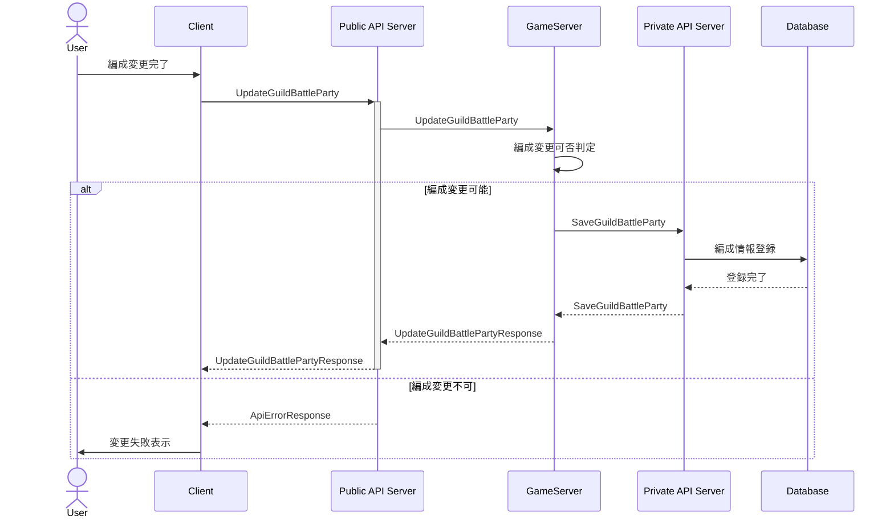

### 騎士団戦参加時

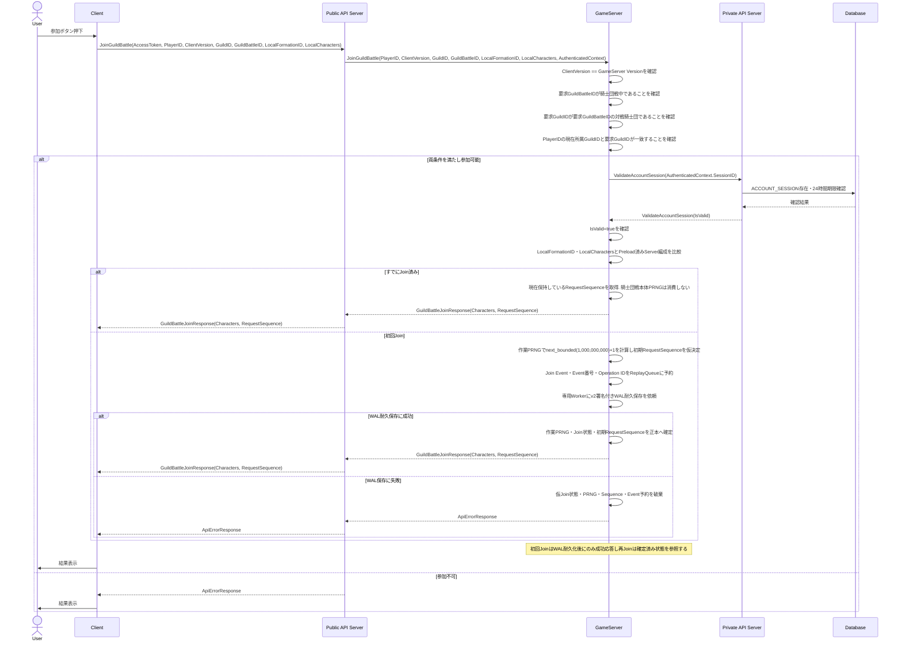

### 騎士団戦

#### 騎士団戦開戦前

騎士団戦開戦前処理は開戦5分前に開始する.
対象開始時刻の騎士団は, 対戦組み合わせ生成前にDatabaseの`GUILD.membership_locked=true`へ更新して加入・脱退を禁止し所属を固定する. 所属変更禁止状態の正本はDatabaseとする.
所属固定後に対戦組み合わせを生成する.
騎士団戦の生成, マッチング, GameServer割当およびPreload開始指示は`GuildBattleCoordinator`だけが行う.
GameServerは未割当騎士団戦の検索・自己割当・マッチング生成を行わず, `GuildBattleCoordinator`から割り当てられた騎士団戦だけをPreload・実行する.

```mermaid
sequenceDiagram
    participant DiscordBot as Discord Bot
    participant GuildBattleCoordinator
    participant GameServerScaleController as Dedicated GameServer Scale Controller
    participant GameServer
    participant PrivateAPIServer as Private API Server
    participant Database

    Note over GuildBattleCoordinator,Database: 開戦5分前. GuildBattleCoordinatorが対象開始時刻の騎士団戦開戦前処理を開始
    GuildBattleCoordinator->>PrivateAPIServer: GetGuildsForBattleMatching(TargetDate, GuildBattleStartTime)
    PrivateAPIServer->>Database: 対象開始時刻のGuildID・所属人数一覧を取得
    Database-->>PrivateAPIServer: GuildBattleMatchCandidate[]
    PrivateAPIServer-->>GuildBattleCoordinator: GetGuildsForBattleMatching
    GuildBattleCoordinator->>PrivateAPIServer: SetGuildMembershipLock(対象GuildID[], true)
    PrivateAPIServer->>Database: GUILD.membership_locked = true
    Note over GuildBattleCoordinator,Database: 対象開始時刻の騎士団の加入・脱退を禁止し所属を固定
    GuildBattleCoordinator->>PrivateAPIServer: GetGuildsForBattleMatching(TargetDate, GuildBattleStartTime)
    PrivateAPIServer->>Database: ロック後のGuildID・所属人数一覧を再取得
    Database-->>PrivateAPIServer: GuildBattleMatchCandidate[]
    PrivateAPIServer-->>GuildBattleCoordinator: GetGuildsForBattleMatching
    GuildBattleCoordinator->>PrivateAPIServer: GetScheduledGuilds(TargetDate, GuildBattleStartTime)
    PrivateAPIServer->>Database: 同一日付・開始時刻の既存GUILD_BATTLEを取得
    Database-->>PrivateAPIServer: 既存ScheduledGuildBattle[]
    PrivateAPIServer-->>GuildBattleCoordinator: GetScheduledGuilds
    alt 既存データあり
        GuildBattleCoordinator->>GuildBattleCoordinator: 既存ScheduledGuildBattle[]をそのまま使用
    else 既存データなし
        GuildBattleCoordinator->>GuildBattleCoordinator: 取得済みGuildBattleMatchCandidate[]から所属0人の騎士団を除外
        GuildBattleCoordinator->>PrivateAPIServer: SaveGuildBattleExcludedGuilds(TargetDate, StartTime, ExcludedGuildID[])
        PrivateAPIServer->>Database: 0人除外Guild一覧を保存
        alt 除外後の通常候補が0件
            GuildBattleCoordinator->>PrivateAPIServer: SetGuildMembershipLock(ExcludedGuildID[], false)
            PrivateAPIServer->>Database: 0人Guildの所属ロック解除
            GuildBattleCoordinator->>PrivateAPIServer: SaveErrorLog
            opt DiscordNotificationEnabled=true
                GuildBattleCoordinator->>DiscordBot: 0人候補エラー通知
            end
            GuildBattleCoordinator->>PrivateAPIServer: ClearGuildBattleExcludedGuilds(TargetDate, StartTime)
        else 通常候補あり
            GuildBattleCoordinator->>GuildBattleCoordinator: GuildID昇順へ並べ替え
            GuildBattleCoordinator->>GuildBattleCoordinator: GenerateTimeBasedSeedでマッチング用Seedを生成
            GuildBattleCoordinator->>GuildBattleCoordinator: Seedを使用して騎士団一覧をシャッフルしペア生成
            GuildBattleCoordinator->>GuildBattleCoordinator: PairIndex=0からGuildBattleIDを生成
            GuildBattleCoordinator->>PrivateAPIServer: SaveScheduledGuildBattles(TargetDate, StartTime, Battles[])
            PrivateAPIServer->>Database: GuildBattleCoordinator生成済みGUILD_BATTLEをscheduledとして保存
            Database-->>PrivateAPIServer: 保存済みまたは既存ScheduledGuildBattle[]
            PrivateAPIServer-->>GuildBattleCoordinator: SaveScheduledGuildBattles
        end
    end
    Note over GuildBattleCoordinator,Database: 0人除外Guild一覧はDatabaseに保持する

    loop 検出したready GameServer
        GuildBattleCoordinator->>GameServer: GetGameServerCapacity
        GameServer-->>GuildBattleCoordinator: GameServerInstanceID, AcceptNewGuildBattle, AvailableGuildBattleCount, AvailableGuildBattleThreadCount, TotalGuildBattleThreadCount
    end

    alt 空きGameServerあり
        GuildBattleCoordinator->>PrivateAPIServer: AssignScheduledGuildBattles(GameServerInstanceID, GuildBattleID[])
        PrivateAPIServer->>Database: 未割当scheduled騎士団戦を指定GameServerへ原子的に割当
        Database-->>PrivateAPIServer: 割当済みScheduledGuildBattle[]
        PrivateAPIServer-->>GuildBattleCoordinator: AssignScheduledGuildBattles(Battles[])
        GuildBattleCoordinator->>GameServer: StartGuildBattlePreload(Battles[])
        GameServer->>PrivateAPIServer: GetGuildBattleAssignment(GuildBattleID)
        PrivateAPIServer->>Database: game_server_instance_id取得
        Database-->>PrivateAPIServer: GameServerInstanceID
        PrivateAPIServer-->>GameServer: GetGuildBattleAssignment
        GameServer->>GameServer: 自身への割当一致を確認してPreload対象Queueへ追加
    else 空き容量不足
        Note over GuildBattleCoordinator,Database: 未割当騎士団戦はscheduledかつgame_server_instance_id=NULLのまま維持
        GuildBattleCoordinator->>GameServerScaleController: GameServer水平スケーリング要求
        GameServerScaleController-->>GuildBattleCoordinator: 要求受付
        Note over GuildBattleCoordinator: 新規GameServer ready後に容量確認・割当を再実行
    end

    loop 割り当てられた騎士団戦すべて
        loop 対戦する2騎士団
            alt GuildID=0のシステムダミー騎士団
                GameServer->>GameServer: Guild/Player固定値をシステムダミー仕様から構築
                GameServer->>GameServer: CharacterID昇順の先頭10体をダミー編成として選択
                Note over GameServer: 最大BP=500, Itemなし, 全施設Level=100
            else 通常騎士団
                GameServer->>PrivateAPIServer: GetGuildData(GuildID)
                PrivateAPIServer->>Database: 騎士団レベル情報要求
                Database-->>PrivateAPIServer: 騎士団レベル情報返答
                PrivateAPIServer-->>GameServer: GetGuildData
                GameServer->>GameServer: 騎士団レベル情報保管

                GameServer->>PrivateAPIServer: GetGuildMembers(GuildID)
                PrivateAPIServer->>Database: 所属PlayerID一覧要求
                Database-->>PrivateAPIServer: 所属PlayerID一覧返答
                PrivateAPIServer-->>GameServer: GetGuildMembers

                loop 所属しているメンバー全員
                    GameServer->>PrivateAPIServer: GetGuildBattleFormation(PlayerID)
                    PrivateAPIServer->>Database: 最大BP・編成情報要求
                    Database-->>PrivateAPIServer: 最大BP・編成情報返答
                    PrivateAPIServer-->>GameServer: GetGuildBattleFormation

                    GameServer->>PrivateAPIServer: GetPlayerItems(PlayerID)
                    PrivateAPIServer->>Database: PLAYER_ITEM要求
                    Database-->>PrivateAPIServer: PLAYER_ITEM返答
                    PrivateAPIServer-->>GameServer: GetPlayerItems

                    alt 取得成功
                        GameServer->>GameServer: 最大BP・編成・アイテム情報保管
                    else 処理失敗
                        GameServer->>GameServer: 当該GuildBattleIDをPreload失敗として記録
                        GameServer->>GameServer: エラーログ追記
                        GameServer->>PrivateAPIServer: SaveErrorLog(GuildBattleID)
                        PrivateAPIServer->>Database: エラーログ保存
                    end
                end
            end
        end

        alt いずれかのPlayerでPreload失敗
                GameServer->>PrivateAPIServer: GetGuildBattleAssignment(GuildBattleID)
                PrivateAPIServer-->>GameServer: GameServerInstanceID
                alt 自身への割当が継続している
                    GameServer->>PrivateAPIServer: MarkGuildBattlePreloadFailed(GuildBattleID, GameServerInstanceID)
                    PrivateAPIServer->>Database: scheduled -> preload_failed (所有権確認と同一Transaction)
                    opt DiscordNotificationEnabled=true
                        GameServer->>DiscordBot: Preload失敗通知
                    end
                    Note over GameServer: 当該1対戦だけ開戦しない. 他の騎士団戦は継続. 以後は運営判断
                else 割当解除または別GameServerへ変更済み
                    GameServer->>GameServer: 当該騎士団戦のPreload済み保持データを破棄しDatabase状態を変更しない
                end
            else Preload成功
                GameServer->>GameServer: InitialSeed = 固定値 XOR GuildBattleID
                Note over GameServer: 開戦前データ処理終了. 所属変更禁止は開戦前処理開始時点から継続中
                Note over GameServer: 開戦時刻到達
                GameServer->>PrivateAPIServer: GetGuildBattleAssignment(GuildBattleID)
                PrivateAPIServer-->>GameServer: GameServerInstanceID
                alt 自身への割当が継続している
                    GameServer->>GameServer: 開戦時に保持する騎士団戦データを確定しGuildBattleInitialSnapshotを生成
                    GameServer->>PrivateAPIServer: StartGuildBattle(GameServerInstanceID, CreateLog)
                    PrivateAPIServer->>Database: InitialSeed + Create Replay + scheduled -> in_progressを同一Transactionで確定
                else 割当解除または別GameServerへ変更済み
                    GameServer->>GameServer: 当該騎士団戦のPreload済み保持データを破棄して開戦しない
                end
            end
    end

    opt DiscordNotificationEnabled=true
        GameServer->>DiscordBot: 処理終了通知
    end
```

GetGuildDataまたはGetGuildMembersを含む開戦前Preloadの必須データ取得に失敗した場合も, Player単位の取得失敗と同様に当該GuildBattleIDをPreload失敗として扱う.
Database上の状態遷移は「[騎士団戦永続ライフサイクル](guild_battle_lifecycle.md)」を正とし, GameServerは任意statusを指定せずLifecycle APIで遷移を要求する.

`GUILD_BATTLE_STATUS_PRELOAD_FAILED`となった対戦は運営判断待ちとする. 問題解決後に運営が同一ペアで再開する場合は`RetryPreloadFailedGuildBattle(GuildBattleID, RestartAt)`を実行し, 旧レコードを`replaced`として保持して新IDの`scheduled`かつ未割当の対戦を作成する. `GuildBattleCoordinator`は返却された新IDで通常の割当・再Preloadを実行する. 再抽選の場合は, `GuildBattleCoordinator`が対象GuildをGuildID昇順へ並べ, 共通時刻ベースSeedを新規生成してShuffleする. `PRELOAD_FAILED`のGuildBattleIDを昇順に並べて新ペアを対応させ, `RematchPreloadFailedGuildBattles`へ保存する. 再抽選は既存ID内で`scheduled`へ戻す. 運営中止の場合は`CancelPreloadFailedGuildBattle`で`canceled`へ遷移させ, 対戦Guildの所属ロック解除と同一マッチング枠の終端判定を同一トランザクションで確定する.

#### 騎士団戦中

出撃結果Responseは出撃要求元のClientへ**出撃Replay EventのDB COMMIT（Recovery中はv2署名付きJournal耐久保存）を確認した後**に返す. 確定前の出撃状態とRequestSequenceは作業状態として扱い、保存失敗・結果不明時に成功応答しない。出撃成立後のBP/TP回復、スコア・チェイン更新は, Responseとは別に`GuildBattleScoreUpdate`で両騎士団の接続中全参加者へ通知する. GameServerのRuntimeは出撃要求を受信順で直列処理し, 当該出撃の後処理と通知対象状態の確定まで同一出撃の処理とする. 通知はゲーム状態の正本ではなく, 再接続時は`GetGuildBattleStatus`で同期する.

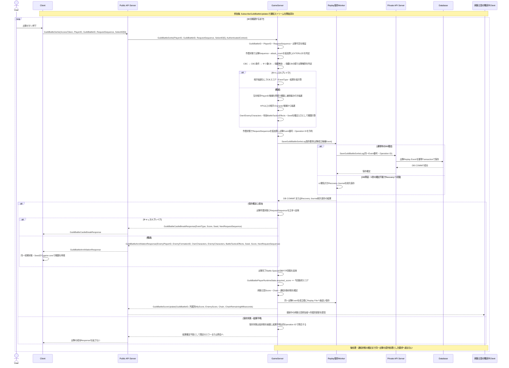

#### 騎士団戦通知ストリーム

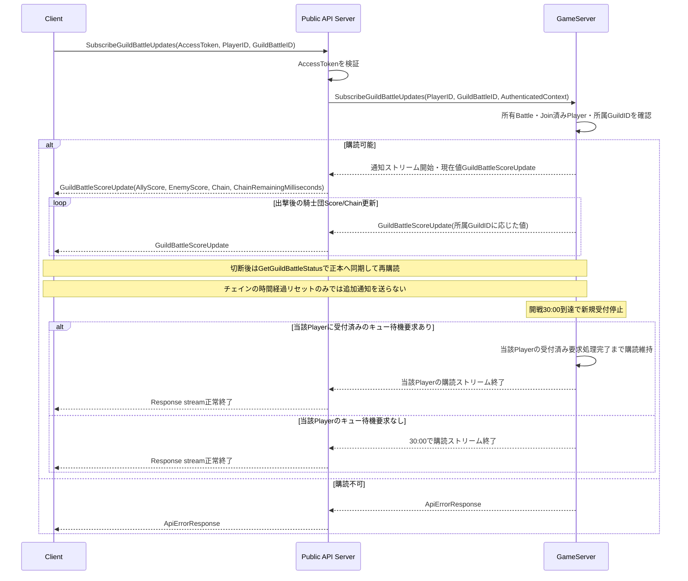

#### Battle Specialイベント処理

騎士団戦中は出撃判定, キャッスルブレイク判定, 戦闘開始, 迎撃, 敵全滅, スコア反映, 出撃完了の各処理で有効な`TACTICS_EFFECT_BATTLE_SPECIAL`を評価する. `TacticsBattleSpecialType`ごとの具体効果は「[タクティクス仕様](../../specification/game/tactics.md#特殊効果系列)」を正本とする. 騎士団全体効果は対象Guildの各出撃処理へ反映し, 対戦騎士団全体へのデバフは相手Guildの各出撃処理へ反映する. `bp_recovery` / `tp_recovery`を使用する効果は出撃が成功して完了した時点でTrigger条件を評価し, 条件成立時に回復する.

#### 要求処理順

GameServerが受信するあらゆる要求は先に到達した順に処理する. GameServer受信時刻が異なる要求は受信時刻の早い要求を先に処理する. GameServer上で完全に同時として扱われる要求同士の順序は処理系定義とし, 疑似乱数による順序決定は行わない.

出撃要求についても同じ規則を使用する. Clientは出撃要求送信後から処理結果応答受信まで通信中として追加操作送信を抑止するため, GameServer側に出撃処理中・処理待ちを表す独立状態は持たせない.

#### ログ・Metric

騎士団戦のログ・Metric・Trace処理は「[ログ仕様](../system/log.md)」に従う.
通常の非出撃操作は作業状態の仮計算後、専用Workerの署名付きReplay WAL耐久化を待ち、成功時にだけ状態とRequestSequenceを確定する。Replay WorkerはFileとDBへ後追い保存する。出撃は固有の例外とし、非同期Workerによる`SaveGuildBattleSortieLog`のDB COMMIT（Recovery時は署名付きJournalの耐久化）を成功Response前に確認し、その同じEventを後続Fileへ成立順で追記する。DB保存に失敗した出撃を成功扱いにしない。
正常なゲームルール拒否は要求単位のApplication Logへ出力せずMetricへ集約する. `RequestSequence`不一致, 不正CharacterID, 不正TacticsID等は要求ごとに同期ログ出力せずMemory上で集約する.


#### 再接続・状態復元

`GetGuildBattleStatus`は再接続用の状態復元APIとして扱う.
ClientはAccessToken, PlayerID, GuildBattleIDだけを送信し, GameServerは現在のRequestSequenceを要求しない.
GameServerは現在HP, BP, TP, `HealState`, `ReviveState`と残り時間, 出撃待機時間, `TacticsActiveEffectState`, アイテム残数, 両騎士団スコア, チェイン, `GuildBattleCbcStatus`, 現在RequestSequenceを返す.
`GetGuildBattleStatus`の実行ではRequestSequenceを加算しない.
CharacterID, Follower, MainSkill, Ability, FormationID等の静的な編成構成はClientが編成確定時からローカルに保持する. `JoinGuildBattle`時にServer編成と照合し, 不一致の場合はServer編成でローカル情報を上書きする. 再接続時は照合済みのローカル情報から復元する. `GetGuildBattleStatus`では静的な編成構成を再送しない.

##### タクティクス使用時

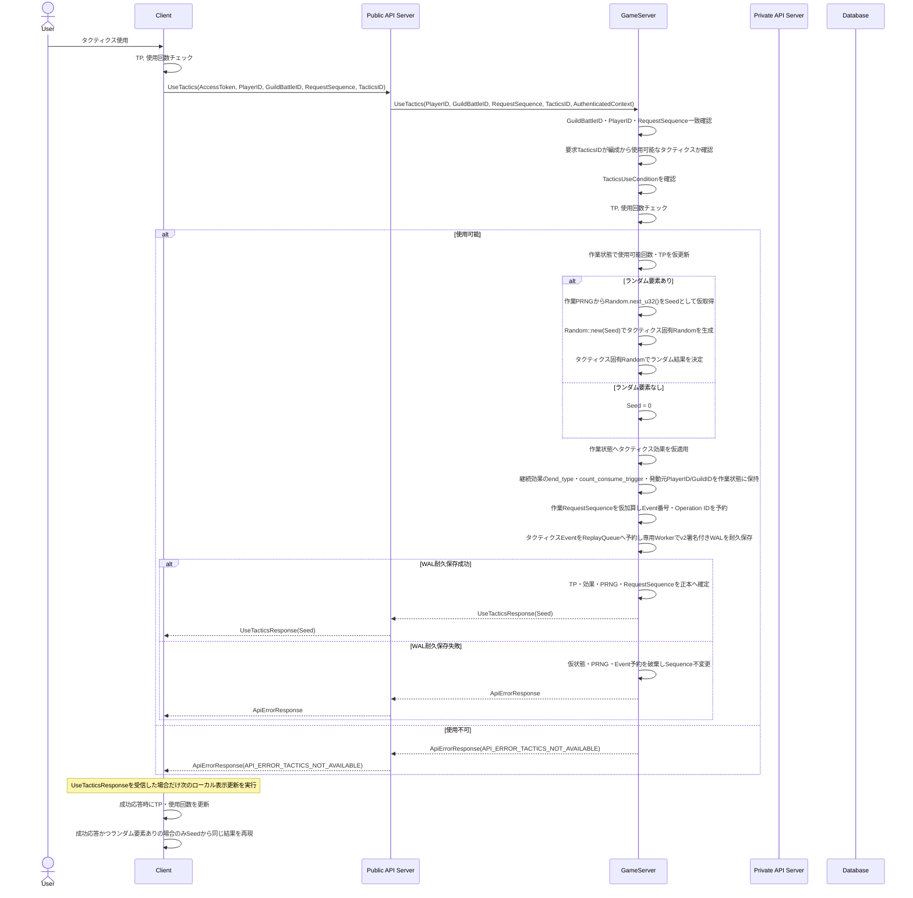

継続効果を生成する場合は`TacticsActiveEffectState.source_player_id`へ使用者PlayerID, `source_guild_id`へ使用成立時点の所属GuildIDを保存し, `TacticsTarget`の相対対象解決に使用する.

`TACTICS_USE_CONDITION_ALL_ANNIHILATED`を満たさない要求は`API_ERROR_TACTICS_NOT_AVAILABLE`として拒否し, TP・使用可能回数・RequestSequenceを変更しない. `REVIVE` / `RESURRECTION`は対象キャラクターを`FormationSlotID`（編成ID）の小さい順に並べ, その順序でタクティクス固有Randomを用いて1回ずつ確率判定する.

##### 回復アイテム使用時

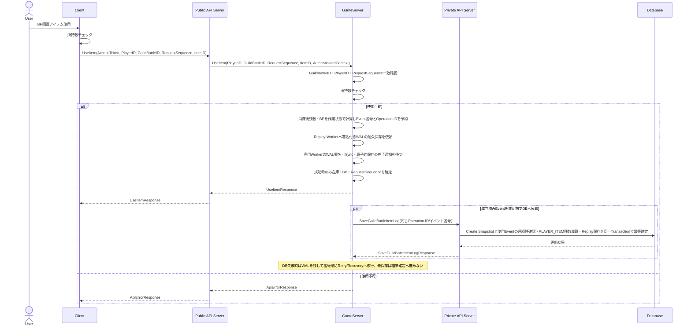

##### 治療時

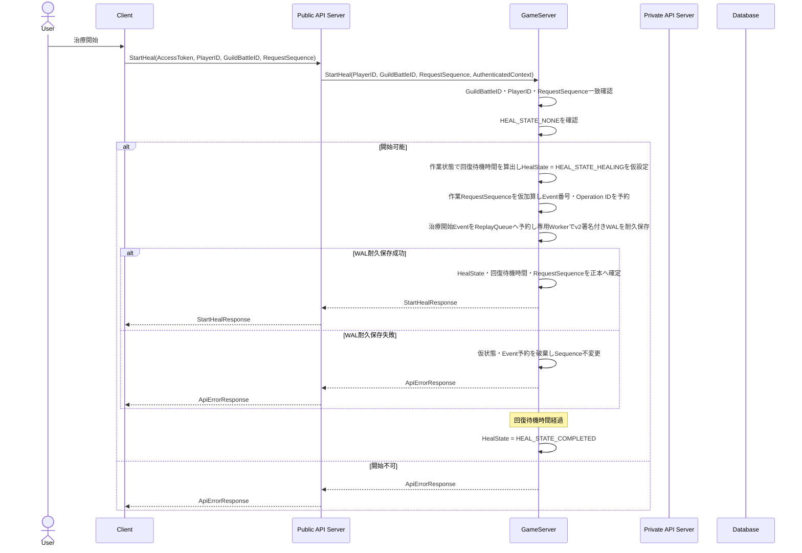


##### 治療キャンセル

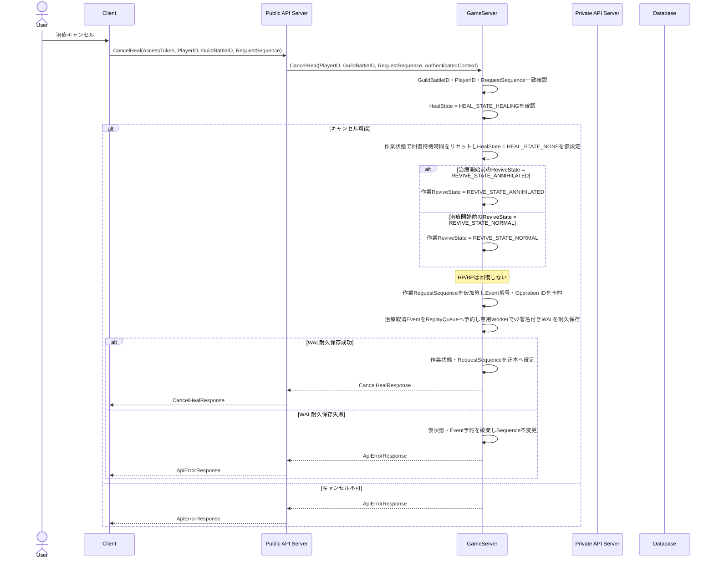

##### 治療完了状態解除

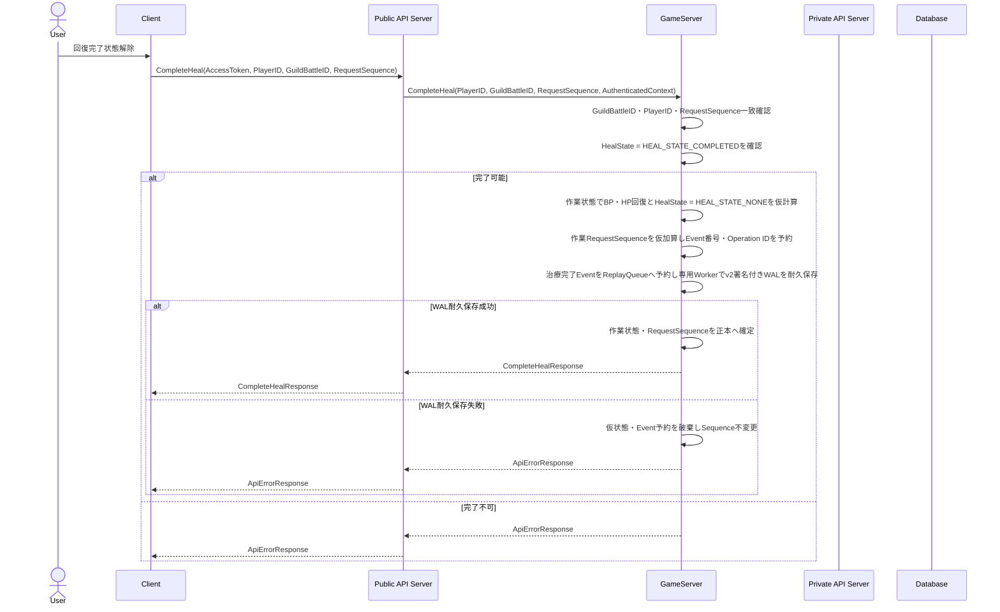

##### 復活

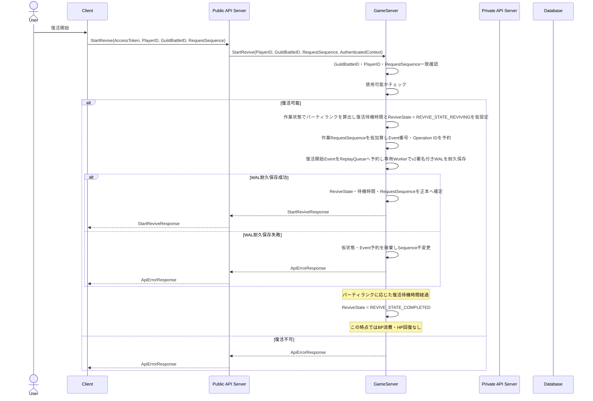


##### 復活キャンセル

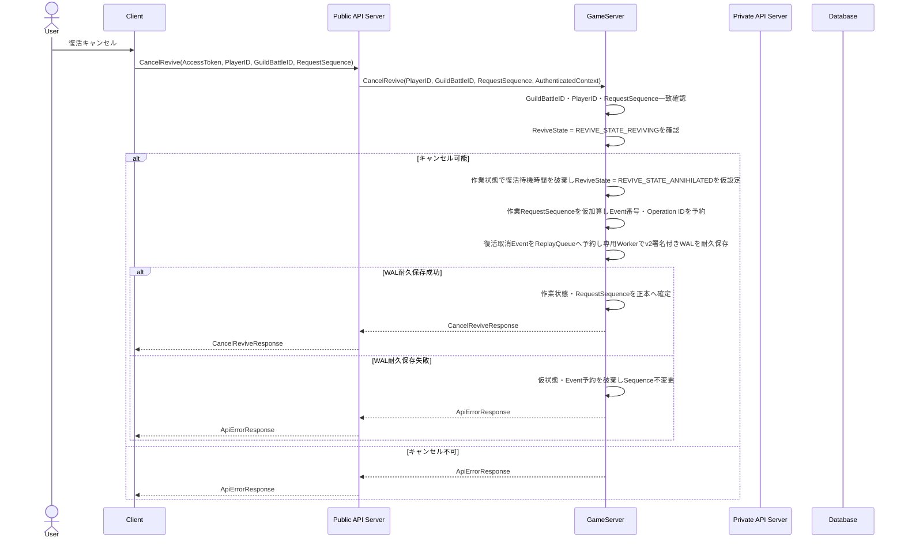


##### 復活完了状態解除

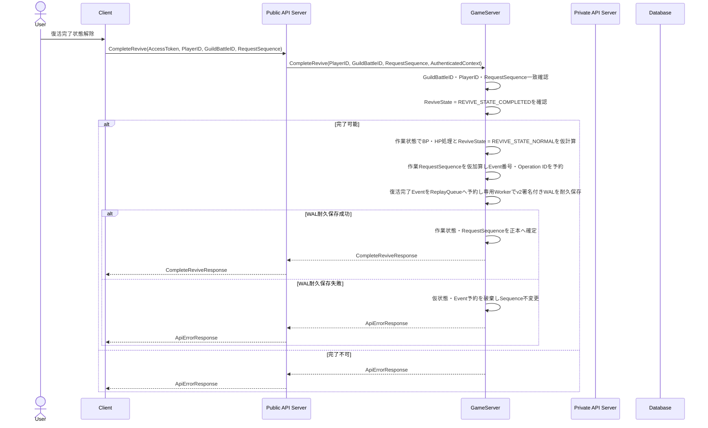

### Database送信失敗時

騎士団戦中にDatabaseへの送信が失敗した場合は, Retry可能な一時障害に限り、同一Operation IDで初回から合計5秒以内に1回だけ再試行する。確定失敗・再試行失敗・5秒上限でRecoveryへ移行する。 Replay Workerによるリプレイログ送信も同じ規則を使用する. 再試行も失敗した場合, GameServerは当該騎士団戦についてDB障害発生状態へ移行する.

DB障害発生状態では, それ以降の騎士団戦中Database送信を行わず, 本来送信するデータをGameServerローカルのファイルへ保存する. Replay EventのRecovery保存はReplay Worker側で行う。処理スレッド自体はファイルI/Oをしないが、操作成功応答はWorkerの署名付き耐久書込完了後に限る。
保存形式はUTF-8 JSONとし, 保存先は`/var/lib/game-server/recovery`とする. 本番Kubernetes環境では同PathをGameServer専用Persistent Volumeへmountする.
保存形式は`guild_battle_<GuildBattleID>_<InstanceID>/event_<EventIndex>_<OperationID>.json`の不変Eventファイルとする。Eventごとに要求、Operation ID、番号、検査用Hashを保持し、一時ファイル→fsync→atomic rename→ディレクトリfsyncで確定する。
ローカルファイルはGameServer再起動後も保持する.
騎士団戦終了時に当該BattleのローカルEventを番号順に再送する。GameServer起動時は終了済みBattleのみ再送し、進行中Battleの記録は保全して終了時までDB送信を再開しない。
再送中に失敗したローカル記録は残す。DB再送が全件成功しても、該当EventのReplay File反映とv2署名・連鎖検証まで完了する前はファイルを削除しない。DB確定済みでFileのみ未反映ならDB正本から補修・照合し、条件成立後にだけ該当レコードを削除する。

騎士団戦最終結果の保存は下記終了シーケンスの専用規則を使用する.

#### 騎士団戦終了時

```mermaid
sequenceDiagram
    participant GameServer
    participant PublicAPIServer as Public API Server
    participant PrivateAPIServer as Private API Server
    participant Database
    participant DiscordBot as Discord Bot

    Note over GameServer: 騎士団戦開始から30:00到達

    GameServer->>GameServer: 新規処理受付停止
    GameServer->>GameServer: キュー待機要求がないPlayerの通知ストリームを終了
    Note over GameServer: キュー待機中のPlayerは当該要求の処理完了時にストリーム終了
    GameServer->>PrivateAPIServer: BeginGuildBattleResolving(GuildBattleID, GameServerInstanceID)
    PrivateAPIServer->>Database: in_progress -> resolving (所有権確認と同一Transaction)

    loop 処理キューが空になるまで
        GameServer->>GameServer: キュー先頭の処理を実行
        GameServer->>GameServer: 結果を状態へ反映
    end

    GameServer->>GameServer: 最終合計pt算出
    GameServer->>GameServer: 勝敗判定
    GameServer->>GameServer: 署名付きReplay WAL・Recovery Journalの検証とDB未確定Event収集

    opt 当該騎士団戦のRecoveryファイルが存在
        GameServer->>GameServer: Recoveryファイルを保存順に読込
        loop Recoveryレコード
            GameServer->>PrivateAPIServer: 元のPrivate API要求を同じX-Operation-IDで再送
            PrivateAPIServer->>Database: Operation ID重複確認後, 未処理時のみ更新
            PrivateAPIServer-->>GameServer: 再送結果
        end
        alt 全Recoveryレコード再送成功
            GameServer->>GameServer: DB全件確定・Replay File反映・署名連鎖検証を確認後にRecoveryファイル削除
        else 1件以上再送失敗
            Note over GameServer: 再送不成立。検証可能な記録を保持してresolvingを維持し、CompleteGuildBattleを要求しない
        end
    end

    opt 全Replay WAL・Recovery Journalの検証、欠番検査、DB冪等反映が完了した場合のみ
        GameServer->>GameServer: GuildResults[2]・PlayerRecords[]・Participants[]を生成
        GameServer->>PrivateAPIServer: CompleteGuildBattle(GuildBattleID, GameServerInstanceID, GuildResults, PlayerRecords, Participants)
        PrivateAPIServer->>Database: 結果・参加回数・勝敗数・個人累計スコア更新 + completed + 対戦2Guildロック解除; 同時間帯全対戦完了時だけexcluded解除・削除
        Database-->>PrivateAPIServer: 完了結果
        PrivateAPIServer-->>GameServer: CompleteGuildBattle

        alt CompleteGuildBattle成功
            Note over GameServer: 騎士団戦の永続終了処理完了
        else 初回失敗
            GameServer->>PrivateAPIServer: CompleteGuildBattle 同一X-Operation-IDで再試行（1回）
            PrivateAPIServer->>Database: 同一Transactionを再実行
            Database-->>PrivateAPIServer: 再試行結果
            PrivateAPIServer-->>GameServer: CompleteGuildBattle
            opt 再試行も失敗
            GameServer->>GameServer: エラーログ追記
            GameServer->>PrivateAPIServer: SaveErrorLog
            PrivateAPIServer->>Database: エラーログ保存
            opt DiscordNotificationEnabled=true
                GameServer->>DiscordBot: エラーメッセージ送信
            end
            Note over GameServer: TransactionはRollbackされcompletedへ遷移しない. 原因調査および復旧は運営が手動で行う
        end
        end
    end

```

## DB/NW障害時の5秒判定

当該騎士団戦の最初のDB送信開始から各操作のDB COMMIT確認まで5秒を超えた場合、その操作以降はBattle終了までDB送信を停止する。GameServerは新規成立Eventを永続ローカルJournalへ保存し、保存完了後にのみ成功応答する。Battle終了後、Operation IDとEvent Indexで冪等に一括送信する。通常時の出撃はDB COMMIT確認後に成功を返す。通常の非出撃Eventは署名付きWALの耐久化後に成功を返し、DB反映を非同期とする。

### 酒場回復のDB障害時受付

`UseTavernRecovery`はPlayerの共有ストックをDB行の排他Transactionで更新するため、対象GuildBattleがRecovery中は要求を受付不可として`API_ERROR_TAVERN_RECOVERY_NOT_AVAILABLE`を返す。BP/使用残数/RequestSequenceは変更せず、Replay Eventも作成しない。ローカルに別のPlayerストックを設けたり、復旧時に酒場消費を一括適用したりしない。

**終了処理の前提：** GameServerは署名・Hash連鎖・Event Index・Operation IDを照合し、当該Battleの受理済みReplay WALとRecovery Journalの全イベントがDBへ冪等に確定していることを確認してから`CompleteGuildBattle`を発行する。1件でも失敗・不明・隔離中なら`resolving`を維持し、結果・勝敗・参加回数・ロック解除を確定しない。再試行・Owner喪失時の引継ぎは同一Eventの重複適用を禁止する。

### Replay WALと応答待機

通常の非出撃操作はGameServerの作業状態で先に計算し、署名付きのローカルReplay WALが耐久書込み済みになってから正本状態・RequestSequenceを確定して成功Responseを返す。Private API経由のDB保存とReplay File書込は非同期Workerで行い、DBの往復を応答の条件としない。出撃と酒場等のDB Transactionが必要な操作は、それぞれのより強い固有確定条件を優先する。WALの形式・再起動検証・冪等性は`design/programming/server/logging_recovery.md`を正本とする。

### 対戦内Item残数の初期化

Preloadで取得したItem情報は、開戦時の`StartGuildBattle`で現在DB値と照合した`GuildBattleInitialSnapshot`から初期化する。初回Join・再JoinにItem予約・解放・残数の再取得を伴わない。以降のItem使用はその対戦を処理する単一GameServerの状態を正本とし、当該Battleの直列キュー内でのみ更新する。使用後のDB所持数の減算は検証済みReplay Eventに基づいて非同期で確定する。

### Replay Event確定と保存媒体の扱い

通常非出撃Eventは署名付きWAL耐久保存後に応答でき、DBの順次COMMITを待たない。GameServerは各Eventの媒体に依存しないEvent Hashを連鎖させる。DBはReplay行とDB確定アンカーを同一Transactionで更新し、既成立EventのIndexを変更しない。同一EventがWALとRecovery Journalに存在しても重複計上せず、署名・Hash・Operation ID・Replay内容を照合してから冪等反映する。署名対象のByte形式と境界は[ローカルReplay記録v2](../system/replay_local_record_encoding.md)に従う。

## アイテム使用の単一Owner・低遅延確定契約

- 各`GuildBattleID`の状態変更は割当済みの**単一GameServer Owner**だけが受理し、対戦内の要求キューを直列処理する。GameServerは**その対戦に属するPlayerのItem残数だけ**をBattle Runtimeに保持し、他GameServerとのItem在庫同期・共有キャッシュ・予約APIを設けない。Clientが送る残数やBPは正本にしない。
- Preload時の`GetPlayerItems`は開戦用Snapshot候補を取得する。`StartGuildBattle`はCreateの`initial_snapshot.participants[].items`と**開戦時のDB在庫**を同一Transactionで確認し、一致したSnapshotだけをCreate Replayとともに確定する。不一致時は開戦を成立させず既存のPreload失敗経路に移す。Dummy PlayerのItemは空。開戦後の対戦内Item残数はCreate Snapshotを初期値とし、成功したItem Eventだけを順番に減算する。Joinは初期残数の読出しだけで、DBとの予約・更新は行わない。
- `UseItem`では認証済み`PlayerID`・当該Battle Owner・Join状態・`RequestSequence`・許可されたItemID・対戦内残数1以上・BP回復規則を検証する。Runtimeの作業状態でItem残数を1減らしBPを更新し、`quantity_before/after`を付けたReplay Eventを発行する。署名付きWALの耐久化が完了した場合だけ状態とSequenceを確定し、**DBの応答を待たず**成功を返す。WAL失敗時は作業状態を破棄して不成立とする。重複Sequenceは二重使用を生じさせない。
- 成功Eventの`SaveGuildBattleItemLog`は既存のReplay Workerから**非同期**に、同一Event Index・Operation IDで順序どおりPrivate APIへ送る。Private APIは当該BattleのCreate Snapshotと直前のItem Eventから`quantity_before/after`の連続性を検証し、`PLAYER_ITEM.quantity >= 1`を確認した上で、当該Player/ItemのDB残数減算とReplay Event追加を**同一Transaction**で冪等に確定する。再送による二重減算、同番号別Payload、負の在庫を拒否する。反映不能な成功Eventは検証済みWAL/Journalを保持して当該Battleの結果確定を保留する。Client成功Responseは巻き戻さない。
- この再現段階では騎士団戦進行中・結果確定待ちのPlayerに対する、Battle Item Event**以外**の`PLAYER_ITEM`書込みはPrivate APIで拒否する。`UpdatePlayerItem`を含む全DB更新経路に同じ条件を適用し、DBへの書込権限はPrivate APIに限定する。異なるGameServer間の同期を増やすのではなく、**DB正本への競合書込みを禁止**する規則であり、GameServerは他対戦のItem情報を一切保持しない。Battle未成立・開始前の更新は許可されるが、開戦時Snapshotと食い違えば開戦を拒否する。
- 対戦終了時は全成立済みReplay EventのDB反映（Itemの減算を含む）とReplay File整合性を確認してから既存の`CompleteGuildBattle`へ進む。未使用Itemの解放APIや追加DB減算は不要。GameServerが異常終了してデータが失われた場合の完全復旧は保証しない。署名・連鎖検証に失敗したEventから在庫を推測して減算しない。通常のItem 2種の回復量・使用条件は`specification/game/item.md`から変更しない。
